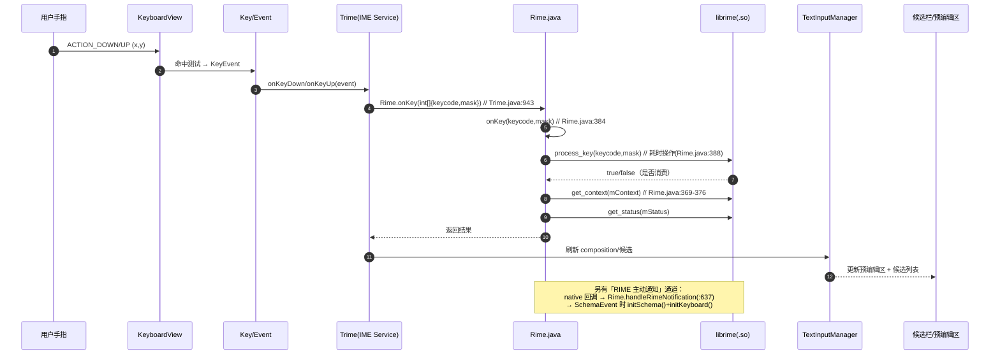
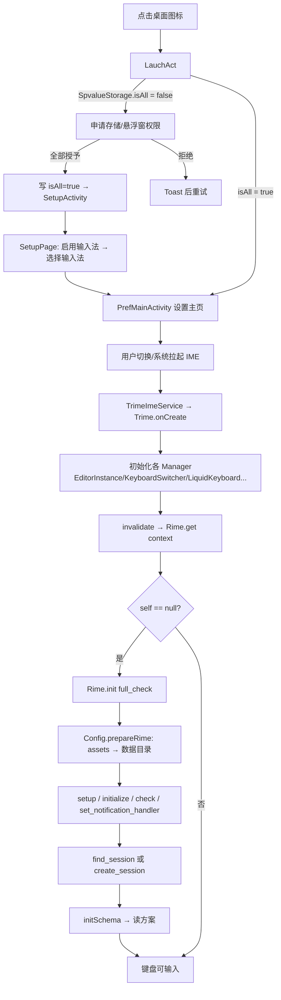

# 01 · 架构

## 目录

1. [分层总览](#1-分层总览)
2. [包职责](#2-包职责)
3. [关键类](#3-关键类)
4. [一次按键的完整链路](#4-一次按键的完整链路)
5. [启动与部署时序](#5-启动与部署时序)
6. [数据目录模型](#6-数据目录模型)
7. [线程模型与性能约束](#7-线程模型与性能约束)
8. [生命周期](#8-生命周期)
9. [可扩展点](#9-可扩展点)

---

## 1. 分层总览

```text
┌──────────────────────────────────────────────────────────────────────┐
│ 系统层（Android Framework）                                          │
│   InputMethodManager / Settings.Secure(ENABLED_INPUT_METHODS)        │
└───────────────▲──────────────────────────────────────────────────────┘
                │ BIND_INPUT_METHOD
┌───────────────┴──────────────────────────────────────────────────────┐
│ 进程入口层                                                            │
│   TrimeApplication ──崩溃捕获──► LogActivity                          │
│   TrimeImeService ─(空壳, 类名不可变)─► Trime  ← 系统实际绑定的是它   │
│   LauchAct / SetupActivity / PrefMainActivity / AboutActivity         │
└───────────────┬──────────────────────────────────────────────────────┘
                │
┌───────────────▼──────────────────────────────────────────────────────┐
│ UI 层（ime/**）                                                       │
│   InputView/KeyboardView/Keyboard/Key/Event   画键盘、收触摸          │
│   TextInputManager / Composition / Candidate  预编辑区 + 候选栏       │
│   LiquidKeyboard / TabManager / *Adapter      剪贴板/草稿/符号分页    │
└───────────────┬──────────────────────────────────────────────────────┘
                │ Rime.onKey(int[]{keycode, mask})
┌───────────────▼──────────────────────────────────────────────────────┐
│ 引擎门面层 core/Rime.java（860 行）                                   │
│   init() / onKey() / getContexts() / selectCandidate() / deploy…      │
│   静态缓冲 mCommit / mContext / mStatus；72 个 native 方法            │
└───────────────┬──────────────────────────────────────────────────────┘
                │ JNI（Java_com_osfans_trime_core_Rime_*）
┌───────────────▼──────────────────────────────────────────────────────┐
│ native 层 app/libs/arm64-v8a/librime_jni.so（唯一）                    │
│   librime 1.7.3 (+lua/octagram/charcode 插件) + OpenCC + snappy…      │
│   读 YAML 方案、建词典、算候选、维护用户词频                          │
└───────────────┬──────────────────────────────────────────────────────┘
                │ 文件系统
┌───────────────▼──────────────────────────────────────────────────────┐
│ 数据层 data/**                                                        │
│   Config（assets→数据目录 复制/部署） AppPrefs（SharedPreferences）    │
│   DataManager（shared/user 目录解析） OpenCCDictManager（.ocd2 词典）  │
│   db/**（剪贴板/草稿 Room 风格 DAO）                                  │
│   外部路径：/sdcard/Android/data/<applicationId>/files/rime           │
└──────────────────────────────────────────────────────────────────────┘
```

## 2. 包职责

| 包 | 文件数 | 职责 | 代表类 |
|---|---|---|---|
| `core/` | 2 | native 门面：初始化、按键、上下文、部署、OpenCC、事件回调 | `Rime.java`（860 行）、`RimeEvent.kt` |
| `data/` | 11 | 配置、偏好、目录解析、OpenCC 词典、SQLite DAO | `Config.java`（1218 行）、`AppPrefs.kt`（408）、`DataManager.kt`、`db/*` |
| `ime/` | 36 | 输入法全部 UI 与交互逻辑 | `core/Trime.java`（1517）、`keyboard/KeyboardView.java`（1881）、`text/TextInputManager.kt`（477） |
| `settings/` | 16 | 设置界面（Preference + 自定义 Dialog） | `PrefMainActivity.kt`（291）、`fragments/*`、`components/*` |
| `setup/` | 5 | 首次启动引导：权限 → 启用输入法 → 选择输入法 | `LauchAct.kt`（127）、`SetupActivity.kt`（150）、`SetupPage.kt` |
| `util/` | 15 | 工具：IME 状态、版本比较、图形、SharedPreferences 包装等 | `InputMethodUtils.kt`、`AppVersionUtils.kt`、`SpvalueStorage.kt` |
| 根 | 2 | 进程级入口 | `TrimeApplication.kt`、`TrimeImeService.kt` |

## 3. 关键类

| 类 | 行数 | 为什么重要 |
|---|---|---|
| `core/Rime.java` | 860 | **唯一的 JNI 边界**。任何 native 问题都在这里暴露；`static{}` 里决定加载哪个 `.so`（`:237-239`） |
| `ime/core/Trime.java` | 1517 | IME 主体：`onCreate`（`:365`）、`onStartInputView`（`:791`）、按键分发（`:943`）、`onDestroy`（`:630`） |
| `data/Config.java` | 1218 | 主题/键盘/方案配置解析 + **首次运行把 assets 复制到数据目录**（`prepareRime` `:178-212`） |
| `data/AppPrefs.kt` | 408 | 全部偏好项；决定性字段 `sharedDataDir`/`userDataDir`（`:348-353`） |
| `ime/keyboard/KeyboardView.java` | 1881 | 键盘绘制与触摸命中，候选栏也在这一层协调 |
| `ime/text/TextInputManager.kt` | 477 | 把 RIME 的 composition/候选转成 UI 状态 |
| `ime/symbol/LiquidKeyboard.java` | 380 | 液态键盘（剪贴板/草稿/符号），独立于主键盘 |
| `ime/broadcast/IntentReceiver.kt` | 64 | 外部 intent 触发 deploy/sync（`:61-62` 是硬编码 action 名） |
| `util/InputMethodUtils.kt` | 46 | 判断本 IME 是否启用/被选中（`:12-13` 用 `ComponentName` 动态生成 id） |

## 4. 一次按键的完整链路



要点：

- **候选不是「每次都问 native」**：`Rime` 用三个静态对象 `mCommit/mContext/mStatus`（`Rime.java:230-235`）缓存最近一次上下文，UI 直接读字段。
- `get_context` 被代码注释明确标为**耗时**（`Rime.java:371`），`process_key` 同样是耗时操作（`:387`）。因此按键处理只能发生在 IME 主线程，且不能在这里做重 IO。
- **方案切换**走通知回调：native 发 `schema` 事件 → `Rime.handleRimeNotification` → `initSchema()` + `trime.initKeyboard()`（`Rime.java:637-656`）。

## 5. 启动与部署时序



`Config.prepareRime`（`data/Config.java:178-212`）的决策逻辑（**升级/覆盖安装的行为差异全在这里**）：

| 条件 | 行为 |
|---|---|
| `sharedDataDir` 不存在（首次运行） | `copyFileOrDir("", false)` 全量复制 assets/rime → 数据目录，随后 `Rime.get(context, true)` 强制部署 |
| 版本号变化（`AppVersionUtils.isDifferentVersion`） | `copyFileOrDir("", true)` 覆盖复制，再 `Rime.get(context, false)` |
| 目录存在且版本未变 | 只补拷 `trime.yaml`，`Rime.get(context, false)` |

复制完成后还会做两件兜底（`Config.java:178-212`）：

1. 轮询等 `trime.yaml` 落盘（`while(!exists) sleep(100)`）；
2. 若 `default.custom.yaml` 不存在则补建**空文件**——它是 RIME 的「补丁入口」，缺了会让 `default.yaml` 的默认 `schema_list`
   （`bopomofo_tw`/`luna_pinyin*`）生效，而这些方案在本仓库并不存在，表现为「方案列表为空」。

> 现状：`assets/rime/default.custom.yaml` 已随包提供（12 行，`patch:` + `menu/page_size` + `schema_list`
> 指向 `hakka_jiugong`/`hakka_qwerty`/`ipa_yunlong`），且三项**均有实体方案文件**（`726a209` 补齐，见 [07 §8](07-opencc-and-rime-data.md)）。

## 6. 数据目录模型

RIME 需要两个目录（`Rime.init` 把它们传给 native，`Rime.java:329-337`）：

| 目录 | 默认值 | 用途 |
|---|---|---|
| shared_data_dir | `getExternalFilesDir(null)/rime` | 只读：方案 `*.schema.yaml`、词典 `*.dict.yaml`、`trime.yaml` 主题、`opencc/`（部署后含 `*.ocd2`） |
| user_data_dir | 同上（默认与 shared 同路径） | 可写：用户词频 `*.userdb`、`*.custom.yaml`、`installation.yaml` |

- 默认值来自 `AppPrefs.kt:346-353`：`EXTERNAL_PATH_PREFIX = appContext.getExternalFilesDir(null)!!.absolutePath`，
  即 `/sdcard/Android/data/<applicationId>/files/rime`。
- ⚠ 两个 getter（`:349`、`:352`）默认都返回 `$EXTERNAL_PATH_PREFIX/rime`，即「默认同路径」；
  但**用户可分别改**。本机真机实测 sharedDataDir = `…/files/rime`、userDataDir = `/storage/emulated/0/rime`，
  是该机既有偏好所致，**不是默认值**。
- 实际路径**随 applicationId 变化**：改包名后用户数据目录也会变，旧数据不会自动迁移（见 05 改名影响面）。
- `DataManager.getDataDir(child)`（`data/DataManager.kt:5-16`）：优先 `sharedDataDir/child`，不存在则回退 `userDataDir/child`。
- OpenCC 词典目录 = `getDataDir("opencc")`（`OpenCCDictManager.kt:18-20`），放 `*.ocd2` 二进制词典。
- native 侧的 `traits.app_name` 现为 `com.hazukieq.hkrime`（重建 `.so` 时已 patch，上游 v3.2.7 原值 `com.osfans.trime`）。
  它只影响 librime 的 **glog 日志文件名**；用户数据目录由 Java 通过 `setup(sharedDataDir, userDataDir, …)` 显式传入，
  **不随 `app_name` 变化**（详见 02 §4）。

## 7. 线程模型与性能约束

| 位置 | 线程 | 约束 |
|---|---|---|
| 按键 → `process_key` / `get_context` | IME 主线程 | 阻塞式 JNI 调用，禁止再叠加文件 IO |
| `RimeUtils.deploy(context)` | `Dispatchers.IO`（`util/RimeUtils.kt:22-26`） | 先 `Rime.destroy()`，再 `Rime.get(context,true)`，完成后 Toast |
| `RimeUtils.sync(context)` | `Dispatchers.IO`（`:30-35`） | `sync_user_data` 后 destroy + 重新 get |
| `IntentReceiver` | `MainScope()` 协程（`:34-48`） | `deploy` 用 `launch`，`sync` 用 `async` |
| 部署维护 | librime 内部线程 | `Rime.check(full_check)`：`start_maintenance` 后 `join_maintenance_thread`（`Rime.java:666-670`） |

`Rime` 的所有方法都是 **static + 单例语义**（`private static Rime self`，`Rime.java:228`），
没有实例锁；**禁止从多线程并发调用 native 方法**。新增后台任务时要么切回主线程，要么复用 `RimeUtils` 模式（destroy → 重建）。

## 8. 生命周期

```text
Application.onCreate  TrimeApplication.kt:29-49   安装崩溃捕获、Timber、AppPrefs 默认值
  └─ IME 被系统选中
     Trime.onCreate          Trime.java:365        建 Manager、super.onCreate、广播 EventListener
     Trime.onStartInputView  Trime.java:791        绑定键盘视图、显示候选
     Trime.onWindowShown     Trime.java:274
     Trime.onFinishInputView Trime.java:879
     Trime.onDestroy         Trime.java:630        → Rime.destroy() (:639)
        Rime.destroy         Rime.java:355-359     destroy_session + finalize1 + self=null
```

两个必须记住的「不能改」：

1. **`TrimeImeService` 的类名与包名是系统记录的 IME id 的一部分**。源码注释明确写了它只是个「升级后不失效」的空壳（`TrimeImeService.kt:5-12`）。改名后用户需要在系统设置里**重新启用并选择**一次输入法（见 05）。
2. `TrimeImeService` 只有 14 行，逻辑全在 `Trime`。不要往壳类里加逻辑。

## 9. 可扩展点

| 想做什么 | 改哪里 |
|---|---|
| 加一个设置项 | `res/xml/pref_*.xml` + `settings/fragments/*` + `data/AppPrefs.kt` |
| 加一种键盘布局/主题 | 数据目录里的 `trime.yaml`（主题）+ `*.yaml` 键盘定义，不需要改 Java |
| 加一个液态键盘分页（如「客家话常用字」） | `ime/symbol/TabManager.java` + `TabTag.java` + 对应 Adapter |
| 加一个外部命令（部署/同步） | `ime/broadcast/IntentReceiver.kt:50-63` 注册 action + 处理分支 |
| 内置一套输入方案 | `assets/rime/` 放 `*.schema.yaml`/`*.dict.yaml` + `Config.prepareRime` 会自动复制（见 [07](07-opencc-and-rime-data.md) §8、[04](04-hakka.md) §5） |
| 换 native 库 | 跑 `script/build-jni-so.sh`（产出 `app/libs/arm64-v8a/librime_jni.so`）+ `script/verify-jni-symbols.sh` 校验（见 02） |
