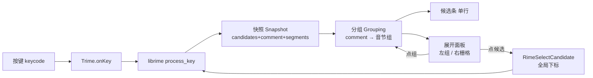

# 10 · 12 键（九宫格）客家话输入：设计与实现方案

> 本文回答两个问题：**librime 到底能给 12 键做什么**（issue #123 之后），以及 **hkrime 里怎么落地**。
> 结论先行：**不改 librime，只补一个候选枚举 JNI + 重写候选面板**。
> 文中所有引擎行为都已在 host 上实测（`artifacts/12key/engine/probe/`），不是推测。

---

## 0. TL;DR

| # | 结论 | 依据 |
|---|---|---|
| 1 | 打开 `translator/spelling_hints: 100` 后，**每条候选自带精确拼音注释**（`人`→`nzin`、`仁孝`→`nzin hau`） | 引擎实测，`script_translator.cc:348/455` |
| 2 | 注释就是「候选实际读的哪些音节」→ **它就是左列音节组的唯一真源**，不用自己猜、不用 DP 切分 | `set:5a5ia` 得到 8 个组：`kak ga / ka kia / lak ha / la kia / kak / lak / ka / la` |
| 3 | 全量候选可用 `RimeCandidateListBegin/Next/End` 枚举，**不受 page_size 限制**（`Menu::GetCandidateAt` 会 `Prepare(index+1)` 惰性拉满） | `rime_api.cc:427`、`rime/menu.cc:71` |
| 4 | `RimeSelectCandidate(session, index)` 用**全量下标**，`Context::Select` 作用在 `composition().back()` 的 menu 上，**与枚举同源** | `rime_api.cc:998`、`rime/context.cc:112` |
| 5 | 选中「半个音节」的候选时，引擎**原生支持部分消费**：`yi4ia3` 选 `人`(nzin) → composition 变 `人ia3`，剩余 `ia3` 自动重算候选 | 实测 `select:30` |
| 6 | 因此 **不需要 `set_input`、不需要 `set_caret_pos` 探测、不需要翻页收集** | 见 §11 |
| 7 | 12 键方案本身只需改一处：`hakka_jiugong.schema.yaml` 加 `spelling_hints: 100`（可选再加 `menu/page_size`） | `assets/rime/hakka_jiugong.schema.yaml` |

一句话架构：

> **每次按键后取一次「全量候选快照」→ 按 comment 分组 → 左列组、右栅格同组候选；点组只切换本地视图（不动引擎）；点候选调 `selectCandidate(全局下标)`，引擎自己决定消费几个音节。**

---

## 1. issue #123 说了什么，本方案怎么用

[librime#123](https://github.com/rime/librime/issues/123)（2017，已关）：

- 提问：现有引擎能否支持九宫格键盘？
- osfans：Trime/iRime 前端层可以做，**类似模糊音，但没有筛选和纠错**。
- lotem 给了 4 条，前 3 条是本方案的直接依据：
  1. 用**拼写运算**把「九宫格码」与「精准拼音」分开（derive/xlit，用大写或占位符表示不精确输入）；
  2. **preedit 只能反映音节切分，反映不了「输入码→词典编码」的对应**；
  3. `script_translator` 有 `translator/spelling_hints`，可给候选标注**原有拼音**；
  4. 建议 App 侧建 T9 码 → 音节映射表，按前缀枚举音节（同时充当手动分词）。

**本方案对第 4 条做了替换（关键取舍）**：

| | lotem 建议 / 上一轮实现 | 本方案 |
|---|---|---|
| 「有哪些音节」的数据源 | App 自建 T9→音节表（字典音节反查）+ DP 切分 | **引擎候选的 comment**（词典原始拼写） |
| 分组方式 | 按 caret / segments / 码字节去猜 | 按 comment 精确分组 |
| 上屏 | App 拼出音节串再想办法喂引擎 | `selectCandidate(全局下标)`，引擎原生消费 |
| 风险 | 歧义码猜错 = 左列与右格不相关 | 左列与右格**同源同快照**，不可能不相关 |

理由很简单：**引擎已经知道每个候选读的是什么音节，而且知道该怎么切**（`SyllabifyTask` 在 syllable graph 上 DFS）。App 再算一遍只会引入第二套真相。上一轮「左列切分不对 / 点左列右侧候选不相关」的根因就是两套真相打架。

---

## 2. 引擎能力实证（host probe）

探针：`artifacts/12key/engine/probe/rime_probe.c`（系统 librime 1.17 + 方案部署副本）。
命令形如：

```bash
./rime_probe deploy/hakka_hints/shared deploy/hakka_hints/user hakka_hints \
    "set:1i4ia3" dump
```

### 2.1 候选注释 = 精确拼音

```text
INPUT "1i4ia3"   PREEDIT "1i 4ia3"
CAND 0 text="五秒"   comment="ngh miau"
CAND 2 text="凝胶"   comment="ngin gau"
CAND 7 text="凝"     comment="ngin"
CAND 8 text="垠"     comment="ngin"
```

- 来源链：`ScriptTranslation::Peek()` → `GetOriginalSpelling()` → `ScriptTranslator::Spell()` → `Dictionary::Decode()` → `primary_table()->GetSyllableById()`。拿到的是**词典里的原始拼写**，不是折叠后的码。
- 多音节用 `speller/delimiter` 的首字符连接（本方案是空格）→ `"nzin hau"`。
- `spelling_hints` 默认 0（不输出）；N 是**音节数上限**（`cand.code().size()` = 该候选由几个音节组成），只有 `size <= N` 才出注释，所以长词要 N 足够大，**设 100 即全量**。
- 句子候选通常也有注释，但**不保证**：`enable_sentence` 的句子候选在有的路径下 comment 为空（实测 `五秒五秒` 有、部分句子没有）；拿不到时按「整句」组处理。
- **comment 有洞，不能假设「每个读音都能还原」**：`nia`（乜）与 `mia` 折叠到同码 `4ia`，词典 table 按 `(字符,码)` 去重后只剩一个读音；`ngik`（孽）四读被 `1` 缩写码吞并。这类丢读音是方案层的，不是本设计的 bug（见 §3 数据硬伤）。

### 2.2 一个候选表里天然存在「不同消费长度」的候选

以 `1i4ia3`（= ngin + hau，也可解作 ngh + miau）为例，44 条候选、**8 个发音组**：

| 组（comment） | 含义 | 说明 |
|---|---|---|
| `ngh miau` | 两个音节、吃完整个码 | 五秒 / 鱼苗 |
| `ngin gau` | 两个音节、吃完整个码 | 凝胶 |
| `ngh ni bu` | 三个音节 | 伍尔夫 |
| `ngh mi` | 两个音节 | 五味 / 五米 |
| `ngin` | **只消费第一个音节** | 凝 / 垠 |
| `ngio` | 消费 `1i`+`o`? | 驭 |
| `ngh` | 只消费 `1i` | 女/五 |
| `ngi` | 只消费 `1i` 的另一种读法 | 乂 |

→ **左列根本不用算**：把候选按 comment 分组就得到 `ngh miau / ngin gau / … / ngin / ngh`。用户 msg78 说的「ngin、ngin hau 两个」就是这个结构。

### 2.3 部分消费：引擎原生支持

```text
---- CMD set:yi4ia3          # = nzin + hau
MENU num_candidates=99
CAND 30 text="人" comment="nzin"      ← 1 音节候选
---- CMD select:30
SELECT ok=1
PREEDIT "人ia3"               ← 已选前缀 + 剩余码
MENU num_candidates=121
CAND 0 text="好" comment="hau"
CAND 1 text="高" comment="gau"
```

即：**选「人」→ 引擎消费 `yi4`、留下 `ia3`、自动重算剩余候选**。用户 msg78 期望的「选完 ngin 后剩 hau，hau 再切 ha | hau」完全由引擎天然完成。

继续 `select:0`（好 / ha）→ 剩余码 `3`：

```text
CAND 0 text="儿" comment="r"      ← 词典里 3 的唯一音节是 r（儿）
```

> 注意：用户历史里提到的「剩下 U」在引擎侧是 **r**（儿）。若 UI 想显示成 `u`，属于 fallback 展示策略（§8.3），不是引擎行为。

### 2.4 全量枚举与下标一致性

- `RimeCandidateListBegin(session, &it)` 取 `composition().back().menu`，`Next` 逐条 `GetCandidateAt(i)`；`GetCandidateAt` 内部 `Prepare(i+1)`，**会越过 page_size 继续往下拉**。
- `RimeSelectCandidate(session, i)` → `Context::Select(i)` → `composition_.back().GetCandidateAt(i)`。**与枚举同一张 menu、同一个下标空间**。
- 实测 `page_size=9` 时 `select:30` 依然成功（越页选择）。
- `select_candidate_on_current_page` 反而**不能**用：它做 `page_start + index` 且有 `index >= page_size` 的硬检查（`rime_api.cc:1000`）。

### 2.5 分段：只用来算「已消费了多少码」

自定义补丁 `RimeGetCompositionSegments` 实测（1.7.3 构建）：

```text
set:1i4ia3, select:7 → SEGMENTS count=2  [0,3)status=2  [3,6)status=1
```

`status` 枚举：`0=void / 1=guess / 2=selected / 3=confirmed`（`segmentation.h:19-24`）；start/end 是 **raw input 的字节偏移**。

要点（`artifacts/12key/engine/REPORT.md` §4.3 复核）：

- **未选择时通常只有 1 段**：段是 segmentor 的切分单位（`abc_segmentor` 按字母 run 切），`yi4ia3` → `[0,6) status=1`。preedit 里的空格来自候选 preedit，不来自段。
- 选择/部分消费后才变多段：已消费 `status=2`、剩余 `status=1`（`yi4ia3` 选「人」→ `[0,3)status=2` + `[3,6)status=1`）。
- 段只覆盖 **caret 前缀**（`Compose` 用 `input.substr(0, caret_pos)`）。12 键 App 里 caret 恒在末尾，故可视为覆盖全串；若将来支持移动光标，必须先判断 `caret_pos == input.length()`。

→ `consumedEnd = 所有 status>=2 段的最大 end`；`remaining = input.substring(consumedEnd)`。未选择时 `consumedEnd=0`，`remaining` 就是整串，符合预期。
**不要**再拿 segments 当「音节分组」（segmentor 只产一段，上一轮的错就在这）。

### 2.6 性能

host 上（含进程启动）枚举 990 条候选 ≈ 20 ms；1224 条同量级。Android 上按 3～5 倍估，**面板打开时异步枚举、上限截断**足够。单键（如 `8`=1224 条、69 组）建议截断到 500～800 条并对左列做虚拟化。

---

## 3. 数据基础（来自 `artifacts/12key/data/`）

| 项 | 值 | 用途 |
|---|---|---|
| 音节并集（JS 787 ∪ 词典 714） | **848** | 12 键可打性 / 解码器词表 |
| 主码唯一 | 509（含 derive 510） | 码→音节索引 |
| 每码音节数 | 1:226 / 2:252 / 3:12 / 4:15 / 5:2 / 6:2 | 歧义上界 |
| 落在歧义码的音节 | **73.3%** | 为什么必须让引擎消歧 |
| 12 键发码集 | `1345789aeiowy` | 与 12 个键一一对应 |
| 逐字母固定映射 vs 现 algebra 主码 | 847 合法音节 **0 差异** | §7.1 可简化（P2） |
| derive 9 条 | 仅 3 条真改码，45/46 撞别的主码 | **不要进正式索引**（P2） |
| 词典覆盖 | 现表 96.1%，补 46 个 dict-only → 99.8% | 数据清洗（P2） |
| 词典硬伤 | `客家`/`客家人` 无读音词条；1548 行缺读音；14 条含错误音节 | 影响候选质量，与 12 键架构无关 |

**对 12 键架构的含义**：歧义（`kak/lak`、`hau/gau`）是**键位固有的**（k/l 同键、g/h 同键），App 层永远无法消解；只有引擎的词表+词频能消解。这也是「分组交给 comment、消歧交给引擎」的根本原因。

另一组实测（`artifacts/12key/engine/REPORT.md` §6，按 `Projection::Apply` 语义逐条折叠 `hakka.dict.yaml`）：

- 695 个音节 → **437 个唯一码；437/437 全部能出候选**（`checkfile hit=437 miss=0`）。
- 128 个音节有多码（derive 造成，如 `ngin→1,1i4`）；**319 个码被 >1 个音节共享**（如 `4ia3 ← bu,cu,mh,mi,mia,...`）。
- 缩写码候选量巨大：`w`(th*) = 436、`y`(nz*) = 205、`1`(ng*) = 190 —— 短码必须靠 comment 分组+虚拟化，不能直接平铺。
- 已知丢读音：`nia`（乜，同码去重）、`ngik`（孽，被 `1` 缩写吞并）。

---

## 4. 架构

### 4.1 分层



**单数据源**：一次按键 → 一个不可变 `CompositionSnapshot`；所有 View 只读它。
**无累积**：列表每次整体替换（`ListAdapter.submitList` + `DiffUtil`），不存在「翻页追加」。
**无状态机**：面板开关、当前组下标属于 UI 局部状态，不进引擎。

### 4.2 数据模型（Kotlin）

```kotlin
// core/twelvekey/TwelveKeyModels.kt
data class CandidateItem(
    val text: String,
    val comment: String,     // "nzin" / "nzin hau" / ""（句子）
    val index: Int,          // 全量 menu 下标，直接喂 selectCandidate
)

data class SyllableGroup(
    val reading: String,             // comment 原文，UI 左列标签
    val syllables: List<String>,     // reading.split(' ')
    val items: List<CandidateItem>,  // 同组候选，保持引擎顺序
) { val size get() = items.size }

data class TwelveKeySnapshot(
    val input: String,          // Rime.RimeGetInput()
    val consumedEnd: Int,       // segments 里 status>=2 的最大 end（字节）
    val remaining: String,      // input.substring(consumedEnd)
    val groups: List<SyllableGroup>,
    val fallback: Fallback?,    // groups 为空时使用
) {
    val isEmpty get() = input.isEmpty()
    val hasCandidates get() = groups.isNotEmpty()
}

data class Fallback(val rawCode: String, val letters: String)  // §8.3
```

### 4.3 快照刷新（每次按键后 / 每次上屏后）

```kotlin
fun refresh(): TwelveKeySnapshot {
    val input = Rime.RimeGetInput()
    if (!Rime.isComposing() || input.isEmpty()) return TwelveKeySnapshot.empty()

    val segs = Rime.getRimeCompositionSegments()          // [start,end,status]×n
    val consumedEnd = (0 until segs.size / 3)
        .filter { segs[it * 3 + 2] >= 2 }                 // kSelected / kConfirmed
        .maxOfOrNull { segs[it * 3 + 1] } ?: 0

    val all = Rime.enumerateCandidates(MAX_CANDIDATES)     // 新 JNI，见 §7.2
    val groups = LinkedHashMap<String, MutableList<CandidateItem>>()
    all.forEachIndexed { i, c ->
        val key = if (c.comment.isBlank()) "…" else c.comment
        groups.getOrPut(key) { mutableListOf() }.add(CandidateItem(c.text, c.comment, i))
    }
    return TwelveKeySnapshot(
        input = input,
        consumedEnd = consumedEnd,
        remaining = input.substring(consumedEnd.coerceIn(0, input.length)),
        groups = groups.map { (k, v) -> SyllableGroup(k, k.split(' ').filter(String::isNotBlank), v) },
        fallback = if (groups.isEmpty() && remaining.any()) {
            Fallback(remaining, fallbackLetters(remaining))
        } else null,
    )
}
```

要点：

- `enumerateCandidates` 返回的**顺序即 menu 下标顺序**，所以 `index` 直接用。
- 组顺序 = 组内第一名的出现顺序 = 引擎综合打分顺序（**不要重排**；实测首组就是最佳组）。
- 同一 comment 的候选可能跨多个消费长度？不会：comment 是「词典读音」，消费长度由 code 决定，两者一一对应。

### 4.4 分组语义校验（实测）

| 输入码 | 候选数 | 组数 | 组（前几个） |
|---|---|---|---|
| `1i4ia3` | 44 | 8 | `ngh miau`, `ngin gau`, `ngh ni bu`, `ngh mi`, `ngin`, `ngio`, `ngh`, `ngi` |
| `yi4ia3` | 99 | 18 | `nzim gau`, `nzio gau`, `nzin hau`, `nzi miau`, …, `nzin`, `nzi` |
| `ia3` | 121 | 5 | `hau`, `gau`, `ga r`, `ha`, `ga` |
| `5a5ia` | 48 | 8 | `kak ga`, `ka kia`, `lak ha`, `la kia`, `kak`, `lak`, `ka`, `la` |
| `8i9` | 66 | 2 | `jit`, `zit` |
| `i44i` | 77 | 6 | `hong`, `gong`, `go mi`, `go ni`, `ho`, `go` |
| `4i` | 52 | 4 | `ni`, `nh`, `mi`, `mh` |
| `i` / `5` / `8` | 990 / 1077 / 1224 | 77 / 87 / 69 | 单键歧义很大，必须滚动/虚拟化 |

---

## 5. 交互规格（严格对齐历史 msg57–85）

### 5.1 候选条（固定单行）

- 显示**当前组**的候选（默认第 0 组），最多一屏；超出的进面板。
- 候选下方小字显示 comment（`Candidate.java` 已有 `commentPaint`，直接可用）。
- 右端固定两个钮：`▼`（展开/收起面板）、`⌄`（空候选时收起键盘）。
- **候选条不随面板滚动**（msg67①）。面板是覆盖层，候选条保持原样。

### 5.2 展开面板

```
┌──────────────────────────────────────────┐
│ 音节组                 │  候选栅格        │
│ ┌──────────┐          │ ┌──┬──┬──┬──┐   │
│ │ ngin  ★  │          │ │凝│垠│仞│… │   │
│ │ ngin gau │          │ └──┴──┴──┴──┘   │
│ │ ngh miau │          │                  │
│ │ …        │          │ （独立滚动）      │
│ └──────────┘          │                  │
│ （独立滚动）            │                  │
└──────────────────────────────────────────┘
```

- 左列 = 组（comment），可滚动；选中组高亮（`★`）。
- 右栅格 = 该组候选，网格 4 列（主题 `92dp` 已适配），**独立滚动**。
- 点左列组：**只切换右栅格**——不调引擎、不动 caret、不改候选条（msg72）。
- 点右栅格候选：`Rime.selectCandidate(item.index)` → 刷新快照 → **面板保持打开**，左列自动变成剩余码的组（msg78 的连续消费体验）。
- 面板头部固定（`▼` 不在滚动容器里，msg67②）。
- 滚动/切换组一律 `submitList(新列表)`，**没有 append**（msg83–85 的重复累积/只剩 5 条/回顶全部消失）。

### 5.3 键盘与候选条联动

| 事件 | 行为 |
|---|---|
| 任意 12 码按键 | `process_key` → `refresh()` → 更新条，若面板开着同时更新面板 |
| 退格 | 引擎删一个码 → `refresh()`；若 `input` 变空 → 关闭面板 |
| 上屏（选中句子/标点） | `input` 空 → 关闭面板、清空快照 |
| `▼` 且候选为空 | `Trime.getService().requestHideSelf(0)`（msg59 + 最后一条投诉） |
| `▼` 且候选非空 | 开/关面板（面板关时不需要任何异步收集） |
| 面板开着按 `▼` | 关闭面板，候选条不变 |

### 5.4 默认组与「整串上屏」

- 默认组 = 第 0 组。用户想整串上屏时，点第 0 组第一条即可（它吃完整个码）。
- 不做「单击组 = 直接上屏首选」——会与「点组只切换视图」的语义冲突（msg72）。

---

## 6. preedit 显示

引擎 preedit 是「已选字 + 剩余码」，如 `人ia3` / `1i 4ia3`。显示规则：

```text
display = 已选字文本 + " " + decodeToPinyin(remaining)
```

- 已选字文本：从 preedit 里取 CJK 前缀，或由 `consumedEnd` 之前的 input 切片对应候选文本拼出（简单起见用 preedit 的 CJK 前缀）。
- `decodeToPinyin(remaining)`：沿用现有 `TwelveKeyPreedit.decode()` 的 DP（码表来自 `hakka.dict.yaml` 音节），但：
  - 输入改为 **remaining**，不再喂整条 preedit；
  - **删掉 hint 对齐 hack**（之前用首候选字反推读音，现已由组结构代替）；
  - 可选增强：若当前组 `reading` 能整段覆盖 remaining，直接用它（零 DP、绝对正确）。
- DP 失败 → 原样显示码（`1i4ia3`）。
- preedit **纯展示**，绝不影响引擎状态（不 set_input、不 set_caret）。

---

## 7. 代码改动清单

### 7.1 方案/资源（1 行必要 + 2 行建议）

`app/src/main/assets/rime/hakka_jiugong.schema.yaml`

```yaml
translator:
  dictionary: hakka
  prism: hakka
  enable_user_dict: true
  enable_sentence: true
  spelling_hints: 100        # ← 必要：候选 comment = 精确拼音
  # always_show_comments: true   # 可选：preedit==comment 时也显示
menu:
  page_size: 9                # 建议：候选条一屏条数（原有默认 5 太窄）
```

> P2 可选：把 4 组 algebra 换成「逐字母固定映射 + nz/th/ng 特判」（数据证明 0 差异），并从正式索引里去掉 derive —— 与本期架构解耦，先不动，避免一次改两处。

### 7.2 新增 JNI：全量候选枚举

`jni-build/trime-v3.2.7/app/src/main/jni/librime_jni/rime_jni.cc`

```cpp
// 返回扁平 String[]：[text0, comment0, text1, comment1, ...]
// index 即 candidate_list 的下标，可直接传给 select_candidate
JNIEXPORT jobjectArray JNICALL
Java_com_hazukieq_hkrime_core_Rime_enumerateCandidates(JNIEnv *env, jclass,
                                                       jint max_count) {
    std::vector<std::pair<std::string, std::string>> out;
    RimeCandidateListIterator it;
    memset(&it, 0, sizeof(it));          // RIME_STRUCT 的 C 写法
    if (RimeCandidateListBegin(activated_session_id, &it)) {
        do {
            const auto &c = it.candidate;
            out.emplace_back(c.text ? c.text : "",
                             c.comment ? c.comment : "");
            if ((jint)out.size() >= max_count) break;
        } while (RimeCandidateListNext(&it));
        RimeCandidateListEnd(&it);
    }
    auto cls = env->FindClass("java/lang/String");
    auto arr = env->NewObjectArray((jsize)out.size() * 2, cls, nullptr);
    for (size_t i = 0; i < out.size(); ++i) {
        env->SetObjectArrayElement(arr, (jsize)(i * 2),
                                   env->NewStringUTF(out[i].first.c_str()));
        env->SetObjectArrayElement(arr, (jsize)(i * 2 + 1),
                                   env->NewStringUTF(out[i].second.c_str()));
    }
    return arr;
}
```

`core/Rime.java`

```java
/** 全量候选（不受 page_size 限制）；返回 [text, comment] × n，下标即 selectCandidate 的下标。 */
public static native String[] enumerateCandidates(int maxCount);

public static List<RimeCandidate> candidatesSnapshot(int maxCount) { /* 解析 String[] */ }
```

调用约束：

- 必须在与 `process_key` 相同的 session/线程序列里调用（现有 `Rime.runTask` 队列）。
- `composition` 为空时 `RimeCandidateListBegin` 返回 false → 空列表。
- 上限 `MAX_CANDIDATES = 600`（单键 1224 条时截断）；左列组数再截断（如 200 组）。

### 7.3 App 层（新增包 `core/twelvekey/`）

| 文件 | 职责 | 依赖 |
|---|---|---|
| `TwelveKeyModels.kt` | §4.2 数据类 | 无 |
| `TwelveKeySnapshotBuilder.kt` | §4.3 快照 + 分组 + fallback + `fallbackLetters()` | `Rime`、`TwelveKeyPreedit` |
| `TwelveKeyController.kt` | 按键后/上屏后刷新；`selectCandidate(globalIndex)`；回调 `onSnapshot` / `hideKeyboard` | Builder、`Rime`、`Trime` |
| `CandidatePanelController.kt` | 面板/条绑定：`submit(snapshot, activeGroup)`、DiffUtil、滚动位置、开关 | 两个 Adapter |
| `CandidateBarBinder.kt` | 单行候选条（复用 `Candidate` 的 commentPaint + `▼`/`⌄`） | `Candidate.java` |

`TwelveKeyController` 设计成**无 Android View 依赖**，便于 JVM 单测：

```kotlin
class TwelveKeyController(
    private val rime: RimeApi,
    private val onSnapshot: (TwelveKeySnapshot) -> Unit,
    private val onCommit: (String) -> Unit,
) {
    private var snapshot = TwelveKeySnapshot.empty()
    fun onKeyProcessed() { snapshot = builder.build(); onSnapshot(snapshot) }
    fun selectCandidate(globalIndex: Int) {
        rime.selectCandidate(globalIndex)
        if (rime.isComposing()) onKeyProcessed()
        else { onCommit(rime.takeCommitText()); snapshot = TwelveKeySnapshot.empty(); onSnapshot(snapshot) }
    }
    fun commitFallback() { /* §8.3 */ }
}
```

### 7.4 要删掉的旧逻辑（上一轮 bug 的根源）

在 `ime/text/TextInputManager.kt` 中：

| 旧成员/方法 | 现状 | 处置 |
|---|---|---|
| `panelItems/panelSeen/panelMaxPages/collecting/collectionGen` | 翻页追加去重 | **删**（整块换成快照） |
| `startPanelCollection/collectRest/collectCandidatePanelItems` | 分批补页 | **删** |
| `rebuildPinyinGroups` 里 `hakka_jiugong` 的「按 input 每个字节分组」 | 左列变成 `ja,a,j,a,u` 的元凶 | **删** |
| 通用分支的 `RimeSetCaretPos(p)+getContexts()` 探测 | 改引擎状态、慢、易错 | **删**（msg73 已明确否决） |
| `probeGroups` / `remainingCode()` 的 caret 版 | 与字节/字符偏移混淆 | 删，改由 `consumedEnd` 算 |
| `TwelveKeyPreedit.decode(preedit, hint)` 的 hint 对齐 | 猜读音 | 保留 DP，删 hint 参数 |

`Candidate.java` / `CandidatePanelAdapter.kt` / `CandidateGroupAdapter.kt` 保留骨架，改数据源与布局（左列 = 组、右格 = 组内候选）。

---

## 8. 边界与兜底

### 8.1 没有任何候选（真正的 fallback）

`groups.isEmpty() && remaining.isNotEmpty()` → 左列一项 `〔码〕…`、右格一项 = 剩余码本身（`fallbackLetters`）。点击 = `clearComposition()` + `commitText(letters)`（本地原文上屏，不走引擎）。

实测绝大多数码都有候选（如 `3`→`儿` comment=`r`），fallback 只兜底非法码串。

### 8.2 句子候选 comment 为空

分组键退化为 `"…"`，显示「整句」；点它走正常 `selectCandidate`。

### 8.3 fallback 展示用字母表

`3 → u`（按用户 msg79–81 的直觉）、`1 → ng`、`w → th`、`y → nz`、`4 → m`、`5 → k`、`7 → p`、`8 → z`、`9 → q`、`a/e/i` 原样。仅影响 fallback 标签/原文上屏，不影响正常路径。

### 8.4 超长输入

`input.length > 48` 时只对最后 48 个码做分组（面板仍显示全部组），避免单键歧义叠加爆炸。

### 8.5 用户词典

`enable_user_dict: true` 保持不变；选中过的词条会进 `hakka.userdb`，下次候选前置 —— 快照机制自动吃到排序变化，无需额外处理。

---

## 9. 迁移路径

### P0（能跑通，改动可控）

1. schema 加 `spelling_hints: 100`（+ `menu/page_size: 9`）；
2. 新增 `enumerateCandidates` JNI + `Rime.candidatesSnapshot()`，重建 `.so`；
3. 新增 `TwelveKey*` 五个文件；
4. `TextInputManager`：面板/条改为消费快照，删除 §7.4 旧逻辑；
5. preedit 改为「已选字 + DP(remaining)」。

验收：见 §10 用例表（可先用 host probe 校验数据层，UI 用 JVM 单测 + 真机手测）。

### P1（体验打磨）

- `▼`/`⌄` 语义、退格关面板、面板头部固定、主题尺寸复核；
- 左列组虚拟化（单键 77 组）与组数上限；
- 面板打开时机（首批同步出 1 组，其余异步？——P0 实测 20ms 量级，可先同步）。

### P2（数据/方案清理，与架构解耦）

- 46 个 dict-only 音节补进音节表；剔除 10 个错误音节；6 个 q- 缺格决策；
- `客家`/`客家人` 等高频词补读音；1548 行缺读音词条；
- algebra 简化（固定映射）、derive 退出正式索引；
- 26 键方案保持精确拼音，不加 hints。

---

## 10. 验收用例（真机手测即可，期望值来自 host 实测）

| # | 按键序列 | 期望左列组（前几） | 期望行为 |
|---|---|---|---|
| 1 | `yi4`（人 nzin） | `nzin`, `nzio`, `nzim` | 条显示 人/如/女…，▼ 打开左列为这三组 |
| 2 | `1i4ia3` | `ngh miau`, `ngin gau`, `ngh ni bu`, `ngh mi`, `ngin`, `ngio`, `ngh`, `ngi` | 点 `ngin` 组 → 右格 凝/垠；候选条不变 |
| 3 | `1i4ia3` → 点「凝」 | 左列变为 `hau`, `gau`, `ga r`, `ha`, `ga`（剩余码 `ia3`） | preedit = `凝 hau`；面板保持打开 |
| 4 | 接上 → 点「好」 | 左列 `r`（剩余码 `3`） | preedit = `凝好`；再点「儿」上屏 |
| 5 | `5a5ia` | `kak ga`, `ka kia`, `lak ha`, `la kia`, `kak`, `lak`, `ka`, `la` | 左列 8 组，滚到底不重复 |
| 6 | 空输入 + 候选为空 | — | 点 `▼`/`⌄` → 键盘收起 |
| 7 | 面板开着连续按退格 | 组随输入缩短 | 输入清空时面板自动关闭 |
| 8 | 面板滚动到底再点左列另一组 | 右格整体替换 | 无残留、无重复、滚动位置回顶 |

---

## 11. 为什么这版能修掉上一轮 7 个 bug

| 历史 bug（msg57–85） | 上一轮根因 | 本方案 |
|---|---|---|
| 左列切分错误（`ja,a,j,a,u`） | 按输入字节/键帽分组 + caret 探测 | 左列 = 引擎 comment 分组 |
| 点左列后右格候选不相关 | 自己 DP 猜音节，与引擎菜单不同源 | 同快照同组，物理上不可能不相关 |
| 滚动重复累积 | 翻页 append + 重入 | 每次 `submitList` 整体替换 |
| 点回某音节只剩 5 条 | 依赖 page_size 与收集进度 | 组内候选来自全量枚举，与翻页无关 |
| 空候选不隐藏键盘 | 语义未接 | `▼` 空候选 → `requestHideSelf` |
| 面板滚动 ▼ 消失 | ▼ 在滚动容器里 | ▼ 移到固定头部 |
| caret 乱、需要 `set_caret_pos` | 用 caret 当分组依据 | 不用 caret；`consumedEnd` 来自 segments |

---

## 12. 风险与对策

| 风险 | 影响 | 对策 |
|---|---|---|
| 全量枚举在单键下 2k+ 条 | 面板打开慢 | 上限 600 + 左列虚拟化；实测 host 20ms/千条 |
| `comment` 依赖 `spelling_hints`，改方案即失效 | 分组为空 | P0 加自检：jiugong 方案启动时断言候选带 comment，缺失则回退「整句」模式 |
| 句子候选无 comment | 组标签是 `…` | 按「整句」组，正常可选 |
| JNI 与 session 线程模型 | 崩溃/竞态 | 所有调用走现有 `Rime.runTask` 串行队列；枚举只读 menu，不改 input |
| 主题 4 列 / 92dp 与右格冲突 | 显示挤 | 复用现有主题 key，先跑真机再调（P1） |
| `selectCandidate` 越页行为未来变化 | 上屏错位 | 加单测：`page_size=9` 时 index=30 仍应成功（已在 host 验证） |

---

## 13. 附：三个「不要做」

1. **不要 `RimeSetInput` 去拼音节串**——只在 App 端过滤即可；一旦改 input，用户词典/句子模型/undo 全乱，且要自己管 caret。
2. **不要 `RimeSetCaretPos` 遍历分段**——会触发重译、丢候选、破坏状态；`segments` 已经直给。
3. **不要翻页收集候选**——`candidate_list` 本来就是全量视图；翻页只会把「分页」这个 UI 概念漏进数据层。

---

## 14. 实施状态（P0 已落地，commit `44f4974`）

| 项 | 状态 | 位置 |
|---|---|---|
| schema：`spelling_hints: 100` + `menu/page_size: 9` | ✅ | `assets/rime/hakka_jiugong.schema.yaml` |
| JNI：`enumerate_candidates`（全量枚举） | ✅ 重建 `.so`（13,602,464 B，sha256 `e3eb531c…`） | `jni-build/.../librime_jni/rime_jni.cc`、`core/Rime.java` |
| 快照 + comment 分组 + 面板 | ✅ | `core/twelvekey/*.kt`（5 个文件）、`ime/text/*` |
| 旧翻页收集 / caret 探测 / 字节分组 | ✅ 已删 | `ime/text/TextInputManager.kt` |
| preedit 越界（`Composition.setWindow`） | ✅ 已修（`RimeComposition.normalizeAfterRewrite()`） | `core/Rime.java` |
| 真机冒烟（候选条 / 面板 / 空闲 ⌄） | ✅ 见 `artifacts/12key/verify/DEVICE-SMOKE.md` | — |

实测截屏证据：`artifacts/12key/verify/device-bar.png`、`device-panel.png`、`device-idle.png`。

**上线注意**：assets 只在 `versionName` 变化时覆盖到 `/sdcard/rime`（`Config.prepareRime`）。
发版必须 bump 版本号，或让用户用设置里的「重置」；否则老用户升级后仍是旧 schema（无 comment、page_size=5）。

P1（2026-11-08 已做，commit `0cfcd30` / `618b75c`）：

| 项 | 结果 |
|---|---|
| 展开/收起图标同尺寸 | ▼/⌄/▲ 统一 `Path` 绘制（20dp 占位，10×7dp 三角） |
| 空候选区显示 schema 开关 | 未组字时显示 `简/繁、情/联`，点击切 `Rime.toggleOption`；删除废弃 `_key_Hide` |
| 单键长列表 | 枚举移出 UI 线程（debounce 120ms + `Dispatchers.Default` + generation），8 条 LRU 快照缓存，`ENGINE_LOCK` 串行 |
| 连续消费手感 | 部分消费后保持当前 reading 组；`submit` 不再 scroll 回顶；点组只滚右格 |

真机 gfxinfo（连按单键 `8`）：janky **100% → 40.4%**，p50 **77ms → 5ms**，p90 **93ms → 27ms**。
证据：`artifacts/12key/verify/UI-P1-VERIFY.md`、`artifacts/12key/app/P1-UI-PERF.md`。

仍待办：popup composition 与 preedit 改写联动验证；物理键盘路径未持 `ENGINE_LOCK`（`Trime.onKeyEvent`，
不在本轮改动范围）；候选条 120ms debounce 的手感是否再调；Gboard 式菜单/主题按钮（用户提过，未做）；
46 个 dict-only 音节与 `客家` 词条补读音（P2 数据）。

---

## 15. UI 迭代记录（2026-11-08 晚，已上真机）

| 轮次 | 改动 | commit |
|---|---|---|
| 图标状态 | 有候选时只留 ▼/▲；无候选（未组字）才显示 ☰ 菜单 / 配色 / ⌄ 收起 | `0db2779` |
| 图标风格 | 统一线性图标（2dp、圆角、颜色=`candidate_text_color`），绘制中心对齐候选词行 | `41eece6` |
| 图标间距 | 两枚 Symbol 盒之间留 14dp；再按 Gboard 工具栏规格改为 **48dp 触摸盒 + 24dp 光学尺寸** | `b16661d`、`5aeda4d` |
| 网格布局 | `GridLayoutManager(4)` 等宽 → **`FlowLayoutManager`**：item 按内容测宽、行内换行 | `5aeda4d` |
| 面板视觉 | 左列 index rail（14sp、accent 10% 底 + 3dp 竖线，不再整行反白加粗）；右格表面色卡片（14dp 圆角、ripple、词 20sp + 拼音 10.5sp） | `5aeda4d` |
| 拼音完整性 | 格子宽 = max(词宽, 读音宽)，拼音不缩字、不截断 | `25aa04f` |

### 15.1 一个必须记住的结论：同组必然等宽

右格是「当前选中读音组的候选」，**同组所有候选的 comment（精确拼音）完全相同**；
不同字数的词（1 字 vs 2 字）才会让格子宽度有差异，而同一读音下候选几乎都是同字数。
所以：

- **同组等宽是设计结果，不是 bug**；
- 宽度变化体现在「切换读音组」（`nzin gau` 3 列 vs `nzim gau` 1 列）；
- 用户 2026-11-08 21:37 明确拍板：**保持现状，不改混排**。

若将来仍要视觉上的「长短不一」，只有一条路：右格默认混排当前输入的全部候选、左列退化为筛选器——
这会改变 P0 的交互语义，需重新过一遍验收用例。

### 15.2 真机验证工具

`tools/tap_text.py`：截图 → dca 常驻带 OCR（`dca.ocr_client`，CUDA，~0.7s/张，坐标 1:1）→
按文字坐标 `adb tap`。彻底替代「截图后肉眼估键盘坐标」，验证脚本可以按 `nz`/`ghi`/`退格` 这种
键面文字直接点。遵守 `desktop-chain` 规范：不另起 PaddleOCR，全部走 dca 常驻服务。

### 15.3 「漢字混進 preedit」的真正原因（2026-11-08）

現象：連續打很多音節後，鍵盤上方出現多行漢字（`1.幾句幾句…`），看起來像 preedit 裡冒出漢字。

原因不是 preedit 被寫成漢字，而是主題的 **懸浮窗口**：
`hakka_theme.trime.yaml` 的 `style/window` 有兩個 `windows_comps` 組件——

1. `composition: '%s'`（編碼/拼音）；
2. `'\n' + label: '%s.' + candidate: '%s'`（**帶編號的候選列表**）。

12 鍵輸入很長時，懸浮窗把 `composition + 整個候選列表` 一起畫出來，看起來就是「漢字上屏到 preedit」。
12 鍵本身已有候選條 + 展開面板，懸浮窗裡的候選列表純屬重複。

**修法（2026-11-08 用戶定調：改主題、不改代碼，避免傷主題參數可配置性）**：
直接改 `assets/rime/hakka_theme.trime.yaml` 的 `style/window`，把第二個
`candidate` 組件註釋掉，只保留 `composition`：

```yaml
window: #悬浮窗口组件：12 鍵只顯示編碼/拼音（候選交给候选条 + 展開面板）
  - {start: '', composition: '%s', end: '', letter_spacing: 0.12}
  # - {start: "\n", label: '%s.', candidate: '%s', comment: '%s', end: '', sep: ' '}
```

這樣 12 鍵懸浮窗只畫編碼/拼音，候選在候選條與展開面板；其它方案若也要這個行為，
改自己的主題即可（代碼裡不寫死方案名）。

> 歷史：曾用代碼（`Composition.setSkipCandidates` + `isTwelveKeySchema()`）實現，已回退。

### 15.4 為甚麼「改了主題沒生效」（2026-11-08）

主題是先在編譯期被 `rime_deployer` 編成 `build/<theme>.yaml` 緩存，運行時
`Config.init()` 走 `Rime.deploy_config_file(name, "config_version")` 並**只在緩存不存在時**才重建。
結果是：改了 `hakka_theme.trime.yaml`（甚至 push 到 `/sdcard/rime` 再 deploy），
`build/hakka_theme.trime.yaml` 仍是舊的，`windows_comps` 還是「composition + 候選」，
悬浮窗照樣把帶編號的候選畫出來 —— 看起來就是「改主題沒用」。

修法（代碼契合主題參數變化）：`Config.init()` 比較**源文件 mtime 與 build 緩存 mtime**，
源文件更新就重新 `deploy_config_file`，不再只看「緩存存在與否」。

```java
File build = new File(Rime.get_user_data_dir() + "/build", file_name);
File source = new File(Rime.get_user_data_dir(), file_name);
if (!source.exists()) source = new File(Rime.get_shared_data_dir(), file_name);
boolean needDeploy = !build.exists()
    || (source.exists() && source.lastModified() > build.lastModified());
if (needDeploy) Rime.deploy_config_file(file_name, "config_version");
```

驗證：刪掉/改舊 `build/hakka_theme.trime.yaml` 後重啟 IME，緩存重建為
`window: [{composition: "%s"}]`，悬浮窗只剩拼音。

### 15.5 「打長了就停止候選」的真正原因（2026-11-08）

現象：連續打十幾個音節後，候選條只剩一兩個候選，看起來像「候選停了」。

根因**不是主題參數**，而是候選條的數據源：
`TwelveKeySnapshot.barItems` 取的是 **`groups[0]`（第 0 個讀音組）**。
短輸入時同一讀音有很多候選（nzin 8 個字），看不出問題；長輸入時引擎為每個候選
給出的 comment（精確拼音）各不相同，於是「第 0 組」通常只剩 **1 條**，
候選條就被抽乾了。

修法：快照新增 `barEntries` —— **按選單順序取前 12 條**（`flat.take(12)`，
index 仍是全局下標，點擊上屏不受影響）；`barItems` 優先讀 `barEntries`，
沒有時才退回第 0 組（兼容舊快照）。展開面板仍按讀音分組，職責不變。

驗證：連打 48+ 鍵，`twelvekey:latency` 日誌的 `items=12` 保持不變
（修前同樣輸入是 `items=1`）。

### 15.6 native crash：release 事件沒持引擎鎖（2026-11-08）

真機連續輸入時 `com.hazukieq.hkrime` 進程 SIGSEGV 崩潰，tombstone：

```
signal 11 (SIGSEGV), Cause: null pointer dereference
#00 librime_jni.so
#01 librime_jni.so (RimeGetContext+1252)
#02 librime_jni.so (Java_..._get_1context)
#08 Rime.getContexts
#12 Rime.onKey
#20 TextInputManager.onRelease
#24 KeyboardView.releaseKey
```

根因：`TextInputManager.onRelease()` 直接調 `Rime.onKey(RELEASE)`（內部 `process_key` + `getContexts`），
**沒有** `ENGINE_LOCK`；而按鍵後的快照重建在 `Dispatchers.Default` 線程持鎖枚舉候選。
兩者同時碰同一個 librime session → context 被寫壞 → 空指針。

修法（雙保險）：
1. `onRelease` 的 Rime 調用整體放進 `withEngineLock { }`；
2. `Rime.java` 暴露 `public static final Object ENGINE_LOCK`，`onKey()`（含 `process_key` +
   `getContexts`）整段 `synchronized (ENGINE_LOCK)`；Kotlin 的
   `TwelveKeyController.ENGINE_LOCK` 直接引用同一顆鎖（不再是兩把各管各的）。

驗證：`adb` 併發猛點 200 次（80 次 + 120 次並行 tap）後進程 PID 不變、
logcat 中 `FATAL / signal 11 / ANR in com.hazukieq.hkrime` 計數為 0。

### 15.7 數據目錄 `rime` → `hkrime`（2026-11-08）

默認用戶數據目錄從 `/sdcard/rime` 改為 `/sdcard/hkrime`（避免和官方 Trime / 其他
輸入法共用目錄互相覆蓋）。

- `AppPrefs.Configuration`：新增 `DEFAULT_DIR_NAME = "hkrime"`；
  `sharedDataDir` / `userDataDir` 的默認值改為 `$EXTERNAL_PATH_PREFIX/hkrime`；
- 一次性遷移：pref 裡若是舊默認（以 `/rime` 結尾）就改寫成 `/hkrime`，
  不覆蓋用戶自定義路徑；
- `res/values/donottranslate.xml` 的 `default_shared_data_dir`、`conf__default_user_data_dir`
  同步改成 `/sdcard/hkrime`。

真機遷移：`cp -a /sdcard/rime /sdcard/hkrime`（100MB，含 userdb/build），
啟動後 pref 自動改成 `/sdcard/hkrime`，日誌確認 `conf__user_data_dir=/sdcard/hkrime`，
輸入正常。舊的 `/sdcard/rime` 與 `Android/data/.../files/rime` 保留作備份（未刪）。


## 15.5 簡拼（兩鍵/多鍵聯想）—— 2026-11-08

用戶反饋「kl,kl（碼 55）出不了聯想組詞」。根因是方案只給 th/nz/ng 做了 abbrev，
其餘音節沒有「首字母縮寫」，所以 `55` 這種只有聲母的碼串在 prism 裡查不到任何音節。

修法（只動 schema，不動 App）：

```yaml
    # 簡拼：統一的「取聲母」規則（不再逐個手寫）
    # th / nz / ng 取兩字母，其餘取首字母；之後經 xform/xlit 落到 12 鍵上
    - abbrev/^(th|nz|ng|[a-z]).*$/$1/
```

（最初是手寫 `abbrev/^(th)…`、`^(nz)…`、`^(ng)…` 三條；2026-11-08 改成上面這一條，
長聲母優先匹配、其餘取首字母，所有聲母統一覆蓋，避免漏掉某個聲母。）

驗證（vivo 真機）：`55` → 考慮 / 看看 / 來看 / 理論 / 起來；`55555555` → 可口可樂。
注意 preedit 仍會把 `55` 猜成 `ko keu` 之類的完整音節（TwelveKeyPreedit 的 DP 限制），
但候選是正確的；要更準可在後續讓 decode 對「單字符碼」只顯示首字母。


## 15.6 簡拼引發的 ANR 與 librime 修補（2026-11-08）

真機症狀：連打 `kl`（碼 `5`）十幾次後輸入法卡死，`am_anr`：
`Input dispatching timed out (InputMethod is not responding)`，主線程 99% CPU 20s+。

ANR 棧（dropbox data_app_anr）：

```
ScriptTranslator::Query → ScriptTranslation::Evaluate
  → MakeSentence → UserDictionary::Lookup → DfsLookup → LevelDbAccessor::Jump (DFS)
```

根因：簡拼讓每個位置的候選拼寫有幾十個分支，`translated_len < consumed` 時
`script_translator` 會做句子裝配，句子裝配要對**用戶詞庫**做 DFS，長輸入是指數爆炸。
librime 1.7.3 的 `script_translator` **根本不讀 `enable_sentence`**（源碼裡沒有這個配置），
所以 schema 裡關掉沒用。

修法（改 librime，重編 `.so`）：`src/rime/gear/script_translator.cc` 的 `Evaluate()`：

1. 掃 `syllable_graph.edges` 的 `EdgeProperties.type`，只要出現 `kAbbreviation`
   （即輸入用了簡拼）就**不做 MakeSentence**——簡拼詞仍可由詞典直接命中；
2. 另加硬上限 `kMaxSentenceSyllables = 12`，完整拼音的極長輸入也不爆。

重編後 `.so`：13,603,232 B，sha256 `94bed12b8356109880373f38f71eb706cfe5c8aa9b02b588d15a325ab80b1732`，75 個 JNI 導出。
壓測：連按 `kl` 40 次，PID 不變、無新 ANR；候選仍為 可口可樂 等，preedit 顯示 `k l k l …`（聲母）。


## 15.7 簡拼卡頓：兩處修補（2026-11-08）

症狀：簡拼後按鍵「格外卡」，gfx p90 250ms、每鍵→候選落地 270ms（無 ANR）。

用 `dbgkey` 打點拆開：`process_key` 每鍵 ~250ms，`getContexts` 2ms，App 端枚舉 8ms。
`process_key` 卡在 `ScriptTranslation::Evaluate`：即使不做句子裝配，`user_dict->Lookup`
對簡拼的 SyllableGraph 仍做 leveldb DFS。

兩處改動：

1. **librime**（`script_translator.cc`）：偵測到 abbrev 拼寫就**連用戶詞庫都不查**
   （主詞典照常，簡拼詞仍命中）；完整拼音輸入仍走用戶詞庫。
   效果：`process_key` 250ms → **40ms**。
2. **App**：候選條只需 12–16 條，面板關閉時只枚舉 `BAR_CANDIDATES=16`，打開面板才全量 600
   （`TwelveKeySnapshotBuilder.build(local, maxCandidates)`，緩存 key 帶 `|bar`/`|full`）。
   效果：枚舉 30ms → **8ms**。

合計：按鍵→候選條落地 **270ms → ~70ms**（p90 250ms → 73ms），不再 ANR。
剩餘 40ms 在 librime 的主詞典 Lookup（簡拼每個位置仍有幾十條分支），要再快就得限制
簡拼分支或給 Lookup 加 limit，屬下一步可選項。


## 15.8 簡拼再提速：給 Table::Query 加展開預算（2026-11-08）

用 `evgraph`/`evtable` 打點量出真相（連按 `kl`）：

| 階段 | len=1 | len=3 | len=12 |
|---|---|---|---|
| `BuildSyllableGraph` | 0.3ms | 1.2ms | 3.8ms |
| `dict->Lookup` | 0.4ms | 35ms | 38ms |

`Table::Query` 的計數器顯示：**一次 Query 有 ~75,970 次 `Access` + 75,828 次 `Advance`**、
BFS 隊列峰值 766 —— 也就是說 37ms 全是簡拼圖 BFS 的展開成本，且長度到 3 音節就飽和
（2–3 音節詞最多）。

修法（`src/rime/dict/table.cc`，`Table::Query`）：

- `kMaxExpansions = 6000`：`Access+Advance` 次數超過就停，保留已收集結果；
- `kMaxChunksPerEnd = 48`：每個 end_pos 的 chunk 上限（詞典按 by_weight 排序，先到即高頻）。

效果（同機、連按 20 次 `kl`）：

| 指標 | 修前 | 修後 |
|---|---|---|
| `dict->Lookup` | 37ms | **4ms** |
| 按鍵→候選條 | 70ms | **33ms** |
| gfx p90 | 73ms | **31ms** |
| gfx p50 | 6ms | 5ms |

代價：簡拼時候選召回被截斷（低頻長詞可能不進候選），面板分組仍正常（實測 `55` 出 5 組）。
完整拼音路徑分支少，預算遠未觸頂，不受影響。


## 15.9 左列排序與跑馬燈（2026-11-08）

用戶：「展開面板，我需要單個音節排在前面，方便對聯想詞不滿意時手動選。然後多個音節的
哪怕沒有選中也要跑馬燈，否則看不清楚了」。

- `TwelveKeySnapshotBuilder.group()`：分組後按音節數升序 stable sort（單音節組在前，
  同音節數保持候選順序）。`ngin/ngio/ngh/ngi` 這類單音節組因此排在 `ngin hau` 前面。
- `CandidateGroupAdapter.onBindViewHolder()`：`marquee = selected || 讀音含空格`；
  多音節行 `isSelected=true` + `ellipsize=MARQUEE` + `marqueeRepeatLimit=-1`，
  單音節行仍只有選中時滾動。


## 15.10 簡拼分支均衡取樣（2026-11-08）

用戶反饋：敲 `kl`（碼 `5`）打開面板，左列幾乎全是 k 開頭的音節，l 開頭只有 2 個。

原因：`Table::Query` 按 `map` 順序展開分支，預算（6000 次 Access/Advance）耗盡時只覆蓋
前面那批音節；k 排在 l 前，於是 l 幾乎沒被展開。

修法（`src/rime/dict/table.cc`，`Table::Query`）：

第二版（用戶要求「按音節詞頻加權 + 顯示要按字母排序」）：

- 分支權重 = `TableAccessor::remaining()`，即該音節開頭的詞條數（詞頻代理，
  不需要外部頻次表）；按權重降序入隊，同權重按 `syllable_id` 保證確定性；
- 預算維持 12000（覆蓋全部 2 音節組合 89×89=7921，2 音節詞不會被截斷；
  3 音節以上才按權重取樣）；
- App 端左列**先按音節數、再按 reading 字母升序**排序，顯示有規律：
  實測 `5 5` 的 rail 為 `ken / ket / ki / ko / kong / ku …`（k 段）→ `len / li / liau / lin / lit / liu …`（l 段），
  k、l 都在且各自按字母排好。

## 15.11 「貨不對版」根因修復 + 所見即所得的學習排序（2026-11-09）

用戶反饋：按 `kl` 後候選條顯示的與展開面板裡的不一樣；點候選條上的字，上屏的卻是別的字。

### 根因一：候選條條目丟了「引擎全域下標」

`TwelveKeySnapshotBuilder.build()` 原先 `flat` 是 `List<Pair<text, comment>>`，
`barEntries` 用 `mapIndexed { index → CandidateItem(text, comment, index) }` 把**顯示位置**
當成了引擎下標。一旦 App 側學習排序把順序重排，顯示位置 ≠ 引擎順序，
`select_candidate(index)` 就會選到另一個字 —— 這正是「貨不對版」。

修法：枚舉時就帶上下標（`snapshot.mapIndexed { i, row → CandidateItem(text, comment, i) }`），
排序、分組、候選條全部沿用同一個 `index`。

### 根因二：點擊用「當前快照」而不是「綁定到條上的那份」

非同步刷新/學習重排會在「顯示」與「點擊」之間換掉快照。修法：`TextInputManager`
記住最近一次綁到候選條的 `boundBarItems`，點擊時按它解析下標（顯示與點擊同一份數據）。
面板同理用各組 `items` 裡的 `index`。

### App 側學習排序（`SelectionMemory`）

- `core/twelvekey/SelectionMemory.kt`：SharedPrefs 計數，key = 讀音 + `\u0001` + 詞；
  排序分 = `次數 × 1000 + 最近一次選中的序號`（次數優先、同次數最近優先）；
  上限 800 條、次數上限 9。
- `TwelveKeySnapshotBuilder`：枚舉結果先按分數穩定排序（同分保持引擎順序），
  再分組與生成 `barEntries` → 候選條與面板同源。
- `TwelveKeyController.selectCandidate()`：select 前按快照找到被點中的條目並 `bump()`。
- 快照緩存鍵加入 `SelectionMemory.version`；每次 `bump()` 自增，避免命中舊快照
  （否則重打同一輸入會拿到重排前的緩存，看起來「學習沒生效」）。

### 驗證（vivo 真機）

- 敲 `kl` → 點候選條第 6 個「啦」→ 上屏「啦」（修前會上屏別的字）；
- 再敲 `kl` → 點「看」→ 再敲 `kl`，「看」排到第一位（修前點 5 次都不動）。
- 面板：點某組的候選，上屏的字與 tile 一致。

## 15.12 候選條穩定性 + 面板跟隨候選條（2026-11-09）

用戶反饋：展開面板後「固定候選區會變」，輸入 `zung ji ko j` 時條上本是「冗余」，開面板又跳回前面。

原因：面板關閉時只枚舉 16 條（`BAR_CANDIDATES`），開面板改全量 600 條；
學習排序在更大的集合裡重排，候選條前 16 名自然換人。

修法：

- `BAR_CANDIDATES` 統一為 `MAX_CANDIDATES`（600）：開/關面板永遠同一份枚舉結果，
  候選條不再跳動；代價是按鍵→條約多 10–25ms（實測仍在 40ms 內）。
- 打開面板時主動跟隨候選條第一條的讀音（`CandidatePanelController.showFollowingBar()`
  + `preferredGroup()`），不會再出現「條上是 `nzin`、面板選中 `nzi`」的錯位感；
  `toggle()` 與 `showCandidatePanel()` 兩條入口都走這個邏輯。

真機驗證：`nz` → 條 `人肉月年让而`（`nzin`）；點箭頭開面板，條不變、左列選中 `nzin`。

## 15.13 關閉固定候選欄的拼音提示（2026-11-09）

用戶：「关闭固定候选栏的第一个汉字拼音提示，不需要了」。

`CandidateBarBinder.bind()` 綁定前 `candidateView.setShowComment(false)`（`clear()` 時恢復 true），
固定候選欄只顯示漢字、不再畫第一條的 comment；候選條高度也隨之少一行 comment。
展開面板的拼音規則不變（多讀音組才顯示）。

## 15.14 空格上屏「看到的第一個」（2026-11-09）

用戶反饋：按空格上屏的是第二個組詞，不是條上第一個。

原因：引擎的「高亮候選」始終是引擎順序的第 0 個；App 側學習重排後，條上第一個
已經不是引擎第 0 個，空格走引擎選高亮 → 上屏的是另一個候選。

修法：`Trime.handleKey()` 最前面攔 `KEYCODE_SPACE`（僅 12 鍵 composing 時）：
`TextInputManager.commitTopCandidateIfTwelveKey()` 取 `boundBarItems.first()`
（沒有則取當前快照的 `barItems.first()`）→ `selectCandidate(item.index)`。

驗證：`nz` → 條首「年」→ 空格 → 上屏「年」。

## 15.15 對話框現代化（類 Apple，2026-11-09）

用戶：「配色和 schema switch 的对话框美化统一设计，要求有现代美感，可以类Apple」。

新增 `ime/dialog/ModernListDialog.kt`，兩個對話框共用同一套視覺：

- 卡片：22dp 圓角、左右 32dp / 上下 24dp 留白、純色 surface（深色模式自動切 #1C1C1E）；
- 標題：17sp Bold 居中，上 22dp / 下 18dp；
- 列表行：50dp 高、17sp，行間 1px 髮絲線（左縮進 20dp）；單選模式右側 2dp 藍色勾（#007AFF）；
- 底部：髮絲線 + 文字按鈕（取消 / 確定），按壓 ripple；**action 模式只留「取消」**
  （點行即生效，避免一個沒意義的「確定」）；
- 窗口 `Gravity.CENTER` + WRAP_CONTENT，`setDimAmount(0.4f)`，背景透明。

接入：`Trime.showColorDialog()`（單選 + 確定後 `initKeyboard()` 立即生效）、
`Trime.showSchemaSwitchDialog()`（action 模式，點行 `Rime.toggleOption`）。
`ColorPickerDialog` 僅 settings 仍在用，IME 內不再走它。

## 15.16 類 Apple 現代化：啟動頁 / 設置頁 / 全部對話框（2026-11-09）

用戶：「所有对话框都是哦…然后IME设置也全面改造，启动页也重新设计。」

- **設計 token**（`values/colors.xml` + `values-night/colors.xml`）：
  `modern_bg` #F2F2F7/#000000、`modern_surface` #FFFFFF/#1C1C1E、
  `modern_ink` #1C1C1E/#F2F2F7、`modern_ink2` #8E8E93、
  `modern_hairline` #E5E5EA/#38383A、`modern_accent` #007AFF/#0A84FF、
  `modern_icon_bg` #EEF3FF/#1E2A44、`launch_bg_start/end`。
- **啟動頁**：`drawable/launch_bg.xml`（+ night）豎直漸變；`layout/activity_lauch.xml`
  96dp 圖標（垂直 bias 0.40）、26sp 粗體應用名、tagline「Hakka Rime · 客語輸入」、
  底部版本號；`LaunchTheme` 透明系統欄 + 淺色模式深色圖標；`LauchAct.playIntro()`
  圖標淡入 + 0.92→1 放大 420ms、文字延時淡入；onCreate 統一 520ms 後分流
  （已初始化 → `PrefMainActivity`，否則權限引導）。launcher alias 的 target
  改為 `.setup.LauchAct`，`PrefMainActivity` 不再自己再開一次啟動頁。
- **設置頁**：`layout/pref_activity.xml` 改大標題頭（返回 / 30sp Bold 標題 /
  副標題 / 右上部署與關於）；`PrefMainActivity` 去掉 Toolbar，header 隨 Fragment
  堆疊更新、返回鍵走 `popBackStack()`、狀態欄融入 `modern_bg`（淺色模式深色圖標）。
- **Preference 樣式**：`ModernPreferenceTheme`（PreferenceThemeOverlay.v14.Material）
  + `ModernPreference*` 六個樣式指向 `pref_modern_row.xml`（58dp、30dp tint 圖標、
  16sp 標題、13sp summary）與 `pref_modern_category.xml`；卡片 14dp 圓角 + ripple。
- **全部對話框換成 ModernListDialog**（單選/多選/actionList/confirm/custom 五種模式）：
  配色、主題、情色方案（SoundPicker）、方案選擇（SchemaPicker，帶初始化進度）、
  重置資源（ResetAssets）、IME 長按菜單、SeekBar 偏好（26sp 數值 + accent SeekBar）、
  崩潰提示、開源/庫授權（WebView 320dp）、初始化跳過確認。
- 對話框**取消一切陰影**（窗口背景透明 + 卡片 elevation 0），只保留 0.4 dim 與
  選項行的按壓 ripple。

## 15.17 關於頁現代化（2026-11-09）

用戶：「关于界面格格不入呀，关于界面中的应用市场版块、用户社区版块挪出，支持版块挪出捐赠、PRIME」。

- `AboutActivity` 丟掉舊 `AboutActivityBinding` + `Toolbar`，改成與設置頁同款外殼：
  inflate `layout/pref_activity.xml`，隱藏右上部署/更多，標題「关于」+ 副標題「客语输入法」，
  左上返回鍵 `onBackPressedDispatcher`；狀態欄同 `modern_bg`（淺色模式深色圖標）。
- `AndroidManifest.xml` 給 `.settings.AboutActivity` 指定 `@style/PreferenceTheme`，
  偏好行自動套用 `ModernPreference*` 樣式（卡片、髮絲線、圖標底色）。
- `res/xml/about_preference.xml` 刪除：
  `pref_help__user_community`（QQ 群整組）、`pref_help__marketplace`（Google Play / Coolapk 整組）、
  `about__donation`（支付寶捐贈）、`about__product_prime`（PRIME）。
  保留：應用信息、開源許可、尋求幫助（wiki/issues）、支持（貢獻代碼）。

## 15.18 列表去分割線 + 底部留白（2026-11-09）

用戶：「IME所有界面都不要用分割线，选项本来就能区分了(选项背景白色，界面背景浅灰色)」；
另要求「贡献代码选项底部应该有留白」。

- 根因：`PreferenceFragmentCompat` 的 RecyclerView 帶了默認 `DividerItemDecoration`，
  在兩張白色圓角卡片之間畫 1px 深灰線；`onViewCreated(view)` 拿到的是外層容器，
  之前對 `view as? RecyclerView` 的判斷永遠不成立。
- 修法：新增 `settings/PreferenceListStyle.kt` 的 `View.tunePreferenceList()`，
  在容器內找到 `androidx.preference.R.id.recycler_view`，移除全部 ItemDecoration，
  並設 `clipToPadding=false` + 底部 padding 24dp；6 個 Fragment 與 AboutFragment
  的 `onViewCreated` 統一調用。
- 對話框同理：`ModernListDialog` 選項行改成獨立圓角淺底「選項片」（12dp 圓角、
  左右 16dp/上下 3dp 間距），刪掉行間與按鈕上的髮絲線。
- `about_preference.xml`：維基教程/問題反饋鏈接改成
  `https://github.com/hazukieq/trime-without-CMake/{wiki,issues}`。

## 15.19 候選條高度統一 + 全字母方案展開面板（2026-11-09）

用戶：「英文全键盘的候选区高度和12键的为啥不一致（全字母键盘的高度应该和12键一致才对），
全字母方案打字时无法展开面板」。

**① 候選條高度不一致（60px = 一行 comment_height）**

- 根因：`Candidate.applyLayoutParams()` 只要 `shouldShowComment && isCommentOnTop` 就給候選條
  加一行 `comment_height`（144px）。12 鍵由 `CandidateBarBinder` 調過 `setShowComment(false)`
  所以是 84px，其它方案（qwerty_cn2en 英文全鍵盤、hakka_qwerty 客語 26 鍵）保持 true → 144px。
  但 hakka_qwerty 沒有 `spelling_hints`，候選 `comment` 全空，這一行完全是白留的。
- 修法：新增 `Candidate.showCommentRow`，在 `updateCandidateWidth()` 裡按**實際候選數據**算
  （`shouldShowComment && numCandidates>0 && !candidates[startNum].comment.isEmpty()`）；
  `applyLayoutParams()` / `onDraw` 的 wordY 偏移 / comment 繪製 / `iconCenterY()` 全部改讀它。
  有註釋的方案（hakka_jiugong）本來就關了註釋，於是同一台機器上所有鍵盤候選區都是 84px。
- 真機（vivo V2520A，1080×2376，480dpi）：IME frame 從 `[0,1356]`（1020px，候選條 144）
  變成 `[0,1416]`（960px，候選條 84），與 12 鍵完全一致。

**② 全字母方案按 ▼ 打不開面板**

- 根因：`44f4974` 把舊 legacy 面板（分頁收集/分批補頁/caret 探測）換成快照路徑時，
  只給 12 鍵餵快照；`CandidatePanelController.show()` 開頭 `if (snapshot.isEmpty) return`，
  而非 12 鍵路徑永遠不會有快照 → `toggleCandidatePanel()` 走到 `showCandidatePanel()`
  也什麼都不發生。
- 修法：
  - `CandidatePanelController` 新增 `legacyMode`：`show()` 只在「非舊路徑且快照為空」時 return；
    新增 `showLegacy(items)` / `updateLegacy(items)`（左列音節索引隱藏、右格全寬），
    `hide()` / `submit(snapshot)` 恢復 `legacyMode=false` 與左列可見，`pickGroup()` 在舊路徑直接 return。
  - `TextInputManager`：`showCandidatePanel()` 的非 12 鍵分支用新增的 `legacyPanelItems()`
    一次性全量枚舉（`Rime.candidatesSnapshot(600)`，全局下標）餵給面板；沒有候選時給一條
    「本地原文」兜底項（index=-1）。`onCandidatesRefreshed()` 舊路徑改成 `updateLegacy(...)`；
    `onPickPanelCandidate()` 舊路徑走新增的 `pickLegacyPanelCandidate()`：
    `Rime.select_candidate(全局下標)` + `getContexts()` + `commitRimeText()`（兜底項則是
    `commitComposition()` + `commitRimeText()`），與 12 鍵點擊語義一致。
  - 刪掉不再使用的舊左列輔助（`legacyGroupItems` / `buildGroupsFromSegments` /
    `rebuildPinyinGroups` / `isCjk`），以及 `CandidatePanelController.submitLegacy(groups, items)`。
- 真機驗收（hakka_qwerty，輸入 `fu g`）：▼ 展開面板顯示全量候選網格（苦瓜/富家/护驾/胡家/…），
  點「富家」上屏並自動收起面板；12 鍵（hakka_jiugong）面板左列 `nzia` + 右格候選照舊可用。

## 15.20 全字母方案共用左列音節索引 + ⌘ 長按輸入方案選單（2026-11-09）

用戶：「左列音节索引对全字母也有意义的，所以改成一样来哈。12键盘的meta键长按弹出菜单的
内容不对，应该是输入方案切换以及启用」。

**① 全字母方案（客語 26 鍵）也走同一套快照/分組/面板**

- 之前的權宜做法是「非 12 鍵走 legacyMode：左列隱藏、右格全寬、候選不按讀音分組」，
  用戶指出左列對全字母同樣有意義 → 取消 legacyMode，**所有方案都只讀同一份
  `TwelveKeySnapshot`**：
  - `TwelveKeySnapshotBuilder.build()` 增加 `applyLearning` / `mapFallbackLetters` 兩個參數：
    非 12 鍵方案候選條由 librime 直接提供，面板必須保持引擎順序（不套 App 學習排序），
    兜底也直接原樣上屏（輸入的就是字母，不做 12 鍵碼 → 拼音映射）。
  - `TextInputManager.legacySnapshot()`：非 12 鍵方案開面板/按鍵時現算快照
    （`local()` 讀 input/segments/remaining → 全量枚舉 → 按 comment 分組），
    再 `submit(snapshot)` + `show()`；`onCandidatesRefreshed()` 同理刷新。
  - `hakka_qwerty.schema.yaml` 打開 `spelling_hints: 100`：候選 comment = 詞典精確拼音，
    左列才能按讀音分組（如 `fu ga` / `fu gai` / `fu gam` / `fu gau` / `fu gen`…），
    點組只切視圖、點候選仍走 `select_candidate(全局下標)`。
  - 固定候選欄在所有方案裡都不再顯示/預留拼音註釋：`CandidateBarBinder.clear()` 也改成
    `setShowComment(false)`，`TextInputManager` 初始化候選條同樣關閉 —— 否則打開
    `spelling_hints` 後非 12 鍵候選條又會多出一行 comment_height（回到 15.19 的高度不一致）。
- 真機驗收（客語 26 鍵，輸入 `fu g`）：面板左列 `fu ga / fu gai / fu gam / fu gau / fu gen`…
  + 右格帶拼音註腳的候選；點 `fu gai` 只剩「湖怪」；點「湖怪」上屏到搜索框並收起面板。

**② ⌘（meta/Menu）鍵長按 → 輸入方案選單**

- 根因：`KEYCODE_MENU`（主題裡 ⌘ 鍵的 `long_click: Menu`）之前走 `showOptionsDialog()`，
  彈的是「設置輸入法／其它輸入法」，與按鍵語義不符。
- 修法：`Trime.showSchemaMenuDialog()` —— `ModernListDialog.actionList("输入方案")`：
  - 列出**已啟用**方案（`Rime.getSchemaNames()`），當前方案標「（当前）」，點一下即切換
    （`Rime.selectSchema(index)`，持 `ENGINE_LOCK`；引擎的 schema 通知再觸發
    `initSchema()` + `initKeyboard()`，鍵盤/候選條/面板隨方案切換）；
  - 最後一行「启用 / 停用方案…」→ 原有 `SchemaPickerDialog`（多選勾選 + 部署）。
- 真機驗收：12 鍵 ⌘ 長按彈出「输入方案：客语12键（当前）/ 客语26键 / 雲龍國際音標 /
  启用 / 停用方案…」；點「客语26键」鍵盤立刻變全字母並可展開分組面板；再從 26 鍵鍵盤
  長按「中文」鍵（`long_click: Menu`）切回 12 鍵；「启用 / 停用方案…」打開多選（三项已勾選）。
