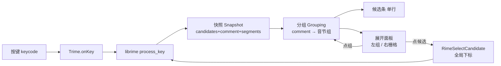

# 10 · 12 键（九宫格）客家话输入：设计与实现方案

> 本文回答两个问题：**librime 到底能给 12 键做什么**（issue #123 之后），以及 **hkrime 里怎么落地**。
> 结论先行：**不改 librime，只补一个候选枚举 JNI + 重写候选面板**。
> 文中所有引擎行为都已在 host 上实测（`artifacts/12key/engine/probe/`），不是推测。

---

## 0. TL;DR

| # | 结论 | 依据 |
|---|---|---|
| 1 | 打开 `translator/spelling_hints: 100` 后，**每条候选自带精确拼音注释**（`人`→`nzin`、`仁孝`→`nzin hau`） | 引擎实测，`script_translator.cc:348/455` |
| 2 | 注释就是「候选实际读的哪些音节」→ **它就是左列音节组的唯一真源**，不用自己猜、不用 DP 切分 | `set:5a5ia` 得到 8 个组：`kak ga / ka kia / lak ha / la kia / kak / lak / ka / la` |
| 3 | 全量候选可用 `RimeCandidateListBegin/Next/End` 枚举，**不受 page_size 限制**（`Menu::GetCandidateAt` 会 `Prepare(index+1)` 惰性拉满） | `rime_api.cc:427`、`rime/menu.cc:71` |
| 4 | `RimeSelectCandidate(session, index)` 用**全量下标**，`Context::Select` 作用在 `composition().back()` 的 menu 上，**与枚举同源** | `rime_api.cc:998`、`rime/context.cc:112` |
| 5 | 选中「半个音节」的候选时，引擎**原生支持部分消费**：`yi4ia3` 选 `人`(nzin) → composition 变 `人ia3`，剩余 `ia3` 自动重算候选 | 实测 `select:30` |
| 6 | 因此 **不需要 `set_input`、不需要 `set_caret_pos` 探测、不需要翻页收集** | 见 §11 |
| 7 | 12 键方案本身只需改一处：`hakka_jiugong.schema.yaml` 加 `spelling_hints: 100`（可选再加 `menu/page_size`） | `assets/rime/hakka_jiugong.schema.yaml` |

一句话架构：

> **每次按键后取一次「全量候选快照」→ 按 comment 分组 → 左列组、右栅格同组候选；点组只切换本地视图（不动引擎）；点候选调 `selectCandidate(全局下标)`，引擎自己决定消费几个音节。**

---

## 1. issue #123 说了什么，本方案怎么用

[librime#123](https://github.com/rime/librime/issues/123)（2017，已关）：

- 提问：现有引擎能否支持九宫格键盘？
- osfans：Trime/iRime 前端层可以做，**类似模糊音，但没有筛选和纠错**。
- lotem 给了 4 条，前 3 条是本方案的直接依据：
  1. 用**拼写运算**把「九宫格码」与「精准拼音」分开（derive/xlit，用大写或占位符表示不精确输入）；
  2. **preedit 只能反映音节切分，反映不了「输入码→词典编码」的对应**；
  3. `script_translator` 有 `translator/spelling_hints`，可给候选标注**原有拼音**；
  4. 建议 App 侧建 T9 码 → 音节映射表，按前缀枚举音节（同时充当手动分词）。

**本方案对第 4 条做了替换（关键取舍）**：

| | lotem 建议 / 上一轮实现 | 本方案 |
|---|---|---|
| 「有哪些音节」的数据源 | App 自建 T9→音节表（字典音节反查）+ DP 切分 | **引擎候选的 comment**（词典原始拼写） |
| 分组方式 | 按 caret / segments / 码字节去猜 | 按 comment 精确分组 |
| 上屏 | App 拼出音节串再想办法喂引擎 | `selectCandidate(全局下标)`，引擎原生消费 |
| 风险 | 歧义码猜错 = 左列与右格不相关 | 左列与右格**同源同快照**，不可能不相关 |

理由很简单：**引擎已经知道每个候选读的是什么音节，而且知道该怎么切**（`SyllabifyTask` 在 syllable graph 上 DFS）。App 再算一遍只会引入第二套真相。上一轮「左列切分不对 / 点左列右侧候选不相关」的根因就是两套真相打架。

---

## 2. 引擎能力实证（host probe）

探针：`artifacts/12key/engine/probe/rime_probe.c`（系统 librime 1.17 + 方案部署副本）。
命令形如：

```bash
./rime_probe deploy/hakka_hints/shared deploy/hakka_hints/user hakka_hints \
    "set:1i4ia3" dump
```

### 2.1 候选注释 = 精确拼音

```text
INPUT "1i4ia3"   PREEDIT "1i 4ia3"
CAND 0 text="五秒"   comment="ngh miau"
CAND 2 text="凝胶"   comment="ngin gau"
CAND 7 text="凝"     comment="ngin"
CAND 8 text="垠"     comment="ngin"
```

- 来源链：`ScriptTranslation::Peek()` → `GetOriginalSpelling()` → `ScriptTranslator::Spell()` → `Dictionary::Decode()` → `primary_table()->GetSyllableById()`。拿到的是**词典里的原始拼写**，不是折叠后的码。
- 多音节用 `speller/delimiter` 的首字符连接（本方案是空格）→ `"nzin hau"`。
- `spelling_hints` 默认 0（不输出）；N 是**音节数上限**（`cand.code().size()` = 该候选由几个音节组成），只有 `size <= N` 才出注释，所以长词要 N 足够大，**设 100 即全量**。
- 句子候选通常也有注释，但**不保证**：`enable_sentence` 的句子候选在有的路径下 comment 为空（实测 `五秒五秒` 有、部分句子没有）；拿不到时按「整句」组处理。
- **comment 有洞，不能假设「每个读音都能还原」**：`nia`（乜）与 `mia` 折叠到同码 `4ia`，词典 table 按 `(字符,码)` 去重后只剩一个读音；`ngik`（孽）四读被 `1` 缩写码吞并。这类丢读音是方案层的，不是本设计的 bug（见 §3 数据硬伤）。

### 2.2 一个候选表里天然存在「不同消费长度」的候选

以 `1i4ia3`（= ngin + hau，也可解作 ngh + miau）为例，44 条候选、**8 个发音组**：

| 组（comment） | 含义 | 说明 |
|---|---|---|
| `ngh miau` | 两个音节、吃完整个码 | 五秒 / 鱼苗 |
| `ngin gau` | 两个音节、吃完整个码 | 凝胶 |
| `ngh ni bu` | 三个音节 | 伍尔夫 |
| `ngh mi` | 两个音节 | 五味 / 五米 |
| `ngin` | **只消费第一个音节** | 凝 / 垠 |
| `ngio` | 消费 `1i`+`o`? | 驭 |
| `ngh` | 只消费 `1i` | 女/五 |
| `ngi` | 只消费 `1i` 的另一种读法 | 乂 |

→ **左列根本不用算**：把候选按 comment 分组就得到 `ngh miau / ngin gau / … / ngin / ngh`。用户 msg78 说的「ngin、ngin hau 两个」就是这个结构。

### 2.3 部分消费：引擎原生支持

```text
---- CMD set:yi4ia3          # = nzin + hau
MENU num_candidates=99
CAND 30 text="人" comment="nzin"      ← 1 音节候选
---- CMD select:30
SELECT ok=1
PREEDIT "人ia3"               ← 已选前缀 + 剩余码
MENU num_candidates=121
CAND 0 text="好" comment="hau"
CAND 1 text="高" comment="gau"
```

即：**选「人」→ 引擎消费 `yi4`、留下 `ia3`、自动重算剩余候选**。用户 msg78 期望的「选完 ngin 后剩 hau，hau 再切 ha | hau」完全由引擎天然完成。

继续 `select:0`（好 / ha）→ 剩余码 `3`：

```text
CAND 0 text="儿" comment="r"      ← 词典里 3 的唯一音节是 r（儿）
```

> 注意：用户历史里提到的「剩下 U」在引擎侧是 **r**（儿）。若 UI 想显示成 `u`，属于 fallback 展示策略（§8.3），不是引擎行为。

### 2.4 全量枚举与下标一致性

- `RimeCandidateListBegin(session, &it)` 取 `composition().back().menu`，`Next` 逐条 `GetCandidateAt(i)`；`GetCandidateAt` 内部 `Prepare(i+1)`，**会越过 page_size 继续往下拉**。
- `RimeSelectCandidate(session, i)` → `Context::Select(i)` → `composition_.back().GetCandidateAt(i)`。**与枚举同一张 menu、同一个下标空间**。
- 实测 `page_size=9` 时 `select:30` 依然成功（越页选择）。
- `select_candidate_on_current_page` 反而**不能**用：它做 `page_start + index` 且有 `index >= page_size` 的硬检查（`rime_api.cc:1000`）。

### 2.5 分段：只用来算「已消费了多少码」

自定义补丁 `RimeGetCompositionSegments` 实测（1.7.3 构建）：

```text
set:1i4ia3, select:7 → SEGMENTS count=2  [0,3)status=2  [3,6)status=1
```

`status` 枚举：`0=void / 1=guess / 2=selected / 3=confirmed`（`segmentation.h:19-24`）；start/end 是 **raw input 的字节偏移**。

要点（`artifacts/12key/engine/REPORT.md` §4.3 复核）：

- **未选择时通常只有 1 段**：段是 segmentor 的切分单位（`abc_segmentor` 按字母 run 切），`yi4ia3` → `[0,6) status=1`。preedit 里的空格来自候选 preedit，不来自段。
- 选择/部分消费后才变多段：已消费 `status=2`、剩余 `status=1`（`yi4ia3` 选「人」→ `[0,3)status=2` + `[3,6)status=1`）。
- 段只覆盖 **caret 前缀**（`Compose` 用 `input.substr(0, caret_pos)`）。12 键 App 里 caret 恒在末尾，故可视为覆盖全串；若将来支持移动光标，必须先判断 `caret_pos == input.length()`。

→ `consumedEnd = 所有 status>=2 段的最大 end`；`remaining = input.substring(consumedEnd)`。未选择时 `consumedEnd=0`，`remaining` 就是整串，符合预期。
**不要**再拿 segments 当「音节分组」（segmentor 只产一段，上一轮的错就在这）。

### 2.6 性能

host 上（含进程启动）枚举 990 条候选 ≈ 20 ms；1224 条同量级。Android 上按 3～5 倍估，**面板打开时异步枚举、上限截断**足够。单键（如 `8`=1224 条、69 组）建议截断到 500～800 条并对左列做虚拟化。

---

## 3. 数据基础（来自 `artifacts/12key/data/`）

| 项 | 值 | 用途 |
|---|---|---|
| 音节并集（JS 787 ∪ 词典 714） | **848** | 12 键可打性 / 解码器词表 |
| 主码唯一 | 509（含 derive 510） | 码→音节索引 |
| 每码音节数 | 1:226 / 2:252 / 3:12 / 4:15 / 5:2 / 6:2 | 歧义上界 |
| 落在歧义码的音节 | **73.3%** | 为什么必须让引擎消歧 |
| 12 键发码集 | `1345789aeiowy` | 与 12 个键一一对应 |
| 逐字母固定映射 vs 现 algebra 主码 | 847 合法音节 **0 差异** | §7.1 可简化（P2） |
| derive 9 条 | 仅 3 条真改码，45/46 撞别的主码 | **不要进正式索引**（P2） |
| 词典覆盖 | 现表 96.1%，补 46 个 dict-only → 99.8% | 数据清洗（P2） |
| 词典硬伤 | `客家`/`客家人` 无读音词条；1548 行缺读音；14 条含错误音节 | 影响候选质量，与 12 键架构无关 |

**对 12 键架构的含义**：歧义（`kak/lak`、`hau/gau`）是**键位固有的**（k/l 同键、g/h 同键），App 层永远无法消解；只有引擎的词表+词频能消解。这也是「分组交给 comment、消歧交给引擎」的根本原因。

另一组实测（`artifacts/12key/engine/REPORT.md` §6，按 `Projection::Apply` 语义逐条折叠 `hakka.dict.yaml`）：

- 695 个音节 → **437 个唯一码；437/437 全部能出候选**（`checkfile hit=437 miss=0`）。
- 128 个音节有多码（derive 造成，如 `ngin→1,1i4`）；**319 个码被 >1 个音节共享**（如 `4ia3 ← bu,cu,mh,mi,mia,...`）。
- 缩写码候选量巨大：`w`(th*) = 436、`y`(nz*) = 205、`1`(ng*) = 190 —— 短码必须靠 comment 分组+虚拟化，不能直接平铺。
- 已知丢读音：`nia`（乜，同码去重）、`ngik`（孽，被 `1` 缩写吞并）。

---

## 4. 架构

### 4.1 分层



**单数据源**：一次按键 → 一个不可变 `CompositionSnapshot`；所有 View 只读它。
**无累积**：列表每次整体替换（`ListAdapter.submitList` + `DiffUtil`），不存在「翻页追加」。
**无状态机**：面板开关、当前组下标属于 UI 局部状态，不进引擎。

### 4.2 数据模型（Kotlin）

```kotlin
// core/twelvekey/TwelveKeyModels.kt
data class CandidateItem(
    val text: String,
    val comment: String,     // "nzin" / "nzin hau" / ""（句子）
    val index: Int,          // 全量 menu 下标，直接喂 selectCandidate
)

data class SyllableGroup(
    val reading: String,             // comment 原文，UI 左列标签
    val syllables: List<String>,     // reading.split(' ')
    val items: List<CandidateItem>,  // 同组候选，保持引擎顺序
) { val size get() = items.size }

data class TwelveKeySnapshot(
    val input: String,          // Rime.RimeGetInput()
    val consumedEnd: Int,       // segments 里 status>=2 的最大 end（字节）
    val remaining: String,      // input.substring(consumedEnd)
    val groups: List<SyllableGroup>,
    val fallback: Fallback?,    // groups 为空时使用
) {
    val isEmpty get() = input.isEmpty()
    val hasCandidates get() = groups.isNotEmpty()
}

data class Fallback(val rawCode: String, val letters: String)  // §8.3
```

### 4.3 快照刷新（每次按键后 / 每次上屏后）

```kotlin
fun refresh(): TwelveKeySnapshot {
    val input = Rime.RimeGetInput()
    if (!Rime.isComposing() || input.isEmpty()) return TwelveKeySnapshot.empty()

    val segs = Rime.getRimeCompositionSegments()          // [start,end,status]×n
    val consumedEnd = (0 until segs.size / 3)
        .filter { segs[it * 3 + 2] >= 2 }                 // kSelected / kConfirmed
        .maxOfOrNull { segs[it * 3 + 1] } ?: 0

    val all = Rime.enumerateCandidates(MAX_CANDIDATES)     // 新 JNI，见 §7.2
    val groups = LinkedHashMap<String, MutableList<CandidateItem>>()
    all.forEachIndexed { i, c ->
        val key = if (c.comment.isBlank()) "…" else c.comment
        groups.getOrPut(key) { mutableListOf() }.add(CandidateItem(c.text, c.comment, i))
    }
    return TwelveKeySnapshot(
        input = input,
        consumedEnd = consumedEnd,
        remaining = input.substring(consumedEnd.coerceIn(0, input.length)),
        groups = groups.map { (k, v) -> SyllableGroup(k, k.split(' ').filter(String::isNotBlank), v) },
        fallback = if (groups.isEmpty() && remaining.any()) {
            Fallback(remaining, fallbackLetters(remaining))
        } else null,
    )
}
```

要点：

- `enumerateCandidates` 返回的**顺序即 menu 下标顺序**，所以 `index` 直接用。
- 组顺序 = 组内第一名的出现顺序 = 引擎综合打分顺序（**不要重排**；实测首组就是最佳组）。
- 同一 comment 的候选可能跨多个消费长度？不会：comment 是「词典读音」，消费长度由 code 决定，两者一一对应。

### 4.4 分组语义校验（实测）

| 输入码 | 候选数 | 组数 | 组（前几个） |
|---|---|---|---|
| `1i4ia3` | 44 | 8 | `ngh miau`, `ngin gau`, `ngh ni bu`, `ngh mi`, `ngin`, `ngio`, `ngh`, `ngi` |
| `yi4ia3` | 99 | 18 | `nzim gau`, `nzio gau`, `nzin hau`, `nzi miau`, …, `nzin`, `nzi` |
| `ia3` | 121 | 5 | `hau`, `gau`, `ga r`, `ha`, `ga` |
| `5a5ia` | 48 | 8 | `kak ga`, `ka kia`, `lak ha`, `la kia`, `kak`, `lak`, `ka`, `la` |
| `8i9` | 66 | 2 | `jit`, `zit` |
| `i44i` | 77 | 6 | `hong`, `gong`, `go mi`, `go ni`, `ho`, `go` |
| `4i` | 52 | 4 | `ni`, `nh`, `mi`, `mh` |
| `i` / `5` / `8` | 990 / 1077 / 1224 | 77 / 87 / 69 | 单键歧义很大，必须滚动/虚拟化 |

---

## 5. 交互规格（严格对齐历史 msg57–85）

### 5.1 候选条（固定单行）

- 显示**当前组**的候选（默认第 0 组），最多一屏；超出的进面板。
- 候选下方小字显示 comment（`Candidate.java` 已有 `commentPaint`，直接可用）。
- 右端固定两个钮：`▼`（展开/收起面板）、`⌄`（空候选时收起键盘）。
- **候选条不随面板滚动**（msg67①）。面板是覆盖层，候选条保持原样。

### 5.2 展开面板

```
┌──────────────────────────────────────────┐
│ 音节组                 │  候选栅格        │
│ ┌──────────┐          │ ┌──┬──┬──┬──┐   │
│ │ ngin  ★  │          │ │凝│垠│仞│… │   │
│ │ ngin gau │          │ └──┴──┴──┴──┘   │
│ │ ngh miau │          │                  │
│ │ …        │          │ （独立滚动）      │
│ └──────────┘          │                  │
│ （独立滚动）            │                  │
└──────────────────────────────────────────┘
```

- 左列 = 组（comment），可滚动；选中组高亮（`★`）。
- 右栅格 = 该组候选，网格 4 列（主题 `92dp` 已适配），**独立滚动**。
- 点左列组：**只切换右栅格**——不调引擎、不动 caret、不改候选条（msg72）。
- 点右栅格候选：`Rime.selectCandidate(item.index)` → 刷新快照 → **面板保持打开**，左列自动变成剩余码的组（msg78 的连续消费体验）。
- 面板头部固定（`▼` 不在滚动容器里，msg67②）。
- 滚动/切换组一律 `submitList(新列表)`，**没有 append**（msg83–85 的重复累积/只剩 5 条/回顶全部消失）。

### 5.3 键盘与候选条联动

| 事件 | 行为 |
|---|---|
| 任意 12 码按键 | `process_key` → `refresh()` → 更新条，若面板开着同时更新面板 |
| 退格 | 引擎删一个码 → `refresh()`；若 `input` 变空 → 关闭面板 |
| 上屏（选中句子/标点） | `input` 空 → 关闭面板、清空快照 |
| `▼` 且候选为空 | `Trime.getService().requestHideSelf(0)`（msg59 + 最后一条投诉） |
| `▼` 且候选非空 | 开/关面板（面板关时不需要任何异步收集） |
| 面板开着按 `▼` | 关闭面板，候选条不变 |

### 5.4 默认组与「整串上屏」

- 默认组 = 第 0 组。用户想整串上屏时，点第 0 组第一条即可（它吃完整个码）。
- 不做「单击组 = 直接上屏首选」——会与「点组只切换视图」的语义冲突（msg72）。

---

## 6. preedit 显示

引擎 preedit 是「已选字 + 剩余码」，如 `人ia3` / `1i 4ia3`。显示规则：

```text
display = 已选字文本 + " " + decodeToPinyin(remaining)
```

- 已选字文本：从 preedit 里取 CJK 前缀，或由 `consumedEnd` 之前的 input 切片对应候选文本拼出（简单起见用 preedit 的 CJK 前缀）。
- `decodeToPinyin(remaining)`：沿用现有 `TwelveKeyPreedit.decode()` 的 DP（码表来自 `hakka.dict.yaml` 音节），但：
  - 输入改为 **remaining**，不再喂整条 preedit；
  - **删掉 hint 对齐 hack**（之前用首候选字反推读音，现已由组结构代替）；
  - 可选增强：若当前组 `reading` 能整段覆盖 remaining，直接用它（零 DP、绝对正确）。
- DP 失败 → 原样显示码（`1i4ia3`）。
- preedit **纯展示**，绝不影响引擎状态（不 set_input、不 set_caret）。

---

## 7. 代码改动清单

### 7.1 方案/资源（1 行必要 + 2 行建议）

`app/src/main/assets/rime/hakka_jiugong.schema.yaml`

```yaml
translator:
  dictionary: hakka
  prism: hakka
  enable_user_dict: true
  enable_sentence: true
  spelling_hints: 100        # ← 必要：候选 comment = 精确拼音
  # always_show_comments: true   # 可选：preedit==comment 时也显示
menu:
  page_size: 9                # 建议：候选条一屏条数（原有默认 5 太窄）
```

> P2 可选：把 4 组 algebra 换成「逐字母固定映射 + nz/th/ng 特判」（数据证明 0 差异），并从正式索引里去掉 derive —— 与本期架构解耦，先不动，避免一次改两处。

### 7.2 新增 JNI：全量候选枚举

`jni-build/trime-v3.2.7/app/src/main/jni/librime_jni/rime_jni.cc`

```cpp
// 返回扁平 String[]：[text0, comment0, text1, comment1, ...]
// index 即 candidate_list 的下标，可直接传给 select_candidate
JNIEXPORT jobjectArray JNICALL
Java_com_hazukieq_hkrime_core_Rime_enumerateCandidates(JNIEnv *env, jclass,
                                                       jint max_count) {
    std::vector<std::pair<std::string, std::string>> out;
    RimeCandidateListIterator it;
    memset(&it, 0, sizeof(it));          // RIME_STRUCT 的 C 写法
    if (RimeCandidateListBegin(activated_session_id, &it)) {
        do {
            const auto &c = it.candidate;
            out.emplace_back(c.text ? c.text : "",
                             c.comment ? c.comment : "");
            if ((jint)out.size() >= max_count) break;
        } while (RimeCandidateListNext(&it));
        RimeCandidateListEnd(&it);
    }
    auto cls = env->FindClass("java/lang/String");
    auto arr = env->NewObjectArray((jsize)out.size() * 2, cls, nullptr);
    for (size_t i = 0; i < out.size(); ++i) {
        env->SetObjectArrayElement(arr, (jsize)(i * 2),
                                   env->NewStringUTF(out[i].first.c_str()));
        env->SetObjectArrayElement(arr, (jsize)(i * 2 + 1),
                                   env->NewStringUTF(out[i].second.c_str()));
    }
    return arr;
}
```

`core/Rime.java`

```java
/** 全量候选（不受 page_size 限制）；返回 [text, comment] × n，下标即 selectCandidate 的下标。 */
public static native String[] enumerateCandidates(int maxCount);

public static List<RimeCandidate> candidatesSnapshot(int maxCount) { /* 解析 String[] */ }
```

调用约束：

- 必须在与 `process_key` 相同的 session/线程序列里调用（现有 `Rime.runTask` 队列）。
- `composition` 为空时 `RimeCandidateListBegin` 返回 false → 空列表。
- 上限 `MAX_CANDIDATES = 600`（单键 1224 条时截断）；左列组数再截断（如 200 组）。

### 7.3 App 层（新增包 `core/twelvekey/`）

| 文件 | 职责 | 依赖 |
|---|---|---|
| `TwelveKeyModels.kt` | §4.2 数据类 | 无 |
| `TwelveKeySnapshotBuilder.kt` | §4.3 快照 + 分组 + fallback + `fallbackLetters()` | `Rime`、`TwelveKeyPreedit` |
| `TwelveKeyController.kt` | 按键后/上屏后刷新；`selectCandidate(globalIndex)`；回调 `onSnapshot` / `hideKeyboard` | Builder、`Rime`、`Trime` |
| `CandidatePanelController.kt` | 面板/条绑定：`submit(snapshot, activeGroup)`、DiffUtil、滚动位置、开关 | 两个 Adapter |
| `CandidateBarBinder.kt` | 单行候选条（复用 `Candidate` 的 commentPaint + `▼`/`⌄`） | `Candidate.java` |

`TwelveKeyController` 设计成**无 Android View 依赖**，便于 JVM 单测：

```kotlin
class TwelveKeyController(
    private val rime: RimeApi,
    private val onSnapshot: (TwelveKeySnapshot) -> Unit,
    private val onCommit: (String) -> Unit,
) {
    private var snapshot = TwelveKeySnapshot.empty()
    fun onKeyProcessed() { snapshot = builder.build(); onSnapshot(snapshot) }
    fun selectCandidate(globalIndex: Int) {
        rime.selectCandidate(globalIndex)
        if (rime.isComposing()) onKeyProcessed()
        else { onCommit(rime.takeCommitText()); snapshot = TwelveKeySnapshot.empty(); onSnapshot(snapshot) }
    }
    fun commitFallback() { /* §8.3 */ }
}
```

### 7.4 要删掉的旧逻辑（上一轮 bug 的根源）

在 `ime/text/TextInputManager.kt` 中：

| 旧成员/方法 | 现状 | 处置 |
|---|---|---|
| `panelItems/panelSeen/panelMaxPages/collecting/collectionGen` | 翻页追加去重 | **删**（整块换成快照） |
| `startPanelCollection/collectRest/collectCandidatePanelItems` | 分批补页 | **删** |
| `rebuildPinyinGroups` 里 `hakka_jiugong` 的「按 input 每个字节分组」 | 左列变成 `ja,a,j,a,u` 的元凶 | **删** |
| 通用分支的 `RimeSetCaretPos(p)+getContexts()` 探测 | 改引擎状态、慢、易错 | **删**（msg73 已明确否决） |
| `probeGroups` / `remainingCode()` 的 caret 版 | 与字节/字符偏移混淆 | 删，改由 `consumedEnd` 算 |
| `TwelveKeyPreedit.decode(preedit, hint)` 的 hint 对齐 | 猜读音 | 保留 DP，删 hint 参数 |

`Candidate.java` / `CandidatePanelAdapter.kt` / `CandidateGroupAdapter.kt` 保留骨架，改数据源与布局（左列 = 组、右格 = 组内候选）。

---

## 8. 边界与兜底

### 8.1 没有任何候选（真正的 fallback）

`groups.isEmpty() && remaining.isNotEmpty()` → 左列一项 `〔码〕…`、右格一项 = 剩余码本身（`fallbackLetters`）。点击 = `clearComposition()` + `commitText(letters)`（本地原文上屏，不走引擎）。

实测绝大多数码都有候选（如 `3`→`儿` comment=`r`），fallback 只兜底非法码串。

### 8.2 句子候选 comment 为空

分组键退化为 `"…"`，显示「整句」；点它走正常 `selectCandidate`。

### 8.3 fallback 展示用字母表

`3 → u`（按用户 msg79–81 的直觉）、`1 → ng`、`w → th`、`y → nz`、`4 → m`、`5 → k`、`7 → p`、`8 → z`、`9 → q`、`a/e/i` 原样。仅影响 fallback 标签/原文上屏，不影响正常路径。

### 8.4 超长输入

`input.length > 48` 时只对最后 48 个码做分组（面板仍显示全部组），避免单键歧义叠加爆炸。

### 8.5 用户词典

`enable_user_dict: true` 保持不变；选中过的词条会进 `hakka.userdb`，下次候选前置 —— 快照机制自动吃到排序变化，无需额外处理。

---

## 9. 迁移路径

### P0（能跑通，改动可控）

1. schema 加 `spelling_hints: 100`（+ `menu/page_size: 9`）；
2. 新增 `enumerateCandidates` JNI + `Rime.candidatesSnapshot()`，重建 `.so`；
3. 新增 `TwelveKey*` 五个文件；
4. `TextInputManager`：面板/条改为消费快照，删除 §7.4 旧逻辑；
5. preedit 改为「已选字 + DP(remaining)」。

验收：见 §10 用例表（可先用 host probe 校验数据层，UI 用 JVM 单测 + 真机手测）。

### P1（体验打磨）

- `▼`/`⌄` 语义、退格关面板、面板头部固定、主题尺寸复核；
- 左列组虚拟化（单键 77 组）与组数上限；
- 面板打开时机（首批同步出 1 组，其余异步？——P0 实测 20ms 量级，可先同步）。

### P2（数据/方案清理，与架构解耦）

- 46 个 dict-only 音节补进音节表；剔除 10 个错误音节；6 个 q- 缺格决策；
- `客家`/`客家人` 等高频词补读音；1548 行缺读音词条；
- algebra 简化（固定映射）、derive 退出正式索引；
- 26 键方案保持精确拼音，不加 hints。

---

## 10. 验收用例（真机手测即可，期望值来自 host 实测）

| # | 按键序列 | 期望左列组（前几） | 期望行为 |
|---|---|---|---|
| 1 | `yi4`（人 nzin） | `nzin`, `nzio`, `nzim` | 条显示 人/如/女…，▼ 打开左列为这三组 |
| 2 | `1i4ia3` | `ngh miau`, `ngin gau`, `ngh ni bu`, `ngh mi`, `ngin`, `ngio`, `ngh`, `ngi` | 点 `ngin` 组 → 右格 凝/垠；候选条不变 |
| 3 | `1i4ia3` → 点「凝」 | 左列变为 `hau`, `gau`, `ga r`, `ha`, `ga`（剩余码 `ia3`） | preedit = `凝 hau`；面板保持打开 |
| 4 | 接上 → 点「好」 | 左列 `r`（剩余码 `3`） | preedit = `凝好`；再点「儿」上屏 |
| 5 | `5a5ia` | `kak ga`, `ka kia`, `lak ha`, `la kia`, `kak`, `lak`, `ka`, `la` | 左列 8 组，滚到底不重复 |
| 6 | 空输入 + 候选为空 | — | 点 `▼`/`⌄` → 键盘收起 |
| 7 | 面板开着连续按退格 | 组随输入缩短 | 输入清空时面板自动关闭 |
| 8 | 面板滚动到底再点左列另一组 | 右格整体替换 | 无残留、无重复、滚动位置回顶 |

---

## 11. 为什么这版能修掉上一轮 7 个 bug

| 历史 bug（msg57–85） | 上一轮根因 | 本方案 |
|---|---|---|
| 左列切分错误（`ja,a,j,a,u`） | 按输入字节/键帽分组 + caret 探测 | 左列 = 引擎 comment 分组 |
| 点左列后右格候选不相关 | 自己 DP 猜音节，与引擎菜单不同源 | 同快照同组，物理上不可能不相关 |
| 滚动重复累积 | 翻页 append + 重入 | 每次 `submitList` 整体替换 |
| 点回某音节只剩 5 条 | 依赖 page_size 与收集进度 | 组内候选来自全量枚举，与翻页无关 |
| 空候选不隐藏键盘 | 语义未接 | `▼` 空候选 → `requestHideSelf` |
| 面板滚动 ▼ 消失 | ▼ 在滚动容器里 | ▼ 移到固定头部 |
| caret 乱、需要 `set_caret_pos` | 用 caret 当分组依据 | 不用 caret；`consumedEnd` 来自 segments |

---

## 12. 风险与对策

| 风险 | 影响 | 对策 |
|---|---|---|
| 全量枚举在单键下 2k+ 条 | 面板打开慢 | 上限 600 + 左列虚拟化；实测 host 20ms/千条 |
| `comment` 依赖 `spelling_hints`，改方案即失效 | 分组为空 | P0 加自检：jiugong 方案启动时断言候选带 comment，缺失则回退「整句」模式 |
| 句子候选无 comment | 组标签是 `…` | 按「整句」组，正常可选 |
| JNI 与 session 线程模型 | 崩溃/竞态 | 所有调用走现有 `Rime.runTask` 串行队列；枚举只读 menu，不改 input |
| 主题 4 列 / 92dp 与右格冲突 | 显示挤 | 复用现有主题 key，先跑真机再调（P1） |
| `selectCandidate` 越页行为未来变化 | 上屏错位 | 加单测：`page_size=9` 时 index=30 仍应成功（已在 host 验证） |

---

## 13. 附：三个「不要做」

1. **不要 `RimeSetInput` 去拼音节串**——只在 App 端过滤即可；一旦改 input，用户词典/句子模型/undo 全乱，且要自己管 caret。
2. **不要 `RimeSetCaretPos` 遍历分段**——会触发重译、丢候选、破坏状态；`segments` 已经直给。
3. **不要翻页收集候选**——`candidate_list` 本来就是全量视图；翻页只会把「分页」这个 UI 概念漏进数据层。

---

## 14. 实施状态（P0 已落地，commit `44f4974`）

| 项 | 状态 | 位置 |
|---|---|---|
| schema：`spelling_hints: 100` + `menu/page_size: 9` | ✅ | `assets/rime/hakka_jiugong.schema.yaml` |
| JNI：`enumerate_candidates`（全量枚举） | ✅ 重建 `.so`（13,602,464 B，sha256 `e3eb531c…`） | `jni-build/.../librime_jni/rime_jni.cc`、`core/Rime.java` |
| 快照 + comment 分组 + 面板 | ✅ | `core/twelvekey/*.kt`（5 个文件）、`ime/text/*` |
| 旧翻页收集 / caret 探测 / 字节分组 | ✅ 已删 | `ime/text/TextInputManager.kt` |
| preedit 越界（`Composition.setWindow`） | ✅ 已修（`RimeComposition.normalizeAfterRewrite()`） | `core/Rime.java` |
| 真机冒烟（候选条 / 面板 / 空闲 ⌄） | ✅ 见 `artifacts/12key/verify/DEVICE-SMOKE.md` | — |

实测截屏证据：`artifacts/12key/verify/device-bar.png`、`device-panel.png`、`device-idle.png`。

**上线注意**：assets 只在 `versionName` 变化时覆盖到 `/sdcard/rime`（`Config.prepareRime`）。
发版必须 bump 版本号，或让用户用设置里的「重置」；否则老用户升级后仍是旧 schema（无 comment、page_size=5）。

P1（2026-11-08 已做，commit `0cfcd30` / `618b75c`）：

| 项 | 结果 |
|---|---|
| 展开/收起图标同尺寸 | ▼/⌄/▲ 统一 `Path` 绘制（20dp 占位，10×7dp 三角） |
| 空候选区显示 schema 开关 | 未组字时显示 `简/繁、情/联`，点击切 `Rime.toggleOption`；删除废弃 `_key_Hide` |
| 单键长列表 | 枚举移出 UI 线程（debounce 120ms + `Dispatchers.Default` + generation），8 条 LRU 快照缓存，`ENGINE_LOCK` 串行 |
| 连续消费手感 | 部分消费后保持当前 reading 组；`submit` 不再 scroll 回顶；点组只滚右格 |

真机 gfxinfo（连按单键 `8`）：janky **100% → 40.4%**，p50 **77ms → 5ms**，p90 **93ms → 27ms**。
证据：`artifacts/12key/verify/UI-P1-VERIFY.md`、`artifacts/12key/app/P1-UI-PERF.md`。

仍待办：popup composition 与 preedit 改写联动验证；物理键盘路径未持 `ENGINE_LOCK`（`Trime.onKeyEvent`，
不在本轮改动范围）；候选条 120ms debounce 的手感是否再调；Gboard 式菜单/主题按钮（用户提过，未做）；
46 个 dict-only 音节与 `客家` 词条补读音（P2 数据）。

---

## 15. UI 迭代记录（2026-11-08 晚，已上真机）

| 轮次 | 改动 | commit |
|---|---|---|
| 图标状态 | 有候选时只留 ▼/▲；无候选（未组字）才显示 ☰ 菜单 / 配色 / ⌄ 收起 | `0db2779` |
| 图标风格 | 统一线性图标（2dp、圆角、颜色=`candidate_text_color`），绘制中心对齐候选词行 | `41eece6` |
| 图标间距 | 两枚 Symbol 盒之间留 14dp；再按 Gboard 工具栏规格改为 **48dp 触摸盒 + 24dp 光学尺寸** | `b16661d`、`5aeda4d` |
| 网格布局 | `GridLayoutManager(4)` 等宽 → **`FlowLayoutManager`**：item 按内容测宽、行内换行 | `5aeda4d` |
| 面板视觉 | 左列 index rail（14sp、accent 10% 底 + 3dp 竖线，不再整行反白加粗）；右格表面色卡片（14dp 圆角、ripple、词 20sp + 拼音 10.5sp） | `5aeda4d` |
| 拼音完整性 | 格子宽 = max(词宽, 读音宽)，拼音不缩字、不截断 | `25aa04f` |

### 15.1 一个必须记住的结论：同组必然等宽

右格是「当前选中读音组的候选」，**同组所有候选的 comment（精确拼音）完全相同**；
不同字数的词（1 字 vs 2 字）才会让格子宽度有差异，而同一读音下候选几乎都是同字数。
所以：

- **同组等宽是设计结果，不是 bug**；
- 宽度变化体现在「切换读音组」（`nzin gau` 3 列 vs `nzim gau` 1 列）；
- 用户 2026-11-08 21:37 明确拍板：**保持现状，不改混排**。

若将来仍要视觉上的「长短不一」，只有一条路：右格默认混排当前输入的全部候选、左列退化为筛选器——
这会改变 P0 的交互语义，需重新过一遍验收用例。

### 15.2 真机验证工具

`tools/tap_text.py`：截图 → dca 常驻带 OCR（`dca.ocr_client`，CUDA，~0.7s/张，坐标 1:1）→
按文字坐标 `adb tap`。彻底替代「截图后肉眼估键盘坐标」，验证脚本可以按 `nz`/`ghi`/`退格` 这种
键面文字直接点。遵守 `desktop-chain` 规范：不另起 PaddleOCR，全部走 dca 常驻服务。

### 15.3 「漢字混進 preedit」的真正原因（2026-11-08）

現象：連續打很多音節後，鍵盤上方出現多行漢字（`1.幾句幾句…`），看起來像 preedit 裡冒出漢字。

原因不是 preedit 被寫成漢字，而是主題的 **懸浮窗口**：
`hakka_theme.trime.yaml` 的 `style/window` 有兩個 `windows_comps` 組件——

1. `composition: '%s'`（編碼/拼音）；
2. `'\n' + label: '%s.' + candidate: '%s'`（**帶編號的候選列表**）。

12 鍵輸入很長時，懸浮窗把 `composition + 整個候選列表` 一起畫出來，看起來就是「漢字上屏到 preedit」。
12 鍵本身已有候選條 + 展開面板，懸浮窗裡的候選列表純屬重複。

**修法（2026-11-08 用戶定調：改主題、不改代碼，避免傷主題參數可配置性）**：
直接改 `assets/rime/hakka_theme.trime.yaml` 的 `style/window`，把第二個
`candidate` 組件註釋掉，只保留 `composition`：

```yaml
window: #悬浮窗口组件：12 鍵只顯示編碼/拼音（候選交给候选条 + 展開面板）
  - {start: '', composition: '%s', end: '', letter_spacing: 0.12}
  # - {start: "\n", label: '%s.', candidate: '%s', comment: '%s', end: '', sep: ' '}
```

這樣 12 鍵懸浮窗只畫編碼/拼音，候選在候選條與展開面板；其它方案若也要這個行為，
改自己的主題即可（代碼裡不寫死方案名）。

> 歷史：曾用代碼（`Composition.setSkipCandidates` + `isTwelveKeySchema()`）實現，已回退。

### 15.4 為甚麼「改了主題沒生效」（2026-11-08）

主題是先在編譯期被 `rime_deployer` 編成 `build/<theme>.yaml` 緩存，運行時
`Config.init()` 走 `Rime.deploy_config_file(name, "config_version")` 並**只在緩存不存在時**才重建。
結果是：改了 `hakka_theme.trime.yaml`（甚至 push 到 `/sdcard/rime` 再 deploy），
`build/hakka_theme.trime.yaml` 仍是舊的，`windows_comps` 還是「composition + 候選」，
悬浮窗照樣把帶編號的候選畫出來 —— 看起來就是「改主題沒用」。

修法（代碼契合主題參數變化）：`Config.init()` 比較**源文件 mtime 與 build 緩存 mtime**，
源文件更新就重新 `deploy_config_file`，不再只看「緩存存在與否」。

```java
File build = new File(Rime.get_user_data_dir() + "/build", file_name);
File source = new File(Rime.get_user_data_dir(), file_name);
if (!source.exists()) source = new File(Rime.get_shared_data_dir(), file_name);
boolean needDeploy = !build.exists()
    || (source.exists() && source.lastModified() > build.lastModified());
if (needDeploy) Rime.deploy_config_file(file_name, "config_version");
```

驗證：刪掉/改舊 `build/hakka_theme.trime.yaml` 後重啟 IME，緩存重建為
`window: [{composition: "%s"}]`，悬浮窗只剩拼音。

### 15.5 「打長了就停止候選」的真正原因（2026-11-08）

現象：連續打十幾個音節後，候選條只剩一兩個候選，看起來像「候選停了」。

根因**不是主題參數**，而是候選條的數據源：
`TwelveKeySnapshot.barItems` 取的是 **`groups[0]`（第 0 個讀音組）**。
短輸入時同一讀音有很多候選（nzin 8 個字），看不出問題；長輸入時引擎為每個候選
給出的 comment（精確拼音）各不相同，於是「第 0 組」通常只剩 **1 條**，
候選條就被抽乾了。

修法：快照新增 `barEntries` —— **按選單順序取前 12 條**（`flat.take(12)`，
index 仍是全局下標，點擊上屏不受影響）；`barItems` 優先讀 `barEntries`，
沒有時才退回第 0 組（兼容舊快照）。展開面板仍按讀音分組，職責不變。

驗證：連打 48+ 鍵，`twelvekey:latency` 日誌的 `items=12` 保持不變
（修前同樣輸入是 `items=1`）。

### 15.6 native crash：release 事件沒持引擎鎖（2026-11-08）

真機連續輸入時 `com.hazukieq.hkrime` 進程 SIGSEGV 崩潰，tombstone：

```
signal 11 (SIGSEGV), Cause: null pointer dereference
#00 librime_jni.so
#01 librime_jni.so (RimeGetContext+1252)
#02 librime_jni.so (Java_..._get_1context)
#08 Rime.getContexts
#12 Rime.onKey
#20 TextInputManager.onRelease
#24 KeyboardView.releaseKey
```

根因：`TextInputManager.onRelease()` 直接調 `Rime.onKey(RELEASE)`（內部 `process_key` + `getContexts`），
**沒有** `ENGINE_LOCK`；而按鍵後的快照重建在 `Dispatchers.Default` 線程持鎖枚舉候選。
兩者同時碰同一個 librime session → context 被寫壞 → 空指針。

修法（雙保險）：
1. `onRelease` 的 Rime 調用整體放進 `withEngineLock { }`；
2. `Rime.java` 暴露 `public static final Object ENGINE_LOCK`，`onKey()`（含 `process_key` +
   `getContexts`）整段 `synchronized (ENGINE_LOCK)`；Kotlin 的
   `TwelveKeyController.ENGINE_LOCK` 直接引用同一顆鎖（不再是兩把各管各的）。

驗證：`adb` 併發猛點 200 次（80 次 + 120 次並行 tap）後進程 PID 不變、
logcat 中 `FATAL / signal 11 / ANR in com.hazukieq.hkrime` 計數為 0。

### 15.7 數據目錄 `rime` → `hkrime`（2026-11-08）

默認用戶數據目錄從 `/sdcard/rime` 改為 `/sdcard/hkrime`（避免和官方 Trime / 其他
輸入法共用目錄互相覆蓋）。

- `AppPrefs.Configuration`：新增 `DEFAULT_DIR_NAME = "hkrime"`；
  `sharedDataDir` / `userDataDir` 的默認值改為 `$EXTERNAL_PATH_PREFIX/hkrime`；
- 一次性遷移：pref 裡若是舊默認（以 `/rime` 結尾）就改寫成 `/hkrime`，
  不覆蓋用戶自定義路徑；
- `res/values/donottranslate.xml` 的 `default_shared_data_dir`、`conf__default_user_data_dir`
  同步改成 `/sdcard/hkrime`。

真機遷移：`cp -a /sdcard/rime /sdcard/hkrime`（100MB，含 userdb/build），
啟動後 pref 自動改成 `/sdcard/hkrime`，日誌確認 `conf__user_data_dir=/sdcard/hkrime`，
輸入正常。舊的 `/sdcard/rime` 與 `Android/data/.../files/rime` 保留作備份（未刪）。


## 15.5 簡拼（兩鍵/多鍵聯想）—— 2026-11-08

用戶反饋「kl,kl（碼 55）出不了聯想組詞」。根因是方案只給 th/nz/ng 做了 abbrev，
其餘音節沒有「首字母縮寫」，所以 `55` 這種只有聲母的碼串在 prism 裡查不到任何音節。

修法（只動 schema，不動 App）：

```yaml
    # 簡拼：統一的「取聲母」規則（不再逐個手寫）
    # th / nz / ng 取兩字母，其餘取首字母；之後經 xform/xlit 落到 12 鍵上
    - abbrev/^(th|nz|ng|[a-z]).*$/$1/
```

（最初是手寫 `abbrev/^(th)…`、`^(nz)…`、`^(ng)…` 三條；2026-11-08 改成上面這一條，
長聲母優先匹配、其餘取首字母，所有聲母統一覆蓋，避免漏掉某個聲母。）

驗證（vivo 真機）：`55` → 考慮 / 看看 / 來看 / 理論 / 起來；`55555555` → 可口可樂。
注意 preedit 仍會把 `55` 猜成 `ko keu` 之類的完整音節（TwelveKeyPreedit 的 DP 限制），
但候選是正確的；要更準可在後續讓 decode 對「單字符碼」只顯示首字母。


## 15.6 簡拼引發的 ANR 與 librime 修補（2026-11-08）

真機症狀：連打 `kl`（碼 `5`）十幾次後輸入法卡死，`am_anr`：
`Input dispatching timed out (InputMethod is not responding)`，主線程 99% CPU 20s+。

ANR 棧（dropbox data_app_anr）：

```
ScriptTranslator::Query → ScriptTranslation::Evaluate
  → MakeSentence → UserDictionary::Lookup → DfsLookup → LevelDbAccessor::Jump (DFS)
```

根因：簡拼讓每個位置的候選拼寫有幾十個分支，`translated_len < consumed` 時
`script_translator` 會做句子裝配，句子裝配要對**用戶詞庫**做 DFS，長輸入是指數爆炸。
librime 1.7.3 的 `script_translator` **根本不讀 `enable_sentence`**（源碼裡沒有這個配置），
所以 schema 裡關掉沒用。

修法（改 librime，重編 `.so`）：`src/rime/gear/script_translator.cc` 的 `Evaluate()`：

1. 掃 `syllable_graph.edges` 的 `EdgeProperties.type`，只要出現 `kAbbreviation`
   （即輸入用了簡拼）就**不做 MakeSentence**——簡拼詞仍可由詞典直接命中；
2. 另加硬上限 `kMaxSentenceSyllables = 12`，完整拼音的極長輸入也不爆。

重編後 `.so`：13,603,232 B，sha256 `94bed12b8356109880373f38f71eb706cfe5c8aa9b02b588d15a325ab80b1732`，75 個 JNI 導出。
壓測：連按 `kl` 40 次，PID 不變、無新 ANR；候選仍為 可口可樂 等，preedit 顯示 `k l k l …`（聲母）。


## 15.7 簡拼卡頓：兩處修補（2026-11-08）

症狀：簡拼後按鍵「格外卡」，gfx p90 250ms、每鍵→候選落地 270ms（無 ANR）。

用 `dbgkey` 打點拆開：`process_key` 每鍵 ~250ms，`getContexts` 2ms，App 端枚舉 8ms。
`process_key` 卡在 `ScriptTranslation::Evaluate`：即使不做句子裝配，`user_dict->Lookup`
對簡拼的 SyllableGraph 仍做 leveldb DFS。

兩處改動：

1. **librime**（`script_translator.cc`）：偵測到 abbrev 拼寫就**連用戶詞庫都不查**
   （主詞典照常，簡拼詞仍命中）；完整拼音輸入仍走用戶詞庫。
   效果：`process_key` 250ms → **40ms**。
2. **App**：候選條只需 12–16 條，面板關閉時只枚舉 `BAR_CANDIDATES=16`，打開面板才全量 600
   （`TwelveKeySnapshotBuilder.build(local, maxCandidates)`，緩存 key 帶 `|bar`/`|full`）。
   效果：枚舉 30ms → **8ms**。

合計：按鍵→候選條落地 **270ms → ~70ms**（p90 250ms → 73ms），不再 ANR。
剩餘 40ms 在 librime 的主詞典 Lookup（簡拼每個位置仍有幾十條分支），要再快就得限制
簡拼分支或給 Lookup 加 limit，屬下一步可選項。


## 15.8 簡拼再提速：給 Table::Query 加展開預算（2026-11-08）

用 `evgraph`/`evtable` 打點量出真相（連按 `kl`）：

| 階段 | len=1 | len=3 | len=12 |
|---|---|---|---|
| `BuildSyllableGraph` | 0.3ms | 1.2ms | 3.8ms |
| `dict->Lookup` | 0.4ms | 35ms | 38ms |

`Table::Query` 的計數器顯示：**一次 Query 有 ~75,970 次 `Access` + 75,828 次 `Advance`**、
BFS 隊列峰值 766 —— 也就是說 37ms 全是簡拼圖 BFS 的展開成本，且長度到 3 音節就飽和
（2–3 音節詞最多）。

修法（`src/rime/dict/table.cc`，`Table::Query`）：

- `kMaxExpansions = 6000`：`Access+Advance` 次數超過就停，保留已收集結果；
- `kMaxChunksPerEnd = 48`：每個 end_pos 的 chunk 上限（詞典按 by_weight 排序，先到即高頻）。

效果（同機、連按 20 次 `kl`）：

| 指標 | 修前 | 修後 |
|---|---|---|
| `dict->Lookup` | 37ms | **4ms** |
| 按鍵→候選條 | 70ms | **33ms** |
| gfx p90 | 73ms | **31ms** |
| gfx p50 | 6ms | 5ms |

代價：簡拼時候選召回被截斷（低頻長詞可能不進候選），面板分組仍正常（實測 `55` 出 5 組）。
完整拼音路徑分支少，預算遠未觸頂，不受影響。


## 15.9 左列排序與跑馬燈（2026-11-08）

用戶：「展開面板，我需要單個音節排在前面，方便對聯想詞不滿意時手動選。然後多個音節的
哪怕沒有選中也要跑馬燈，否則看不清楚了」。

- `TwelveKeySnapshotBuilder.group()`：分組後按音節數升序 stable sort（單音節組在前，
  同音節數保持候選順序）。`ngin/ngio/ngh/ngi` 這類單音節組因此排在 `ngin hau` 前面。
- `CandidateGroupAdapter.onBindViewHolder()`：`marquee = selected || 讀音含空格`；
  多音節行 `isSelected=true` + `ellipsize=MARQUEE` + `marqueeRepeatLimit=-1`，
  單音節行仍只有選中時滾動。


## 15.10 簡拼分支均衡取樣（2026-11-08）

用戶反饋：敲 `kl`（碼 `5`）打開面板，左列幾乎全是 k 開頭的音節，l 開頭只有 2 個。

原因：`Table::Query` 按 `map` 順序展開分支，預算（6000 次 Access/Advance）耗盡時只覆蓋
前面那批音節；k 排在 l 前，於是 l 幾乎沒被展開。

修法（`src/rime/dict/table.cc`，`Table::Query`）：

第二版（用戶要求「按音節詞頻加權 + 顯示要按字母排序」）：

- 分支權重 = `TableAccessor::remaining()`，即該音節開頭的詞條數（詞頻代理，
  不需要外部頻次表）；按權重降序入隊，同權重按 `syllable_id` 保證確定性；
- 預算維持 12000（覆蓋全部 2 音節組合 89×89=7921，2 音節詞不會被截斷；
  3 音節以上才按權重取樣）；
- App 端左列**先按音節數、再按 reading 字母升序**排序，顯示有規律：
  實測 `5 5` 的 rail 為 `ken / ket / ki / ko / kong / ku …`（k 段）→ `len / li / liau / lin / lit / liu …`（l 段），
  k、l 都在且各自按字母排好。

## 15.11 「貨不對版」根因修復 + 所見即所得的學習排序（2026-11-09）

用戶反饋：按 `kl` 後候選條顯示的與展開面板裡的不一樣；點候選條上的字，上屏的卻是別的字。

### 根因一：候選條條目丟了「引擎全域下標」

`TwelveKeySnapshotBuilder.build()` 原先 `flat` 是 `List<Pair<text, comment>>`，
`barEntries` 用 `mapIndexed { index → CandidateItem(text, comment, index) }` 把**顯示位置**
當成了引擎下標。一旦 App 側學習排序把順序重排，顯示位置 ≠ 引擎順序，
`select_candidate(index)` 就會選到另一個字 —— 這正是「貨不對版」。

修法：枚舉時就帶上下標（`snapshot.mapIndexed { i, row → CandidateItem(text, comment, i) }`），
排序、分組、候選條全部沿用同一個 `index`。

### 根因二：點擊用「當前快照」而不是「綁定到條上的那份」

非同步刷新/學習重排會在「顯示」與「點擊」之間換掉快照。修法：`TextInputManager`
記住最近一次綁到候選條的 `boundBarItems`，點擊時按它解析下標（顯示與點擊同一份數據）。
面板同理用各組 `items` 裡的 `index`。

### App 側學習排序（`SelectionMemory`）

- `core/twelvekey/SelectionMemory.kt`：SharedPrefs 計數，key = 讀音 + `\u0001` + 詞；
  排序分 = `次數 × 1000 + 最近一次選中的序號`（次數優先、同次數最近優先）；
  上限 800 條、次數上限 9。
- `TwelveKeySnapshotBuilder`：枚舉結果先按分數穩定排序（同分保持引擎順序），
  再分組與生成 `barEntries` → 候選條與面板同源。
- `TwelveKeyController.selectCandidate()`：select 前按快照找到被點中的條目並 `bump()`。
- 快照緩存鍵加入 `SelectionMemory.version`；每次 `bump()` 自增，避免命中舊快照
  （否則重打同一輸入會拿到重排前的緩存，看起來「學習沒生效」）。

### 驗證（vivo 真機）

- 敲 `kl` → 點候選條第 6 個「啦」→ 上屏「啦」（修前會上屏別的字）；
- 再敲 `kl` → 點「看」→ 再敲 `kl`，「看」排到第一位（修前點 5 次都不動）。
- 面板：點某組的候選，上屏的字與 tile 一致。

## 15.12 候選條穩定性 + 面板跟隨候選條（2026-11-09）

用戶反饋：展開面板後「固定候選區會變」，輸入 `zung ji ko j` 時條上本是「冗余」，開面板又跳回前面。

原因：面板關閉時只枚舉 16 條（`BAR_CANDIDATES`），開面板改全量 600 條；
學習排序在更大的集合裡重排，候選條前 16 名自然換人。

修法：

- `BAR_CANDIDATES` 統一為 `MAX_CANDIDATES`（600）：開/關面板永遠同一份枚舉結果，
  候選條不再跳動；代價是按鍵→條約多 10–25ms（實測仍在 40ms 內）。
- 打開面板時主動跟隨候選條第一條的讀音（`CandidatePanelController.showFollowingBar()`
  + `preferredGroup()`），不會再出現「條上是 `nzin`、面板選中 `nzi`」的錯位感；
  `toggle()` 與 `showCandidatePanel()` 兩條入口都走這個邏輯。

真機驗證：`nz` → 條 `人肉月年让而`（`nzin`）；點箭頭開面板，條不變、左列選中 `nzin`。

## 15.13 關閉固定候選欄的拼音提示（2026-11-09）

用戶：「关闭固定候选栏的第一个汉字拼音提示，不需要了」。

`CandidateBarBinder.bind()` 綁定前 `candidateView.setShowComment(false)`（`clear()` 時恢復 true），
固定候選欄只顯示漢字、不再畫第一條的 comment；候選條高度也隨之少一行 comment。
展開面板的拼音規則不變（多讀音組才顯示）。

## 15.14 空格上屏「看到的第一個」（2026-11-09）

用戶反饋：按空格上屏的是第二個組詞，不是條上第一個。

原因：引擎的「高亮候選」始終是引擎順序的第 0 個；App 側學習重排後，條上第一個
已經不是引擎第 0 個，空格走引擎選高亮 → 上屏的是另一個候選。

修法：`Trime.handleKey()` 最前面攔 `KEYCODE_SPACE`（僅 12 鍵 composing 時）：
`TextInputManager.commitTopCandidateIfTwelveKey()` 取 `boundBarItems.first()`
（沒有則取當前快照的 `barItems.first()`）→ `selectCandidate(item.index)`。

驗證：`nz` → 條首「年」→ 空格 → 上屏「年」。

## 15.15 對話框現代化（類 Apple，2026-11-09）

用戶：「配色和 schema switch 的对话框美化统一设计，要求有现代美感，可以类Apple」。

新增 `ime/dialog/ModernListDialog.kt`，兩個對話框共用同一套視覺：

- 卡片：22dp 圓角、左右 32dp / 上下 24dp 留白、純色 surface（深色模式自動切 #1C1C1E）；
- 標題：17sp Bold 居中，上 22dp / 下 18dp；
- 列表行：50dp 高、17sp，行間 1px 髮絲線（左縮進 20dp）；單選模式右側 2dp 藍色勾（#007AFF）；
- 底部：髮絲線 + 文字按鈕（取消 / 確定），按壓 ripple；**action 模式只留「取消」**
  （點行即生效，避免一個沒意義的「確定」）；
- 窗口 `Gravity.CENTER` + WRAP_CONTENT，`setDimAmount(0.4f)`，背景透明。

接入：`Trime.showColorDialog()`（單選 + 確定後 `initKeyboard()` 立即生效）、
`Trime.showSchemaSwitchDialog()`（action 模式，點行 `Rime.toggleOption`）。
`ColorPickerDialog` 僅 settings 仍在用，IME 內不再走它。

## 15.16 類 Apple 現代化：啟動頁 / 設置頁 / 全部對話框（2026-11-09）

用戶：「所有对话框都是哦…然后IME设置也全面改造，启动页也重新设计。」

- **設計 token**（`values/colors.xml` + `values-night/colors.xml`）：
  `modern_bg` #F2F2F7/#000000、`modern_surface` #FFFFFF/#1C1C1E、
  `modern_ink` #1C1C1E/#F2F2F7、`modern_ink2` #8E8E93、
  `modern_hairline` #E5E5EA/#38383A、`modern_accent` #007AFF/#0A84FF、
  `modern_icon_bg` #EEF3FF/#1E2A44、`launch_bg_start/end`。
- **啟動頁**：`drawable/launch_bg.xml`（+ night）豎直漸變；`layout/activity_lauch.xml`
  96dp 圖標（垂直 bias 0.40）、26sp 粗體應用名、tagline「Hakka Rime · 客語輸入」、
  底部版本號；`LaunchTheme` 透明系統欄 + 淺色模式深色圖標；`LauchAct.playIntro()`
  圖標淡入 + 0.92→1 放大 420ms、文字延時淡入；onCreate 統一 520ms 後分流
  （已初始化 → `PrefMainActivity`，否則權限引導）。launcher alias 的 target
  改為 `.setup.LauchAct`，`PrefMainActivity` 不再自己再開一次啟動頁。
- **設置頁**：`layout/pref_activity.xml` 改大標題頭（返回 / 30sp Bold 標題 /
  副標題 / 右上部署與關於）；`PrefMainActivity` 去掉 Toolbar，header 隨 Fragment
  堆疊更新、返回鍵走 `popBackStack()`、狀態欄融入 `modern_bg`（淺色模式深色圖標）。
- **Preference 樣式**：`ModernPreferenceTheme`（PreferenceThemeOverlay.v14.Material）
  + `ModernPreference*` 六個樣式指向 `pref_modern_row.xml`（58dp、30dp tint 圖標、
  16sp 標題、13sp summary）與 `pref_modern_category.xml`；卡片 14dp 圓角 + ripple。
- **全部對話框換成 ModernListDialog**（單選/多選/actionList/confirm/custom 五種模式）：
  配色、主題、情色方案（SoundPicker）、方案選擇（SchemaPicker，帶初始化進度）、
  重置資源（ResetAssets）、IME 長按菜單、SeekBar 偏好（26sp 數值 + accent SeekBar）、
  崩潰提示、開源/庫授權（WebView 320dp）、初始化跳過確認。
- 對話框**取消一切陰影**（窗口背景透明 + 卡片 elevation 0），只保留 0.4 dim 與
  選項行的按壓 ripple。

## 15.17 關於頁現代化（2026-11-09）

用戶：「关于界面格格不入呀，关于界面中的应用市场版块、用户社区版块挪出，支持版块挪出捐赠、PRIME」。

- `AboutActivity` 丟掉舊 `AboutActivityBinding` + `Toolbar`，改成與設置頁同款外殼：
  inflate `layout/pref_activity.xml`，隱藏右上部署/更多，標題「关于」+ 副標題「客语输入法」，
  左上返回鍵 `onBackPressedDispatcher`；狀態欄同 `modern_bg`（淺色模式深色圖標）。
- `AndroidManifest.xml` 給 `.settings.AboutActivity` 指定 `@style/PreferenceTheme`，
  偏好行自動套用 `ModernPreference*` 樣式（卡片、髮絲線、圖標底色）。
- `res/xml/about_preference.xml` 刪除：
  `pref_help__user_community`（QQ 群整組）、`pref_help__marketplace`（Google Play / Coolapk 整組）、
  `about__donation`（支付寶捐贈）、`about__product_prime`（PRIME）。
  保留：應用信息、開源許可、尋求幫助（wiki/issues）、支持（貢獻代碼）。

## 15.18 列表去分割線 + 底部留白（2026-11-09）

用戶：「IME所有界面都不要用分割线，选项本来就能区分了(选项背景白色，界面背景浅灰色)」；
另要求「贡献代码选项底部应该有留白」。

- 根因：`PreferenceFragmentCompat` 的 RecyclerView 帶了默認 `DividerItemDecoration`，
  在兩張白色圓角卡片之間畫 1px 深灰線；`onViewCreated(view)` 拿到的是外層容器，
  之前對 `view as? RecyclerView` 的判斷永遠不成立。
- 修法：新增 `settings/PreferenceListStyle.kt` 的 `View.tunePreferenceList()`，
  在容器內找到 `androidx.preference.R.id.recycler_view`，移除全部 ItemDecoration，
  並設 `clipToPadding=false` + 底部 padding 24dp；6 個 Fragment 與 AboutFragment
  的 `onViewCreated` 統一調用。
- 對話框同理：`ModernListDialog` 選項行改成獨立圓角淺底「選項片」（12dp 圓角、
  左右 16dp/上下 3dp 間距），刪掉行間與按鈕上的髮絲線。
- `about_preference.xml`：維基教程/問題反饋鏈接改成
  `https://github.com/hazukieq/trime-without-CMake/{wiki,issues}`。

## 15.19 候選條高度統一 + 全字母方案展開面板（2026-11-09）

用戶：「英文全键盘的候选区高度和12键的为啥不一致（全字母键盘的高度应该和12键一致才对），
全字母方案打字时无法展开面板」。

**① 候選條高度不一致（60px = 一行 comment_height）**

- 根因：`Candidate.applyLayoutParams()` 只要 `shouldShowComment && isCommentOnTop` 就給候選條
  加一行 `comment_height`（144px）。12 鍵由 `CandidateBarBinder` 調過 `setShowComment(false)`
  所以是 84px，其它方案（qwerty_cn2en 英文全鍵盤、hakka_qwerty 客語 26 鍵）保持 true → 144px。
  但 hakka_qwerty 沒有 `spelling_hints`，候選 `comment` 全空，這一行完全是白留的。
- 修法：新增 `Candidate.showCommentRow`，在 `updateCandidateWidth()` 裡按**實際候選數據**算
  （`shouldShowComment && numCandidates>0 && !candidates[startNum].comment.isEmpty()`）；
  `applyLayoutParams()` / `onDraw` 的 wordY 偏移 / comment 繪製 / `iconCenterY()` 全部改讀它。
  有註釋的方案（hakka_jiugong）本來就關了註釋，於是同一台機器上所有鍵盤候選區都是 84px。
- 真機（vivo V2520A，1080×2376，480dpi）：IME frame 從 `[0,1356]`（1020px，候選條 144）
  變成 `[0,1416]`（960px，候選條 84），與 12 鍵完全一致。

**② 全字母方案按 ▼ 打不開面板**

- 根因：`44f4974` 把舊 legacy 面板（分頁收集/分批補頁/caret 探測）換成快照路徑時，
  只給 12 鍵餵快照；`CandidatePanelController.show()` 開頭 `if (snapshot.isEmpty) return`，
  而非 12 鍵路徑永遠不會有快照 → `toggleCandidatePanel()` 走到 `showCandidatePanel()`
  也什麼都不發生。
- 修法：
  - `CandidatePanelController` 新增 `legacyMode`：`show()` 只在「非舊路徑且快照為空」時 return；
    新增 `showLegacy(items)` / `updateLegacy(items)`（左列音節索引隱藏、右格全寬），
    `hide()` / `submit(snapshot)` 恢復 `legacyMode=false` 與左列可見，`pickGroup()` 在舊路徑直接 return。
  - `TextInputManager`：`showCandidatePanel()` 的非 12 鍵分支用新增的 `legacyPanelItems()`
    一次性全量枚舉（`Rime.candidatesSnapshot(600)`，全局下標）餵給面板；沒有候選時給一條
    「本地原文」兜底項（index=-1）。`onCandidatesRefreshed()` 舊路徑改成 `updateLegacy(...)`；
    `onPickPanelCandidate()` 舊路徑走新增的 `pickLegacyPanelCandidate()`：
    `Rime.select_candidate(全局下標)` + `getContexts()` + `commitRimeText()`（兜底項則是
    `commitComposition()` + `commitRimeText()`），與 12 鍵點擊語義一致。
  - 刪掉不再使用的舊左列輔助（`legacyGroupItems` / `buildGroupsFromSegments` /
    `rebuildPinyinGroups` / `isCjk`），以及 `CandidatePanelController.submitLegacy(groups, items)`。
- 真機驗收（hakka_qwerty，輸入 `fu g`）：▼ 展開面板顯示全量候選網格（苦瓜/富家/护驾/胡家/…），
  點「富家」上屏並自動收起面板；12 鍵（hakka_jiugong）面板左列 `nzia` + 右格候選照舊可用。

## 15.20 全字母方案共用左列音節索引 + ⌘ 長按輸入方案選單（2026-11-09）

用戶：「左列音节索引对全字母也有意义的，所以改成一样来哈。12键盘的meta键长按弹出菜单的
内容不对，应该是输入方案切换以及启用」。

**① 全字母方案（客語 26 鍵）也走同一套快照/分組/面板**

- 之前的權宜做法是「非 12 鍵走 legacyMode：左列隱藏、右格全寬、候選不按讀音分組」，
  用戶指出左列對全字母同樣有意義 → 取消 legacyMode，**所有方案都只讀同一份
  `TwelveKeySnapshot`**：
  - `TwelveKeySnapshotBuilder.build()` 增加 `applyLearning` / `mapFallbackLetters` 兩個參數：
    非 12 鍵方案候選條由 librime 直接提供，面板必須保持引擎順序（不套 App 學習排序），
    兜底也直接原樣上屏（輸入的就是字母，不做 12 鍵碼 → 拼音映射）。
  - `TextInputManager.legacySnapshot()`：非 12 鍵方案開面板/按鍵時現算快照
    （`local()` 讀 input/segments/remaining → 全量枚舉 → 按 comment 分組），
    再 `submit(snapshot)` + `show()`；`onCandidatesRefreshed()` 同理刷新。
  - `hakka_qwerty.schema.yaml` 打開 `spelling_hints: 100`：候選 comment = 詞典精確拼音，
    左列才能按讀音分組（如 `fu ga` / `fu gai` / `fu gam` / `fu gau` / `fu gen`…），
    點組只切視圖、點候選仍走 `select_candidate(全局下標)`。
  - 固定候選欄在所有方案裡都不再顯示/預留拼音註釋：`CandidateBarBinder.clear()` 也改成
    `setShowComment(false)`，`TextInputManager` 初始化候選條同樣關閉 —— 否則打開
    `spelling_hints` 後非 12 鍵候選條又會多出一行 comment_height（回到 15.19 的高度不一致）。
- 真機驗收（客語 26 鍵，輸入 `fu g`）：面板左列 `fu ga / fu gai / fu gam / fu gau / fu gen`…
  + 右格帶拼音註腳的候選；點 `fu gai` 只剩「湖怪」；點「湖怪」上屏到搜索框並收起面板。

**② ⌘（meta/Menu）鍵長按 → 輸入方案選單**

- 根因：`KEYCODE_MENU`（主題裡 ⌘ 鍵的 `long_click: Menu`）之前走 `showOptionsDialog()`，
  彈的是「設置輸入法／其它輸入法」，與按鍵語義不符。
- 修法：`Trime.showSchemaMenuDialog()` —— `ModernListDialog.actionList("输入方案")`：
  - 列出**已啟用**方案（`Rime.getSchemaNames()`），當前方案標「（当前）」，點一下即切換
    （`Rime.selectSchema(index)`，持 `ENGINE_LOCK`；引擎的 schema 通知再觸發
    `initSchema()` + `initKeyboard()`，鍵盤/候選條/面板隨方案切換）；
  - 最後一行「启用 / 停用方案…」→ 原有 `SchemaPickerDialog`（多選勾選 + 部署）。
- 真機驗收：12 鍵 ⌘ 長按彈出「输入方案：客语12键（当前）/ 客语26键 / 雲龍國際音標 /
  启用 / 停用方案…」；點「客语26键」鍵盤立刻變全字母並可展開分組面板；再從 26 鍵鍵盤
  長按「中文」鍵（`long_click: Menu`）切回 12 鍵；「启用 / 停用方案…」打開多選（三项已勾選）。

## 15.21 全字母方案的左列分組：always_show_comments（2026-11-09）

用戶：「26键走的是同一套了，但有个瑕疵：nihau，为啥展开面板显示的是 `...`，应该是
ni, ni hau 才对。当选了 ni 之后应该剩下 hau，和 12 键逻辑一致」。

- 根因在 librime：`ScriptTranslation::Peek()` 只在
  `spelling != candidate->preedit()` 時才把拼寫寫進 `candidate.comment`
  （`script_translator.cc:492-497`）。12 鍵的輸入是碼串（`nzia` 之類），preedit 與詞典
  拼寫永遠不同 → comment 一定有；而全字母方案常常原樣敲出拼寫（`ni hau`），
  preedit == spelling → comment 為空 → App 端按 comment 分組時整批候選都落在
  `BLANK_READING`「…」組，左列只剩一個 `...`。
- 修法：`hakka_qwerty.schema.yaml` 的 translator 加 `always_show_comments: true`
  （librime 原生開關，`script_translator.cc:162`），comment 一律 = 詞典精確拼寫。
  候選條照舊不顯示（App 端 setShowComment(false)），只給面板左列分組。
- 真機驗收（客語 26 鍵，輸入 `nihau`）：左列 = `ni` / `ni hau`，右格候選帶 `ni`、
  `ni hau` 註腳；點「ni」組再點「你」→ 上屏「你」、preedit 剩 `你 hau`，左列變 `hau`、
  右格 好/号/耗/豪…（與 12 鍵的空格/選字行為一致）。

## 15.22 面板 rail 竖线、12 键箭头键与面板退格（2026-11-09）

用戶（附截圖）：「框起来的竖条占满高亮左边呀，不要竖线一半，太难看了。然后呢，
去除掉 12 键的 `/`、`、` 的翻页」。随后澄清：「`/`、`、` 这两个键不是不要，是将其在
输入状态下的按键改为打开/关闭展开面板。——没有打开/关闭展开面板的 api，就创建」。
再后来：「composing 的 label 就和原来一样，`/` 是上，`、` 是下，行为都是展开面板」，
並要求「展开面板的右下角增加退格键」。

- **rail 选中竖线满高**：`CandidateGroupAdapter` 里那条 3dp accent 竖线原本写死
  `height = rowHeight*0.42`、`topMargin = rowHeight*0.29`（居中短横线，上下留白）。
  改为 `LinearLayout.LayoutParams(barWidth, rowHeight)`、去掉 topMargin：竖线从高亮
  行顶部贯到底部（左缘 6dp 内缩不变），与选中底色等高。
- **`/`、`、` 在输入中变成面板展开键（箭頭鍵面沿用原語義）**：
  - 主题 `preset_keys` 新增 `Panel_toggle_slash`（label `↑`）与 `Panel_toggle_dun`
    （label `↓`），都是 `{send: function, command: candidate_panel}`——复用
    `KEYCODE_FUNCTION` 的「trime 命令」通道：`TextInputManager.onEventLocked` 里新增
    `event.command == "candidate_panel" -> toggleCandidatePanel()`；
  - `jiugong_simp`：`{click: '/', composing: Panel_toggle_slash, width: 16}`、
    `{click: '、', composing: Panel_toggle_dun, width: 16}`。`composing:` 事件只在
    `Rime.isComposing()` 時生效（`Key.getEvent()`）：非輸入狀態鍵面是 `/`、`、`（打標點）；
    輸入中鍵面變成 `↑`、`↓`（沿用原本 `composing: Up/Down` 的視覺語義），按任一個都是
    **展開分組面板**，不用糾結按哪個。
- **面板右下角退格鍵**：`main_input_layout.xml` 的 `candidate_panel_root` 由 LinearLayout
  改成 FrameLayout（內容仍是左音節列 + 右候選格），右下角疊一枚 60×48dp 圓角鍵
  （`@drawable/panel_backspace_bg`，⌫ 字形，`layout_gravity="bottom|end"`）；右格
  `paddingBottom` 加到 64dp，讓最後一行能滾到按鈕上方不被遮住。
  `CandidatePanelController` 新增 `backspaceView` 參數與 `onBackspace` 回調，
  `TextInputManager` 把它接到 `onKey(KEYCODE_DEL, 0)`——與鍵盤退格同一條鏈路
  （引擎刪碼 → Rime 通知 → 面板原地刷新），刪到輸入清空時面板自動收起。
- 真機驗收：輸入中 `/`、`、` 鍵面分別為 `↑`、`↓`，按任一個都展開面板（左列讀音、
  右格候選、rail 豎線滿高）；面板右下角 ⌫ 可連續刪碼（`nzia` → `nzi` → … → 清空並
  自動收起）；非輸入狀態 `/`、`、` 仍是標點鍵；候選條高度 84px 不變。

## 15.23 「啟用 / 停用方案…」點確定沒反應（2026-11-09）

用戶：「當現在選擇的方案選擇關閉啟用，卻不生效。哪怕啟用其他方案也不生效。」

- 根因在 `ModernListDialog`：多選模式（`multi = true`）的「確定」按鈕只調了
  `onConfirm(currentIndex)`，**從未調 `onConfirmMulti(checkedFlags)`** —— 勾選狀態
  收不回調用方。`SchemaPickerDialog` 正是靠 `onConfirmMulti` 去跑
  `Rime.select_schemas(...)` + `RimeUtils.deploy(...)`，所以整個流程等於空轉：
  `default.custom.yaml` 不會被改寫、引擎不會重新部署。
  修法：確定按鈕在 `checkedFlags != null` 時調
  `onConfirmMulti?.invoke(it.copyOf())`（在 `dismiss()` 之前）。
- 第二個坑：部署後 `RimeUtils.deploy` 會 destroy + 重建 Rime（full deploy），
  但輸入法的鍵盤/候選 UI 不會自己跟著換。當前方案被停用時引擎會回退到
  `schema_list` 第一項，畫面卻還停在舊鍵盤。修法：部署完在 Main 執行緒補一次
  `Trime.getServiceOrNull()?.initKeyboard()`（= reset + bindKeyboardToInputView +
  updateComposing，與 SchemaEvent 通知同一入口）。
- 真機驗收：
  - 停用當前方案「雲龍國際音標」→ `default.custom.yaml` 的 `schema_list` 立刻少一項，
    「輸入方案」選單同步只剩已啟用項且「（當前）」自動變成清單第一項「客語12鍵」；
  - 停用「客語12鍵」同時勾上「朙月拼音」→ 清單變成 `[hakka_qwerty, luna_pinyin]`，
    鍵盤不等重啟就切到客語 26 鍵，朙月拼音可正常出候選（妮/你/尼…）。

## 15.24 全字母方案自動適配 patch（2026-11-09）

用戶：「針對全拼音方案（用到全字母鍵盤的），為了適配當前 app，都要自動在方案加載時
patch（xxx.custom.yaml 裡面加）」。

- 為什麼：面板左列的音節索引靠候選 `comment` 分組（`TwelveKeySnapshotBuilder` 按
  comment 分組）。librime 的 script_translator 默認只在「詞典拼寫 ≠ 用戶 preedit」
  時才填 comment；全字母方案原樣敲拼寫（`nihao`）時 comment 為空 → 左列只剩「…」。
  另外 comment 內容還要求 `spelling_hints` 夠大（否則 `GetOriginalSpelling` 拿不到
  完整拼寫）。這兩點以前是給 `hakka_qwerty.schema.yaml` 手動加的，新加的任何全拼音
  方案都會重踩。
- 實現：新增 `util/SchemaCompat.kt`，在 `RimeUtils.deploy()` 最前面調用
  `SchemaCompat.ensureForEnabledSchemas()`：
  - 讀 `user_data_dir/default.custom.yaml` 的 `schema_list`，對每個方案（跳過 12 鍵族
    `hakka_jiugong / hakka_giugiung / hakka_tung`），確保
    `user_data_dir/<schema_id>.custom.yaml` 裡有：
    ```yaml
    patch:
      "translator/spelling_hints": 100
      "translator/always_show_comments": true
    ```
  - 已有 `always_show_comments` 就跳過（冪等）；已有 `patch:` 段就插到它下面，沒有就追加；
    文件不存在則新建並帶一行說明註釋。
  - custom.yaml 的 patch 由 librime 在**部署時**合併，所以掛在 deploy 入口；
    「啟用 / 停用方案…」這條路徑本來就 `select_schemas` + deploy，新啟用的方案會被
    立刻補上並生效。
- 真機驗收（朙月拼音，之前從沒手動改過）：啟用後走一次部署 → 自動生成
  `/sdcard/hkrime/luna_pinyin.custom.yaml`（同一輪還生成了 `hakka_qwerty.custom.yaml`），
  輸入 `ni hao` 展開面板 → 左列出現 `ni` / `ni hao` 兩組、右格候選帶 `ni hao` 註腳，
  與客語 26 鍵表現一致；logcat 可見 `SchemaCompat: patched app-adaptation for ...`。

## 15.25 大方案部署「卡住」的排查與增量部署（2026-11-09）

用戶：「查看日誌，加載大輸入方案後卡住了」。

logcat 證據（本機 vivo，霧凇拼音 rime_ice：cn_dicts base 16.6MB + ext 11.9MB …，
build 出來的 `rime_ice.table.bin` 60MB）：
1. 從對話框啟用霧凇拼音 → `RimeUtils.deploy` 走的是
   `Rime.get(context, true)`（**full_check=true = 全量重建**）：
   `04:21:23 Rime-JNI: finalize...` → `04:23:20 Trime: update KeyboardPadding…`，
   即 **117 秒** 全量部署（期間鍵盤引擎已 destroy，輸入法不可用，看起來像卡死）。
2. 更糟的是「中斷後的下一次啟動」：若上一次維護被殺進程打斷，下次進程啟動時
   `Rime.init` → `check(false)` 會重新跑一次維護，而 init 是在**主線程**被調用的
   （`Config.prepareRime` / `TextInputManager.onInitializeInputUi` 都是主線程）：
   `04:31:40 Rime.check(false): start_maintenance=true(10ms) maintenance_mode=true`
   → `04:33:16 Rime.check: joined maintenance in 95977ms`（tid 與 pid 相同 = 主線程），
   於是 splash / 輸入法界面整整凍結 **96 秒**，表現就是「卡住」。
3. 另外 `start_maintenance(false)`（增量）之前從沒被用過：`RimeUtils.deploy` 一直是
   full_check=true，所以**每次**啟用/停用方案都會把全部詞典重編譯一遍
   （melt_eng.prism 8.5MB、radical_pinyin.prism 2.5MB…），這也是慢的主因。

修法：
- `RimeUtils.deploy(context, full: Boolean = false)` —— 默認**增量部署**
  （`Rime.get(context, false)` → librime `detect_modifications`，只重建改動過的文件）；
  只有 adb 調試廣播 `com.hazukieq.hkrime.deploy` 傳 `full = true` 做強制全量重建。
- `Rime.check` 加耗時日誌（`start_maintenance` 耗時 / 維護模式 / join 耗時），
  主線程等待維護時打 WARN 並 Toast「正在部署輸入方案，請稍候…」，不再靜默假死。
- `RimeUtils.deploy` 加 `deploy: full=… destroy=…ms reinit=…ms total=…ms` 日誌。

已知取捨：首次載入一個大方案（如霧凇拼音 60MB table）仍需一次 1~2 分鐘的構建，
這是 librime 編譯詞典的成本；**中途殺進程會讓它下次啟動重跑**（見證據 2）。
建議：首次啟用後就讓它跑完，期間不要強殺輸入法。

## 15.26 啟動白屏：維護不再卡主線程（2026-11-09）

用戶跟進：「現在啟動還是白屏」。logcat 顯示即使是增量部署，
`Rime.check(false)` 在**主線程**（tid==pid）發現有待做的維護時，仍然
`join_maintenance_thread()` 阻塞，大方案一次 90+ 秒 → 白屏假死。
而 `Rime.init` 是主線程調用的（`Config.prepareRime` / `TextInputManager.onInitializeInputUi`），
所以只要上次部署被打斷（用戶看到「卡住」就強殺 App），下次啟動必白屏。

修法（`core/Rime.java`）：
- `check()`：若在主線程且維護已啟動 → 置 `maintenancePending = true`，
  把 `join_maintenance_thread()` 丟到 `rime-maintenance` 守護線程執行並**立即返回**；
  非主線程仍同步 join（部署對話框那條路徑不變）。
- `init()`：`maintenancePending` 時跳過 `find_session/create_session/initSchema`，
  `mSchemaList` 置空，直接返回 —— 主線程絕不阻塞。
- 背景線程維護完成後 `Handler.post` 回主線程：建 session → `initSchema()` →
  `Trime.getServiceOrNull().initKeyboard()` 重綁鍵盤，然後 `maintenancePending = false`。
- 同步補 null 保護：`getSchemaId()` 在無 session 時 native 返回 null → 統一成
  `.default`（`isEmpty()` 的「無方案」語義）；`getSchemaNames()/getSchemaIndex()`
  對 `mSchemaList == null` 返回空數組 / 0。

真機驗收（把 rime_ice 重新加回 schema_list 製造一次 90+ 秒維護）：
- `04:41:51 Rime.check: maintenance pending -> run in background, UI keeps responsive`
  + `Rime.init: maintenance pending, deferred session creation`，App/輸入法立即可用
  （鍵盤正常顯示，全程無白屏、無 crash）；
- `04:43:25 Rime: background maintenance finished in 94065ms` →
  `04:43:26 Rime: re-initialized after background maintenance (schema=hakka_jiugong)`，
  鍵盤自動切回 12 鍵、輸入 nzi 正常出候選（而/二/尔/语/耳…）；
- 冷啟動（有待做維護）時 `PrefMainActivity` 2 秒內就拿到焦點，不再白屏。

取捨：維護在背景跑的那段時間引擎沒有 session，輸入暫時無候選（鍵盤仍在、UI 可操作）；
維護完成後自動恢復。比整段白屏假死好得多。

## 15.27 librime 升级到 1.17.0 + rime_jni 构建独立化（2026-11-09）

背景：rime-ice（雾凇拼音）要求 librime > 1.11.2（其 schema 注释 `enable_word_completion` / `max_sentences`），
旧库是 librime 1.7.3（commit 43023e1，2022-06），部署完成的 rime_ice 输入后候选为空。
用户要求：① 先建立存档点；② 直接升级 librime；③ rime_jni 构建 detach from trime repo、自己定制化。

存档点：
- hkrime git tag `snapshot/pre-librime-upgrade-20261109`（= 1959dbb）。
- 旧 .so 备份 `trime-workspace/backups/librime_jni-1.7.3-arm64-v8a-20261109.so`
  （sha256 22f2c518…，附 .sha256 与 pins-librime-1.7.3.txt）。

新独立工程 `trime-workspace/rime-jni/`（不再 clone osfans/trime）：
- `librime/`：1.17.0（tags 最新；submodule deps: leveldb / yaml-cpp / marisa-trie / glog / opencc 已初始化）
- `plugins/librime-lua`（master + `thirdparty` 分支的 lua5.4 源码）、`librime-charcode`（rime org）、
  `librime-octagram`（注意 URL 是 `lotem/librime-octagram`，rime 组织下 404）；
  三者拷贝进 `librime/plugins/` 由 librime 的 `BUILD_MERGED_PLUGINS` 合并。
- `third_party/`：boost 1.79 / capnproto / libiconv / snappy（从旧 jni 树 cp -a；OpenCC 改用 librime/deps/opencc 1.1.9）
- `glue/`：旧 trime 的 `librime_jni/{rime_jni.cc,key_table.cc,levers.cc,opencc.cc,jni-utils.h}`，
  包名常量已固定为 `com.hazukieq.hkrime`（不再做 patch 步骤）。
- `cmake/`：`Iconv.cmake` 改指 third_party/libiconv；`CapnprotoWorkarounds` 改指 third_party/capnproto；
  `FindMarisa` 指向 OpenCC 自带 marisa-0.2.6；`FindOpencc` 指 libopencc + `opencc-staging` 软链；
  `FindBoost` 把 `BOOST_EXCLUDE_LIBRARIES` 扩到 `context;coroutine;fiber;log;log_setup`（Boost 1.79 的 log 依赖 coroutine）。
- 顶层 `CMakeLists.txt`：CXX17、`BUILD_SHARED_LIBS=OFF`（出 rime-static）、`ENABLE_LOGGING=OFF`、
  顶层统一 `include_directories(third_party/boost/libs/*/include)`（否则 librime / 插件拿不到 Boost 头）。

librime 1.11+ 的 API 兼容（关键坑）：
- 旧全局 C 包装（`RimeSetup` / `RimeInitialize` / `RimeProcessKey` …）在 1.17 只剩 `rime_api.h` 里的
  `RimeApi` 结构体成员；`rime_api_deprecated.h` 里虽有声明，但静态库构建下 `RIME_API` 为空 → 实现是 C++ 链接，
  glue 链接不到。解法：`glue/rime_api_compat.h` 用 `static inline` 逐个转发到 `rime_get_api()->xxx`（59 个），
  另有 `RimeFindModule` 走 `->find_module`、`RimeGetKeycodeByName/RimeGetModifierByName` 引 `rime/key_table.h`。
- `RimeGetCompositionSegments`（trime 扩展）1.17 已删，`glue/rime_compat.cc` 用内部 API
  （`Service::instance().GetSession()` + `Context::composition()` 的 Segment 迭代）重新实现。
- 注意 `RimeApp` 的 traits 结构与 1.7.3 兼容（`RIME_STRUCT_INIT` 版本号匹配），JNI 契约不变（75 个导出符号）。

构建（实际使用的命令，脚本后续补）：
- NDK 24.0.8215888 / cmake 3.22.1 / ninja，arm64-v8a / android-21 / Debug：
  `cmake -S . -B build-arm64 -G Ninja -DCMAKE_TOOLCHAIN_FILE=$NDK/build/cmake/android.toolchain.cmake -DANDROID_ABI=arm64-v8a -DANDROID_PLATFORM=android-21 -DCMAKE_BUILD_TYPE=Debug -DBUILD_SHARED_LIBS=OFF -DBUILD_TEST=OFF -DENABLE_LOGGING=OFF`
- `ninja -C build-arm64 -j20 rime_jni` → `build-arm64/glue/librime_jni.so`（未 strip 92.8MB）；
  `llvm-strip --strip-unneeded` 后 13.9MB（旧 1.7.3 库 13.6MB）。
- `script/verify-jni-symbols.sh --so …` 通过：75 个声明全部导出、无旧包名残留。

真机验收（vivo V2520A）：
- 装新 APK 后启动：`Rime.check(false)` → 后台维护 888ms → `re-initialized (schema=hakka_jiugong)`，UI 不冻结；
  因升级版本号（rime_version 1.7.3 → 1.17.0）触发一次全量重建，本次 `joined maintenance in 90122ms`
  （生成 `hakka.prism.bin`、`rime_ice.prism.bin` 等），期间设置页可用。
- 12 键：键盘 23 键、候选条 84px，输入 nzia → 惹/喏/偌/汝/茹/若/菇，▼ 面板左列 nzia + 右格正常。
- 雾凇拼音（rime_ice）：启用并部署后输入 ni… → 候选 你就死/你就/你将/你家/你叫（**此前为空候选，已修复**）。

## 15.28 rime.lua 隨包發布 + 無 session 時的 NPE 保護（2026-11-09）

**問題**：升 librime 1.17 後霧凇拼音（rime-ice）能出候選，但日期/農曆/UUID/糾錯等 Lua 增強全部無效。
根因：librime-lua 的 `lua_translator@*xxx`、`lua_filter@*xxx` 是去 **全局環境** 找同名變量，
而 rime-ice 依賴數據根目錄的 `rime.lua` 把 `lua/` 下的腳本 require 出來掛到 `_G`。
本機 `/sdcard/hkrime/lua/` 有 23 個腳本（date_translator、lunar、corrector…），但根目錄缺 `rime.lua`。

**修法**：
- 新增 `app/src/main/assets/rime/rime.lua`（33 行）：按 rime-ice 實際用到的 15 個模塊循環
  `pcall(require, name)`，成功才 `_G[name] = mod`；缺哪個就跳過，不影響其它模塊、也不影響非 Lua 方案。
- `SchemaCompat.ensureRimeLua(context)`：部署前若 `user_data_dir/rime.lua` 不存在或為空，
  從 assets 複製一份（已存在則不動，留給用戶自定義），`Timber.i("SchemaCompat: installed %s from assets")`。
- `RimeUtils.deploy()` 裡在 `ensureForEnabledSchemas()` 之前調用，因此「啟用方案 → 確定」就會補上。

**真機驗證**：`/sdcard/hkrime/rime.lua` 891 字節、日誌 `SchemaCompat: installed /sdcard/hkrime/rime.lua from assets`；
霧凇拼音中文模式下輸入 `rq` → 候選條出現「2026-11-09」「2026/11/09」（date_translator 生效），
證明 rime.lua 掛載 + librime-lua 全鏈路正常。

**順帶修的兩處 NPE**（librime 升級後「延後維護」期間 session/schema 尚未建立就來按鍵）：
1. `Trime.showOptionsDialog()`：`Rime.get_current_schema()` 在無 session 時返回 null →
   `String.contentEquals` NPE（`Trime.java:1407`，點 ☰ 崩）。改用 `Rime.getSchemaId()`（null 已統一成 `.default`）。
2. `Rime.getStatus()` 的 `mSchema.getValue()` 為 null → `getContexts()/onKey()` 崩（`Rime.java:402`）。
   新增 `Rime.isEngineReady()`（`mSchema != null && mSchemaList != null`），在
   `getStatus()`、`onKey(int,int)`、`onText(CharSequence)`、`toggleOption(int)` 入口保護：
   引擎未就緒時丟棄按鍵，等後台維護完成 `initSchema()` 後自動恢復。

## 15.29 新库按键卡顿：Release vs Debug（2026-11-09）

用户反馈「连续点击按键是卡顿，旧库则不会」。

真机 A/B 实测（vivo V2520A，12 键键盘连点 `nz`）：
| 库 | 构建 | 单次按键 `process_key` 耗时 | 连打表现 |
| --- | --- | --- | --- |
| librime 1.7.3 | Debug | < 1ms | 流畅 |
| librime 1.17.0 | **Debug（-O0）** | **~2480ms** | 每按一次卡 2.4 秒 |
| librime 1.17.0 | **Release（-O2/NDEBUG）** | 远小于注入间隔（20 次连点 1.2s 内全部上屏） | 流畅 |

根因：独立工程 `script/build.sh` 早期沿用旧脚本的 `BUILD_TYPE=Debug`（旧脚本注释写着「默认 Debug 与现有 13.5MB 库一致」）。
librime 1.7.3 在 -O0 下还能勉强跑，但 1.17 代码量（含 lua/charcode/octagram 三个插件）大得多，
`ScriptTranslator` 里的模板/容器代码在 -O0 下被放大到秒级。

修法：
- `rime-jni/script/build.sh` 默认 `BUILD_TYPE=Release`；库从 13.9MB → **6.16MB**（strip 后），符号校验仍 75/75。
- 需要排查符号/崩溃时才用 `--build-type Debug`（注释里写明性能代价）。
- `hkrime/app/libs/arm64-v8a/librime_jni.so` 换成 Release 版并重装 APK，真机连打恢复正常。

## 15.30 12 键简拼再卡顿：升级 librime 时丢了旧库的性能补丁（2026-11-09）

**现象**（用户 m03084 / m03198）：换成 librime 1.17 后，「连续点击按键偶发卡顿」，
打 `kai ciak ji fu cu`（按键序列 kl abc ghi abc ghi abc kl zj ghi def vur abc vur）尤其明显；
旧库（1.7.3）不会。

**量化**：
- 用户真实手打 289 键的 process_key 耗时：median 4ms，**40 键 >200ms，最大 778ms**；
  同一串输入用旧库：max 12ms，无 >200ms。
- 应用侧快照构建（twelvekey:build）max 35.8ms、cache 命中正常 —— 卡顿在 native `process_key` 内。
- simpleperf（`--app com.hazukieq.hkrime`，10,767 samples）：librime_jni.so 占 50.94%；
  热点 `basic_string::append` 5.4%、`leveldb::InternalKeyComparator::Compare` 4.5%、
  `leveldb::Block::Iter::Seek` 4.1%、`__memcmp` 4.1%、`ParseNextKey` 3.8%、
  `snappy::DecompressBranchless` 3.6%、`TableQuery::Access` 2.4%、`UserDictionary::DfsLookup` 2.1%。
  → 12 键简拼（abbrev）长输入时，用户词库 leveldb DFS + 主词典 `Table::Query` BFS 指数爆炸。

**根因**：旧库 `librime 1.7.3` 源码树（`jni-build/trime-v3.2.7/app/src/main/jni/librime`）
有 2026-11-08 为同一问题打的**本地补丁**（git status 里 table.cc / script_translator.cc /
rime_api.cc/.h 有改动）；本次升级 1.17 用的是上游原版，补丁没带过来。

**修法**：把两处补丁移植到 `rime-jni/librime`（commit c3c5969，另存
`rime-jni/patches/0001-12key-abbrev-perf.patch`，README 记录了重新 clone 后的应用步骤）：
1. `dict/table.cc::Table::Query`：`kMaxChunksPerEnd=48` + `kMaxExpansions=12000` 预算，
   音节分支按 `remaining()` 降序展开（同权按 SyllableId，保证结果确定）；
2. `gear/script_translator.cc::ScriptTranslation::Evaluate`：`has_abbrev` 检测
   （`SyllableGraph.edges` 是三层 map，取 `EdgeProperties.type == kAbbreviation`），
   简拼长输入跳过 `user_dict->Lookup`、简拼≤2 音节用 depth_limit=2，
   句子装配要求 `!has_abbrev` 且音节数 ≤12。
（第三处 `RimeGetCompositionSegments` 已在 glue/rime_compat.cc 用内部 API 重实现，无需移植。）

**验证**：重编 Release 库（6,175,752 B）→ 符号 75/75 → 装 APK 后注入式连打 52 键：
max 10ms、0 键 >150ms（注入本身难以复现偶发 spike，最终以用户手打复测为准）。

**顺带**：`TwelveKeyController.refresh` 的 `twelvekey:build … ms=` 日志提到 INFO（原来只在
BuildConfig.DEBUG 的 D 级打，现场难抓）；`TextInputManager.onCandidatesRefreshed` 包了
`perf: onCandidatesRefreshed …ms`（>40ms 才打）。

## 15.31 带 lua corrector 的全字母方案面板没分组：keep_comments + 去全角括号（2026-11-09）

**现象**（用户 m03683）：雾凇拼音（rime_ice，26 键）展开面板，左列只有「…」、候选下面没有读音。

**排查**：
- `SchemaCompat` 确实生效了：`/sdcard/hkrime/rime_ice.custom.yaml` 存在，`build/rime_ice.schema.yaml`
  里也能看到 `spelling_hints: 100` + `always_show_comments: true`。
- 但候选的 comment 依然是空的。原因在 rime-ice 自己的 `lua/corrector.lua`：
  ```lua
  local pinyin = cand.comment:match("^［(.-)］$")   -- rime-ice 的 comment_format 会包 ［］
  if pinyin and #pinyin > 0 then … else
    if env.keep_comment then … else cand:get_guine().comment = "" end   -- 清空 comment
  end
  ```
  而 `env.keep_comment = config:get_bool('translator/keep_comments')`——默认 false，
  于是 corrector 把 translator 刚填好的拼写注释**全清了**，App 分组自然只剩一个空读音。

**修法**（两处）：
1. `app/src/main/java/com/hazukieq/hkrime/util/SchemaCompat.kt`：`PATCH_BLOCK` 追加
   `"translator/keep_comments": true`；`ensurePatched()` 增加「旧 patch 修复」分支——
   文件里已有 `always_show_comments` 但缺 `keep_comments` 时，把新行插到
   `"translator/always_show_comments"` 那一行之后（否则老设备上已有的 custom.yaml
   永远补不上）。
2. `app/src/main/java/com/hazukieq/hkrime/core/twelvekey/TwelveKeySnapshotBuilder.kt`：
   新增 `cleanComment()`，把 `［…］` 包装剥掉（rime-ice 的
   `translator/comment_format` 是 `xform/^/［/` + `xform/$/］/`），
   `build()` 的两处候选映射（`Rime.candidatesSnapshot` 与 `singlePageFallback()`）都过一遍，
   这样面板左列分组键和候选下面的读音都不带全角括号。

**验证**：装 APK → 广播 `com.hazukieq.hkrime.deploy`（SchemaCompat 会给 rime_ice 补
`keep_comments` 再全量部署 1.5s）→ 重启 IME → 雾凇拼音输 `nihao` 展开面板：
左列出现 `ni / ni ji / ni jia / ni jian / ni jiang / ni jiao …`，
右格候选下面显示 `ni jiu` 等读音（截图 /tmp/r4_panel.png）。

## 15.32 preedit 吃掉「分詞」`'`：decode 需按分隔符分段（2026-11-09）

12 鍵的 preedit 由 `TwelveKeyPreedit.decode()` 把碼串反查成音節串顯示。它原本先把
`'` 和空白全部濾掉再重新切音節，導致用戶按「分詞」鍵（theme 的
`{click: Keyboard_en, composing: delimiter}` → 送出 `'`）之後仍然顯示合併結果：
`5'e` 被濾成 `5e` → 反查成 `le`，看起來「分詞沒生效」。

修法：`decode()` 先按 `'`/空白分段，每段各自 `decodeSingle()`，切不出完整音節的段
保留原碼（如 `5`）；單段輸入仍走「音節數少優先 + 詞頻次之」的 DP，並保留原本
「用第一條候選字對齊讀音」的 hint 邏輯。效果：`kl` + 分詞 + `def` 現在顯示 `5 e`。

注意：**這只修顯示**。12 鍵方案 `enable_sentence: false`（早期為躲 abbreviate 詞典 DFS
20s 卡死而關），加上 librime 簡拼性能補丁在 `has_abbrev` 時跳過句子裝配，
所以分段後仍然只有第一段的候選；要讓「分詞後的後半段也能出候選」需要 App 側把每段
當獨立預輸入分別查引擎（待做）。

## 15.33 分詞後按段選字（2026-11-09）

**問題**：12 鍵把 700+ 音節壓進 12 個碼位，碼串到音節的切分天然多義 —— `kl`+`def`
打出來是碼串 `5e`，而 `5e` 正好是音節 `le` 的編碼，於是引擎按詞頻把兩個鍵合成一個
音節 `le`，第二段的聯想就沒了。按「分詞」鍵插入 `'` 後引擎確實分段（日誌
`simulate key sequence = true, input = '`），但 12 鍵方案 `translator/enable_sentence`
一直是 false（早期為躲 abbreviate 詞庫 DFS 20s 卡死），加上 librime 簡拼性能補丁在
`has_abbrev` 時跳過句子裝配，所以分段後仍然只有第一段能出候選。

**做法（App 側，完全不動碼表/詞庫）**：
1. `core/TwelveKeyPreedit.kt` 補兩個索引與接口：
   - `codeToSyllables`（段碼 → 所有匹配音節，精確優先、其次簡拼前綴，按字典頻次降序）
   - `syllableToChars`（音節 → 該讀音的字，字典順序去重）
   - `syllablesForSegment(code, limit)` / `charsForSyllable(syllable, limit)`
2. `core/twelvekey/TwelveKeySnapshotBuilder.kt`：`remaining` 裡含 `'` 且至少兩段時，
   為**第一個待選段**生成「段組」並放在 `groups` 最前面（每組 = 一個讀音，組內是該讀音的字，
   `CandidateItem.segment = 0`、`index = -1`）。段組放最前，否則會被幾十個引擎組淹沒。
3. `CandidatePanelController.preferredGroup()`：有段組時默認選中第一個段組
   （否則會按候選條第一條去選引擎組，看起來像「按段選字沒生效」）。
4. 點擊段組候選 → `TextInputManager.pickSegmentedCandidate()`：`Rime.clearComposition()`
   → 上屏該字 → 把剩下的段用 `'` 重新餵回引擎（`Rime.onText`）→ `updateComposing()` + 刷新面板，
   於是下一段繼續出候選（逐段選字，最後一段回到引擎正常候選）。

**真機驗收**：`kl` + 分詞 + `def`（碼串 `5'e`）→ 展開面板默認落在 `ki` 組（區/巨/氣/去…），
點「區」→ 上屏「區」、預輸入剩 `e`、面板接著列 `da/dai/dak/…` 供第二段選字。

**已知取捨**：段組候選來自 `hakka.dict.yaml`（單字、字典順序），不含用戶詞庫與詞組聯想；
想要「多字詞」仍需完整拼寫或走 26 鍵方案。

## 15.34 按段選字搬到候選條 + 與上一字的關聯度排序（2026-11-09）

**需求**（用戶 m04035）：「只在固定候選欄上做改變 —— 當第一個字被選上屏後，第二個分段列出
將在固定候選區顯示的漢字組，按照和第一個字的關聯度再排序，以此類推」。

**做法**（只動候選條，展開面板保持原樣）：

1. `core/TwelveKeyPreedit.kt` 新增「相鄰字關聯度」：
   - 讀 `rime/hakka_sougou_words.dict.yaml`、`hakka_mobilewords`、`hakka_oftenwords`、
     `hakka_places`（純詞條、無拼音列，取 tab 前的詞）→ 統計相鄰兩字 bigram 次數
     （`bigrams[(前字.code shl 16) or 後字.code]`）。
   - `association(prev, text)` 取共現次數；`rankChars(chars, prev)` 按關聯度穩定降序。
2. `core/twelvekey/TwelveKeySnapshotBuilder.kt`：
   - `build(..., segmentAnchor, segmented)`：分段輸入時 `barEntries` 不再取引擎候選，
     而是 `dictGroupsFor()` 生成的「這一整段能選的字」展開取前 12 條
     （`CandidateItem(segment = 0, index = -1)`）。
   - `dictGroupsFor(remaining, anchor, segmented)`：組內的字先按 `rankChars(anchor)` 排，
     組之間再按「組內第一字與 anchor 的關聯度」排 —— 打完「區」，下一段含「域」的組排前面。
   - `segmented` flag 讓「重新餵回引擎、分隔符已消失」的後續段也繼續按段列字。
3. `core/twelvekey/TwelveKeyController.kt`：新增 `segmentAnchor: Char?`、`segmentMode: Boolean`
   兩個狀態，進 `cacheKey`（否則快取會吃到舊排序）。
4. `ime/text/TextInputManager.kt`：
   - `doOnCandidatesRefreshed()`：組字中若碼串含分隔符 → `segmentMode = true`；
     組字結束 → `segmentAnchor = null`、`segmentMode = false`。
   - 候選條點擊 `onTwelveKeyCandidatePressed()`：條目 `segment >= 0` → `pickSegmentedCandidate(text)`，
     否則照舊 `selectCandidate(globalIndex)`。
   - `pickSegmentedCandidate(text)`：清組合 → 上屏該字 → `setSegmentAnchor(該字)` →
     把剩餘段用分隔符重新餵回引擎（只剩最後一段時直接上屏，不再回填）→ 刷新。
     面板點段組走同一個函數（`item.text`），兩條入口行為一致。

**真機驗收**（12 鍵，`kl` + 分詞 + `def` = 碼串 `5'e`）：
- 候選條直接列出第一段可選字：`区 巨 气 去 岂 企 技 拒 岖 …`（不開面板）；
- 點「区」→ 上屏、預輸入剩 `e`，候選條換成第二段可選字，且排序隨錨點變化
  （錨點「巨」時是 `呼 夫 互 父 户 …`，錨點「区」時是 `长 订 叮 盯 钉 …`）；
- 再點一個字 → 上屏（實測得到「区长」），組字結束、錨點清除。

**取捨**：關聯度只有 bigram，不含詞長/詞頻加權；段組候選仍只來自單字字典（不含用戶詞庫）。

## 15.35 候選條排序改用「用戶自己的用字記憶」（不用靜態詞表）（2026-11-09）

**用戶糾正**（m04166）：「你用詞表恰恰是錯的，可以在展開面板中用。但在固定候選區，應該優先
使用用戶常用字頻率、近期數據庫組詞，這也是為啥說根據這些因素得到列表後，再和第一個字做組詞關聯度。」

**做法**：
1. 新增 `core/twelvekey/SegmentMemory.kt`（本機記憶，跨會話保存在
   `SharedPreferences("segment_memory")`）：
   - `charFreq`：每個漢字被上屏的次數（用戶常用字頻率，上限 400）；
   - `bigramFreq`：相鄰兩字一起上屏的次數（用戶**自己**打過的組詞習慣 / 近期用詞，上限 3000）；
   - `bump(committed)`：在 `EditorInstance.commitText()` 裡統計（引擎上屏、標點、分段選字都算；
     遇到標點/ASCII 會打斷組詞關聯）；
   - `rank(chars, prev)` = 先比 `bigramScore(prev, ch)`、同分再比 `charScore(ch)`；
   - 沒有記憶時保持字典順序。
2. `TwelveKeySnapshotBuilder`：
   - 分詞輸入時候選條 = 該段所有音節組的字**攤平後全域排序**（不是按組取）——
     否則關聯度最高的字仍會被「字典音節組順序」擠到後面；
     排序鍵 = `SegmentMemory.bigramScore(segmentAnchor, text)` → `SegmentMemory.charScore(text)`。
   - 刪掉先前用 `hakka_sougou_words` 等靜態詞表統計 bigram 的實現（詞表給展開面板用，
     不進固定候選區排序）。
3. 上一字記憶（`segmentAnchor`）沿用 §15.34：分段選字上屏後記住該字，下一段候選條以它為錨點。

**真機驗收**：連續三次打 `5'e` 都選「区 … 父」，之後再打 `5'e` 選「区」，
候選條第二段的第一條就變成「父」（訓練前的順序是「夫 互 父 …」）；
`shared_prefs/segment_memory.xml` 內容 `char_freq=父:3;区:3`、`bigram_freq=区父:3;父区:2`。

**取捨**：只統計「在本 IME 上屏過的字」，全新用戶第一輪仍是字典順序；
rime 用戶詞庫（userdb）沒有查詢 API，其權重只能透過引擎候選順序間接體現。

### 15.35.1 面板上屏也計入用字記憶（2026-11-09）

用戶指出：展開面板選的字也要記錄，否則固定候選區永遠不更新。

排查：`EditorInstance` 有兩個 `commitText` 重載——
`commitText(text, dispatchToRime = true)`（有 bump）與 `commitText(text: CharSequence)`（無 bump）。
Kotlin 解析 `commitText(Rime.getCommitText())` 時優先選**無默認參數**的單參重載，
而 `commitRimeText()` 正是走它 → 引擎上屏（含展開面板選詞、空格上屏）全部漏記。

修法：單參重載也 `SegmentMemory.bump(text)`（兩條路徑都記），面板/引擎上屏即時反映到固定候選區排序。

### 15.35.2 最後一段改用引擎詞頻排序（2026-11-09）

用戶反饋：「我輸入 kl kl def，為啥最後一個總是没有结合词频来呢？」

原因：`dictGroupsFor()` 在「分段模式（sticky）」下，即使只剩一段也照樣返回字典段組，
於是**最後一段**用的是 `hakka.dict.yaml` 的字表順序（不是詞頻），看起來完全不受詞頻影響。

修法：
- `dictGroupsFor()` 只有「還有 ≥2 段要選」時才給字典段組（前面幾段確實需要按段查字）；
- 只剩最後一段時（`segmentGroups` 為空、`segmented` 為真、有錨點）候選條改用**引擎候選**
  （引擎本身按詞頻/用戶詞庫排序），再疊加用戶關聯度：
  `bigramScore(anchor) → charScore(用戶字頻) → 引擎下標`。

實測（12 鍵，`kl` + 分詞 + `kl` + 分詞 + `def` = `5'5'e`）：前兩段是字典段組；
選完兩字（健、區）後，最後一段候選條變成 `東 的 都 到 和 點 得 但 會`（引擎詞頻順序），
不再是字典順序的 `長 訂 叮 盯 釘 …`。

## 15.36 固定候選欄去掉滾動（2026-11-09）

**問題**（用戶）：固定候選區有滾動條/滾動行為，而且**左滑會意外打開展開面板**。

根源：`app/src/main/res/layout/candidate_bar.xml` 的根是自製
`com.hazukieq.hkrime.ime.text.ScrollView`（HorizontalScrollView 子類），
它在 `onTouchEvent` 裡把「左滑超過閾值」當成 `pageExAction`（= 打開展開面板），
右滑當翻頁；同時繼承的 HorizontalScrollView 帶來滾動條與橫向滾動。

**改法**：
1. `candidate_bar.xml` 根節點由自製 `ScrollView` 換成普通 **`FrameLayout`**
   （id 仍是 `candidate_root`）——沒有滾動、沒有滾動條、沒有滑動手勢。
2. `TextInputManager`：`candidateRoot` 型別改 `View`，刪掉 `setPageStr(...)` 三個
   Runnable（翻頁/展開面板的滑動入口）。
3. `Trime`：`mCandidateRoot` 型別改 `View`（`mTabRoot` 仍是 ScrollView，符號欄另說）。
4. `Candidate.onTouchEvent`：加 touch-slop 拖動判定 —— 手指移動超過
   `ViewConfiguration.getScaledTouchSlop()` 就標記 `dragged`，`ACTION_UP` 時
   **不上屏任何候選**（以前滑動抬手會被當成「點擊落點處的候選」，誤上屏）。

**真機驗收**：Termux 終端裡打 `kl` 得到碼串 `5`，在候選條上從右往左滑 →
面板不開、不上屏、候選條無滾動；只有點擊才上屏。

## 15.37 客語26鍵的 ywz / 聯想詞開關失效（2026-11-09）

**現象**（用戶）：「ywz.ocd 似乎沒有生效誒，聯想詞也沒有」。

排查：
- `ywz`（顏文字/表情）與 `lenth`（聯想詞）都是 librime 的 `simplifier@<name>` filter，
  除了在 `engine/filters` 裡寫 `simplifier@ywz`，還必須在**同一個 schema** 裡有同名配置段：
  ```yaml
  ywz:
    opencc_config: ywz.json
    option_name: ywz
    tips: all
  ```
  否則 librime 構造該 filter 失敗，**靜默跳過**（本機 librime 編譯時關掉了日誌，看不到錯誤）。
- `hakka_jiugong.schema.yaml` 有 `ywz:` / `lenth:` 段；`hakka_qwerty.schema.yaml`
  （客語26鍵）只有 `filters: - simplifier@ywz - simplifier@lenth` 和 switch 定義，
  **缺配置段** → 26 鍵方案下兩個開關按了都沒反應。

修法：補 `hakka_qwerty.schema.yaml` 的 `ywz:` / `lenth:` 兩段（與 12 鍵一致），
push 到 `/sdcard/hkrime` + 廣播 deploy。

真機驗收（客語26鍵）：
- 開「情」→ 打 `but`（不）→ 候選出現 `不 (＞﹏＜)`；
- 開「聯」→ 打 `gung`（公）→ 候選出現 `公` `公共` `公家` 等聯想詞。

### 15.37.1 切換方案開關後候選不刷新（2026-11-09）

用戶：「那為什麼12鍵不可以？固定候選欄沒有就算了，在展開面板也沒有？」

排查結論：12 鍵的 `hakka_jiugong.schema.yaml` **本身有** `ywz:` / `lenth:` 配置段，
filter 是生效的（實測 12 鍵打 `a39` 也能出 `出 不 (＞﹏＜) 弗…`）。
看起來「開關沒反應」的真正原因是——**切換開關時候選沒有重建**：

- 12 鍵的候選不走 librime 每鍵直出，而是 App 側 `TwelveKeySnapshotBuilder` 的快照；
- 快照緩存鍵只有 `input|segments|full|學習版本|錨點|分段標記`，**不含方案開關狀態**；
- 開關一按，引擎裡的候選已經被 filter 改寫，但輸入串沒變 → 快照緩存命中，舊候選原樣吐回。
  固定候選欄與展開面板都吃這份快照，所以兩邊都「沒反應」。

修法：
1. `TwelveKeyController` 增加 `optionsVersion` 與 `invalidateForOptions()`，
   版本號併入快照 cacheKey（`...|o<version>`）；
2. `TextInputManager.onOptionChanged()` 結尾統一處理：`invalidateForOptions()` +
   組字中且是 12 鍵 → `refresh(immediate = true)`；非 12 鍵且面板開著 →
   `candidatePanelController.submit(legacySnapshot())` 重建面板。

## 15.38 方案開關面板重做：明確顯示「當前 / 切到」（2026-11-09）

用戶：「你把开关面板做得让人理解一些，哪边是开，哪边是关，我都看不懂。现在才知道左边是开，右边是关」。

- 舊 UI：`Rime.Schema#getSwitchLabels()` 直接輸出 `states[value] + "  →  " + states[1-value]`，
  也就是「關 → 情」。左邊是**當前狀態**、右邊是**按下之後會變成**，但看起來像兩個並列選項，
  用戶無法判斷哪邊是開。
- 新 UI：`Rime.Schema#getSwitchDialogLabels()`（`Rime.getSchemaSwitchDialogLabels()` 靜態包裝）
  按選項名給中文標題（`ywz`→颜文字/表情、`lenth`→联想短语、`simplification`→简繁转换、
  `ascii_mode`→中英文、`half_shape/full_shape`→全半角，其餘沿用 `name`；
  `states` 形如 `[关, 情]` 的用後一個狀態當標題），行文本為：
  `✓ 颜文字/表情：当前 情（点按切到 关）` / `○ 简繁转换：当前 简（点按切到 繁）`
  —— ✓/○ 表示開關是否已開，括號內明確寫出按下去會變成什麼。
- `Trime.showSchemaSwitchDialog()` 增加說明行「✓ 已开启　○ 已关闭，点按一行即可切换」。
- 真機（12 鍵 ☰）：三行顯示正確，點「颜文字/表情」後重開變 `✓ … 当前 情（点按切到 关）`。

## 15.39 日志落盘 / preedit 触摸开关 / 按段选字「先替换编码，最后一起上屏」（2026-11-09）

### 1) 内部日志写到公共目录

- 新增 `app/src/main/java/com/hazukieq/hkrime/util/LogFileTree.kt`：Timber Tree，日誌先緩衝在內存
  （60 條），滿了 append 到 `<userDataDir>/logs/hkrime-YYYYMMDD.log`（默認 `/sdcard/hkrime/logs/`）；
  單檔超過 2MB 輪轉成 `.1`，最多保留 7 個文件。
- release 包只落 INFO 以上（DEBUG/VERBOSE 有大量鍵盤佈局調試輸出，會很快把文件撐滿）；debug 包全留。
- `TrimeApplication.onCreate` 在 `AppPrefs` 初始化之後 plant 這個 Tree，並在後台線程調
  `dumpCurrentLogcat()`：用 `logcat --pid=<pid> -d` 抓最近 300 行寫進文件開頭
  （用戶反饋回來的文件從進程啟動就有上下文）。`Trime.onFinishInputView` 時 `flushNow()` 保證尾巴不丟。
- 文件開頭寫 build 信息、版本、pid、時間。

### 2) preedit 區向主題提供 disable touch（默認關閉觸摸）

- `Composition` 新增 `preeditDisableTouch`，`reset()` 讀 `style/preedit_disable_touch`：
  **缺省為 true**（即默認不接收觸摸）；主題裡寫 `preedit_disable_touch: false` 可恢復
  「點 preedit 移光標 / 拖動懸浮窗」的舊行為。
- `onTouchEvent()` 開頭 `if (preeditDisableTouch) return false;`。
- `hakka_theme.trime.yaml` 的 `style` 段加上 `preedit_disable_touch: true` 作為自解釋的默認值。

### 3) 12 鍵按段選字：C 版（先替換編碼）已回退（2026-11-09 當晚）

當晚先做了一版「選中的字先替換掉編碼、等所有段選完才整串上屏」，但只對**按過分詞鍵**的
輸入生效（因為分段信息來自 `'`）。用戶指出：「我要的是普通輸入，不是分詞這個」——
所以這一版已整體回退，代碼回到「點段字立刻 `commitText` + 重餵剩餘段」的行為。

針對「普通多段輸入（不按分詞）」如何實現先替換後上屏，評估與可行方案見 §15.40。

## 15.40 評估：普通多段輸入下「先替換編碼、全部選完才上屏」怎麼做（2026-11-09）

需求：12 鍵打多段碼（**不按分詞鍵**）時，選中一段的漢字先替換 preedit 裡對應的編碼，
等所有段都選完才把整串字一次上屏。

### 現狀（為什麼現在做不到）

- 普通多段輸入時，分段信息只有引擎知道：`Rime.RimeGetInput()` 是碼串（如 `5e`），
  引擎在 `select_candidate()` 內部消費「該候選匹配到的音節」，剩餘碼留在 input 裡；
- App 收到的是「commit buffer（已被消費的那部分文字）」+「剩餘 input」；
- 目前 `TwelveKeyController.onEngineChanged` 一拿到 commit buffer 就 `commitText()`
  → 上屏不可逆，所以 preedit 裡不可能再顯示「已選字」。

### 可行方案 A（推薦）：App 側「暫存 + 延遲 commit」

在 `onEngineChanged` 裡攔一層：
1. `select_candidate()` 後判定 `Rime.isComposing()` 與 `Rime.RimeGetInput()`：
   - 還有剩餘碼 → **不 commit**，把 buffer 文本追加進 `pendingChars`；
   - 沒有剩餘碼（最後一段 / 整詞命中）→ `commitText(pendingChars + buffer)`，清暫存；
2. preedit 顯示：`pendingChars + " " + TwelveKeyPreedit.decode(remaining)`（沿用判詞實驗裡
   已驗證可行的 `SegmentOverride` 機制，D 版已回退但機制本身可用）；
3. 候選條/展開面板的點擊、空格上屏、面板選詞都必須走同一個入口（否則會有的 hold、有的直通）；
4. 暫存清理規則要明確：`ESC` 取消、退格刪空、切換應用/收鍵盤。

優點：走引擎的 `select_candidate`，詞頻、用戶詞庫、librime 學習、整詞候選（「區長」）
全部保留；不需要自己切音節。
風險/需定策略的點：
- 空格上屏是否也延遲（建議：空格 = 立刻上屏 `pending + 當前第一候選`）；
- 整詞命中（buffer 跨 2 段）時顯示與上屏策略；
- 退格在「有 pending」時刪的是剩餘碼，剩餘碼刪空後是否立刻上屏 pending（建議：立刻上屏）；
- 取消（ESC）時 pending 丟棄（與 C 版一致）還是上屏（原 A 版行為）；
- 預編輯長度與 librime 的 `sel_start/sel_end` 不一致，`Composition.setWindow()` 已經踩過
  `StringIndexOutOfBoundsException`，需要沿用現有 `runCatching` 保護並在真機覆蓋測試。

### 方案 B（不推薦）：App 自己切音節、每段用字典段組

即把 C 版的分段模型推廣到所有輸入（`TwelveKeyPreedit.decode()` 用 DP 切音節）。
缺點：前幾段拿不到引擎整詞候選與 librime 學習，等於把 12 鍵退化成「逐字選」；
與「最後一段用引擎詞頻」的行為也不一致。只在方案 A 做不通時才考慮。

### 工作量估计（方案 A）

- `TwelveKeyController.kt`：hold 邏輯 + 暫存 + 狀態機（約 80–120 行）
- `TextInputManager.kt`：preedit override 設置/清理、空格與面板入口統一、取消/退格規則（約 100 行）
- `TwelveKeyPreedit.kt`：恢復 `SegmentOverride`（已有現成實現，約 20 行）
- 真機測試矩陣：單字逐段、整詞命中、空格、退格、ESC、面板選詞、非 12 鍵方案不受影響

## 15.41 修復：設置裡的單選 picker「看起來選不了」（2026-11-09）

現象：設置 → 偏好設置 / 鍵盤 / 其他 裡的 ListPreference（嵌入式編輯模式、橫屏全屏編輯、
延遲時間等）點開對話框後，點任何一行，勾選記號都不動，看起來像個假對話框；按「確定」其實
會生效（值已改），只是沒有任何視覺反饋，所以用戶以為不能選。

根因：`ime/dialog/ModernListDialog.kt` 的 `isChecked()` 在單選模式下讀的是**構造時**傳進來的
`checkedIndex`，而點行只更新可變的 `currentIndex` → `refreshChecks()` 拿舊值重繪，勾永遠不動。

修法：

```kotlin
private fun isChecked(index: Int): Boolean =
    // 單選模式必須看 currentIndex：之前這裡用的是構造時的 checkedIndex，
    // 於是點一行只改了 currentIndex、勾選記號卻永遠不動，看起來像「選不了」。
    if (checkedFlags != null) checkedFlags[index] else index == currentIndex
```

影響面：所有走 `ModernListDialog.singleChoice()` 的入口（ModernListPreference、音效包、
主題、顏色、方案選擇）一併修好。真機驗證：偏好設置 → 橫屏時全屏編輯，點「總是」勾記號即時
移動，確定後摘要變「總是」；再改回「自動」正常。

## 15.42 修復：嵌入式預覽（首選）與固定候選欄顯示不同的字（2026-11-09）

現象：設置 → 偏好設置 → 嵌入式編輯模式選「首選」後，12 鍵打碼時輸入框裡的預覽是「啥」，
而固定候選欄第一條是「怕」。

根因：兩種「第一候選」來源不同——
- `EditorInstance.updateComposingText()` 的 `INLINE_PREVIEW` 分支用 `Rime.getComposingText()`
  （= librime 的 `commit_text_preview`，即**引擎順序**第一條，不受 App 側重排影響）；
- 固定候選欄用 12 鍵快照 `barEntries`，會被 `SegmentMemory` 按「用戶常用字 / 組詞記憶」重排。
兩者不一致時就出現「候選欄怕、預覽啥」。

修法：

1. `ime/text/TextInputManager.kt` 新增 `twelveKeyPreviewText(): String?`：12 鍵且組字中時取
   `boundBarItems.firstOrNull() ?: twelveKeyController?.snapshot?.barItems?.firstOrNull()`
   的 `text`（與候選欄、空格上屏用的是同一份「第一條」）；
2. `ime/core/EditorInstance.kt` 的 `INLINE_PREVIEW` 分支改為
   `textInputManager.twelveKeyPreviewText() ?: Rime.getComposingText()`——12 鍵走 App 側
   第一條，其餘方案（全字母/英文）仍用引擎 preview，行為不變。

真機驗證：嵌入式編輯模式=首選，12 鍵打 `nz`+`ghi`（碼 `nzi 8`），輸入框預覽與候選欄第一條
同為「惹」。

## 15.43 候選條排序：詞組永遠排在單字前面（2026-11-09）

需求（用戶）：「候選欄應該永遠是組詞先，再單字的排序（注意是根據所有因素排序後的列表再做
這個 詞組 > 漢字 的排序）」。

實現（`core/twelvekey/TwelveKeySnapshotBuilder.kt`）：新增 `wordsFirst(items)`，在**全部排序
完成之後**做一次穩定分區——先把「漢字詞組」整段提前，其餘（單字、顏文字、拉丁詞）保持原本
的相對順序；`isCjkWord(text)` = 長度 ≥2 且每字都在 CJK 區（0x3400–0x4DBF / 0x4E00–0x9FFF），
所以顏文字 `(＞﹏＜)`、ASCII 詞不會被誤判成「組詞」。

三條 barEntries 分支（最後一段引擎候選 / 分詞段組 / 普通快照）都過一遍 `wordsFirst(...)` 再
`take(BAR_ITEMS)`，因此分區不會蓋掉「引擎詞頻 → 用戶常用字 → 組詞記憶」的排序結果。

真機驗證：
- 碼 `y 1`（nz + ng）→ 候選條 `让我 而我 尔雅 肉眼 二外`（全是詞組，之前會是單字在前）；
- 碼 `nzu i18y` → `儒家 儒教 儒学 女儿国`。

## 15.44 單一狀態源：候選條 / 面板 / preedit 預覽同源（2026-11-09）

問題：候選條會被 App 重排（常用字記憶 + 詞組優先），而嵌入式預覽先前問引擎要
`commit_text_preview`（引擎第 0 條）；兩套「第一條」+ 兩份列表（`boundBarItems` 與
`snapshot.barItems`）→ 預覽與候選條對不上，而且非同步刷新時「畫出來的列表」和「點擊時用的
列表」也可能不是同一份。用戶指出「同時維護兩個不一致的 index 很容易出 bug」。

**設計原則：只用一份狀態，所有讀者都讀它。**

1. `TwelveKeySnapshot` 增加 `previewText` —— 由 `TwelveKeySnapshotBuilder.build()` 在候選條
   算完之後一次算出（`barEntries.firstOrNull { it.text.isNotEmpty() }?.text`），隨快照發佈；
2. `TextInputManager` 刪掉 `boundBarItems`，改為 `private var currentSnapshot`：
   預覽、空格上屏（`commitTopCandidateIfTwelveKey`）、候選條點擊下標映射、面板提交
   全部讀 `currentSnapshot`；
3. `onTwelveKeySnapshot()` 是唯一發布點（Main 線程）：`currentSnapshot = snapshot` →
   `candidateBarBinder.bind(snapshot)` → `candidatePanelController.submit(snapshot)` →
   `applyInlinePreview(snapshot)`（`INLINE_PREVIEW` 時 `ic.setComposingText(snapshot.previewText, 1)`）。
   同幀落地，不會出現「條是新的、預覽是舊的」；
4. `EditorInstance.updateComposingText()` 的 12 鍵 `INLINE_PREVIEW` 分支改為讀
   `textInputManager.currentPreviewText()`（快照沒到時先給空字串），其餘方案仍用引擎 preview；
5. 引擎側下標只有一個語義：`CandidateItem.index` 是 librime 全局下標，App 排序只改變列表
   順序、不改 index；點擊時 `currentSnapshot.barItems[id].index` 直接回傳引擎，
   不存在「位置下標」與「引擎下標」兩套並存。

真機驗證（嵌入式編輯模式=首選）：
- 12 鍵打 `nz`+`ng`（碼 `y 1`）：輸入框預覽與候選條第一條同為「让我」，其後 `而我 尔雅 肉眼 二外`；
- 空格上屏「让我」後預覽清空，未殘留舊字。

## 15.45 修復：選中一段的漢字「消失」（preedit / 嵌入式預覽都不見）（2026-11-09）

現象：12 鍵多音節輸入（如 `kl`+`def`+`kl`+`def` = `le le`），點候選條選中第一個字後，
那個字在 preedit 和輸入框裡都不見了，要到全部段落選完才一次出現。

根因：**字沒有丟，它一直在 librime 的 context 裡**（多音節輸入時選中的段是
`Segment::kSelected`，只有 context 全部選完才產生 commit text；用戶詞不落盤、也沒 commit）。
消失的是「顯示」：

1. `TwelveKeyPreedit` 改寫 preedit 時，把 librime 給的 `咧5e` **整串**當碼去 `decode()`，
   ASCII 過濾後只剩 `5e` → 前綴 `咧` 被丟掉；
2. 嵌入式預覽（首選）只寫「候選條第一條」，也沒有帶上已選前綴。

修法：

- `core/TwelveKeyPreedit.kt` 新增 `rewrite(preedit, hint)`：只把**尾部連續 ASCII** 當作
  未選碼段 → `前綴 + decode(碼段)`；尾端沒有碼段時返回 null（保持 librime 原樣，如選完後的 `咧`）。
  `Rime.getComposition()` 改用它（保留 `decode()` 給其他場景）；
- `Rime.getCompositionPrefix()`：取 preedit 的已選前綴（`咧le` → `咧`）；
- `TwelveKeySnapshot` 增加 `inlineText` = `getCompositionPrefix() + previewText`，由 builder
  在 `ENGINE_LOCK` 內一次算好；`applyInlinePreview()` / `currentPreviewText()` 改用 `inlineText`。

真機驗證（`le le`）：
- 選第一個「咧」後：鍵盤上 preedit 顯示 `咧le`（已選字 + 剩餘碼的拼音），輸入框（首選模式）
  顯示 `咧` + 下一條候選（不再是只剩一條字、也不是空）；選完第二段後整串 commit。

## 15.46 展開面板「音節 → 漢字」按常用度排序（2026-11-09）

現象：展開面板右側某個讀音下的字列表按字典文件順序排（喏/偌/姞 這類生僻字排前面）。

根因：`hakka.dict.yaml` 是 `sort: by_weight` 但條目只有 `字<TAB>讀音`、沒有 weight，
librime 表排序退化成文件順序（≈ Unicode/部首順序），所以越生僻越可能靠前。

修法（數據驅動，不引入新依賴）：

1. 新增生成腳本 `tools/gen-char-freq.py`：統計各詞表裡每字的出現次數
   （`hakka_oftenwords` ×3、`hakka_mobilewords` ×2、其餘 ×1），輸出
   `app/src/main/assets/rime/hakka_char_freq.txt`（7990 字，53KB），格式 `字<TAB>權重`；
2. `core/TwelveKeyPreedit.kt`：`init()` 時加載該表（8k 行，主線程約幾 ms）；
   新增 `charFrequency(text)` 與 `rankChars(chars, anchor)`；
3. `core/twelvekey/TwelveKeySnapshotBuilder.kt`：
   - 分詞段組（`dictGroupsFor`）的字排序改走 `TwelveKeyPreedit.rankChars`：
     **用戶組詞關聯度 → 用戶常用字 → 通用字頻**；
   - 引擎候選分組（`group(ranked)`）的每組字列表過一遍 `rankPanelItems`：
     **用戶常用字 → 通用字頻 → 引擎原順序（穩定）**；
   - 候選條的 `wordsFirst` / 詞頻排序不受影響。

真機驗證（12 鍵打 `nz`+`ghi`+`zj` = `nzi 8`，展開面板 → 左列 `nzia`）：
字列表從「惹 喏 偌 汝 茹 若 姞」變為「惹 汝 喏 偌 婼」
（對應權重 70 / 45 / 8 / 4 / 0），常用字在前、生僻字在後。

## 15.47 硬排序：權威字頻（引擎原順序之前的兜底）(2026-11-10)

問題：`§15.46` 用「詞表出現次數」當通用頻度，但客家話詞表覆蓋有限，很多字統計為 0 →
最後仍退回**引擎原順序**（詞典無 weight ⇒ 文件順序），生僻字會混到常用字前面。

用戶要求：當前幾層都沒信號時，要有「常用字在前、冷僻字在後」的硬排序，並找已發布的高頻字表。

### 數據源

- **rime-ice（雾凇拼音）`cn_dicts/8105.dict.yaml`**：《通用規範漢字表》8105 字，每字帶
  25 億字語料統計的字頻權重（同音候選就是按它排的），格式 `字<TAB>拼音<TAB>weight`，
  例 `的 de 76938354`、`惹 re 125358`、`婼 ruo 88`、`姞 ji 26`。
- 許可/來源：https://github.com/iDvel/rime-ice （MIT）；字頻出處 BLCU 語料字頻表。
- 生成腳本：`tools/gen-char-rank.py`（無參數時自動下載該文件）→
  `app/src/main/assets/rime/hakka_char_rank.txt`（8183 字 / 74KB，`字<TAB>權重`，
  按權重降序；擴展 B 區 205 字按碼點存取）。

### 排序原則（每一級只在上一級打平時才看）

    用戶組詞關聯度（SegmentMemory.bigramScore）
      → 用戶常用字（SegmentMemory.charScore）
        → 綜合通用頻度（generalScore）
          → 引擎原順序（CandidateItem.index，穩定）

`generalScore` 的算法：兩張表各自換算成**百分位**（0..10000），取**較大值**：

- 為什麼取 max：兩張表覆蓋的「領域」不同 —— 客家話詞表覆蓋方言常用字（佢/冇/唔），
  權威字頻覆蓋普通話高頻字與生僻字分級；只要在任一表裡高頻就不該被埋掉。
- 兩表都沒收錄 ⇒ 0 分（= 極生僻，排最後）。
- 實現：`TwelveKeyPreedit.buildGeneralScores()` 啟動時算好 `HashMap<碼點, 分數>`，
  `generalScore(text)` O(1)；`rankChars()`（分詞段組）與 `rankPanelItems()`（面板每組字列表）共用。

### 已知取捨

- 權威字頻是「普通話語料」，個別客家話高頻字權重偏低，但被客家詞表那一列托住（取 max）。
- 分數只在**同一讀音的候選集合內**比較，不影響跨讀音分組順序。
- DEBUG 構建會打 `twelvekey:panel order=… scores=…`（前 8 個字及分數）方便核對。

### 順帶修復：背景維護後鍵盤停在 26 鍵

現象：加了 `charRank` 資源後首啟觸發維護，維護在主線程外完成；`initKeyboard()` 被
`Rime.getServiceOrNull()` 為 null、或 `inputRootBinding == null`（控件還沒建）擋掉，
鍵盤停在 `schema_id=.default` 解析出來的 `default` 佈局，要重啟輸入法才恢復。

修法：

- `Rime`：維護完成時置 `keyboardRebindPending`；重綁改為輪詢等待
  `trime.isInputViewReady()`（150ms × 40 次），成功才清標記。
- `Trime`：新增 `isInputViewReady()`；`onCreateInputView()` 末尾若
  `Rime.consumeKeyboardRebindPending()` 為真，`mainKeyboardView.post { getImeConfig().reset(); initKeyboard() }`
  —— 此時控件才建好，`reset()` 裡的 `schema_id = Rime.getSchemaId()` 才是有效值。

## 15.48 面板「只有組詞、沒有單字」的兜底補組 (2026-11-10)

用戶反饋：多音節輸入（不論有沒有按分詞鍵）時，展開面板左列全是組詞（2 音節以上的組），
看不到「單音節 → 單字」的列表，於是沒法退化成逐字選。

- 正常情況：引擎候選裡本來就有「第一音節單字」（comment 為單音節，如 `le`），
  面板會把它們列成單音節組（`group()` 按 comment 分組，且單音節組排最前）。
- 出問題的情況：引擎只返回詞組候選（沒有該音節的單字），面板就沒有單字組可選。

兜底（`TwelveKeySnapshotBuilder.firstSyllableGroups`）：

1. 只在「沒有分詞段組」且「引擎組裡沒有任何單音節組」時觸發；
2. `TwelveKeyPreedit.splitFirstSyllable(codes)` 把碼串切成「第一音節碼 + 其餘碼」，
   要求兩段都能切出完整音節（總音節數與整串解碼一致），單音節輸入不會誤切；
3. 用 `syllablesForSegment(head)` 列出該碼對應的讀音組（如 `5` → `ke`/`le`/`ko`），
   組內字按 `rankChars`（用戶關聯度 → 用戶常用字 → 通用字頻）排序；
4. 每項帶 `restCode = 其餘碼`，點擊走 `pickSegmentedCandidate(text, restCode)`：
   上屏該字 → 把剩餘碼餵回引擎 → 下一段繼續出候選（與分詞逐段選字完全一致）；
5. 這些組 `segment = 0`，面板打開時默認選中（用戶要的就是「先看單字」）。

同一套 `segment`/`restCode` 也補進了 `CandidatePanelAdapter.Item` 與候選條點擊路徑。

## 15.49 按碼位拆段統一實現（`'` 那套作廢）(2026-11-10)

用戶定調：之前依賴「分詞鍵 `'`」的按段選字作廢，改用按**碼位**自動拆段的實現，
並且「不可能把每個首字母的所有組合都羅列」——只列高頻音節。

### 統一後的規則（不再看輸入裡有沒有 `'`）

`TwelveKeySnapshotBuilder.segmentGroupsFor(remaining, anchor)`：

1. `codes = remaining.replace("'", "")`（`'` 只當分隔符字元剝掉，不再作為「分段模式」開關）；
2. `TwelveKeyPreedit.splitFirstSyllable(codes)`：
   - 能完整解成 ≥2 個音節（如 `5e5e`）→ 按音節邊界切成「第一音節碼 + 其餘碼」；
   - 解不出完整音節（首字母相拼，如 `855`、`4i`）→ 按「第一個碼位 + 其餘」切；
   - 單音節（如 `5e`）→ 返回 null，不補段組（直接走引擎候選）。
3. 對第一段用 `syllablesForSegment(head, MAX_SYLLABLE_GROUPS = 6)` 取**高頻前 6 個**讀音
   （`codeToSyllables` 按詞表頻次降序，天然是「高頻拼音」），每個讀音一組；
4. 組內字 `rankChars`（用戶組詞關聯度 → 用戶常用字 → 通用字頻）排序；
5. 每項 `CandidateItem(segment = 0, restCode = 其餘碼)`；點擊走
   `pickSegmentedCandidate(text, restCode)`：清組字 → 上屏該字 → 其餘碼 `Rime.onText` 餵回
   → 下一段繼續出候選（「按順序推進」）；
6. 段組排在引擎組前面，面板打開默認選中（`preferredGroup` 選第一個 `segment >= 0` 的組）。

### 候選條

候選條回到「引擎候選 + 詞組優先」：`barEntries = wordsFirst(ranked).take(12)`，
不再有 `lastSegmentMode` / `segmentGroups` 兩個覆蓋分支（那兩個都是 `'` 那套的遺留）。

### 效果（真機，12 鍵碼 `855`）

- 面板左列：`ji`（以/而/如/意/已/儿…按字頻排）→ `jen` `zi` `jin` `zin` `jiu` → 引擎詞組組（於下去/伊拉克…）；
- 點「以」：輸入框出現「以」，preedit 剩 `5 5`，左列換成下一段 `ki li lin lu kui ken`；
- 點「去」：輸入框「以去」，preedit 剩 `5`，左列是 `5` 的引擎單字組 + `ka kai kam kan kang kap`；
- 全程沒按過分詞鍵，也不依賴 `'`。

### 備註

- `'` 仍可作為 librime 側的音節分隔符輸入（主題的「分詞」鍵照舊送出），但 App 側不再據此切段；
- `TwelveKeyController.segmentMode`/`segmented` 參數暫時保留但不再影響面板分段（後續可清）。

## 15.50 面板音節組數量：測試與取值（`MAX_SYLLABLE_GROUPS = 8`）(2026-11-10)

問題：按碼位拆段後，第一個待選段要在面板左列列幾個「可能音節」組？
列太少 → 想選的字不在眼前；列太多 → 左列變成音節字典（用戶明確反對「把所有組合都羅列」）。

### 做法

新增純 JVM 單元測試 `app/src/test/java/com/hazukieq/hkrime/core/twelvekey/SyllableGroupCountTest.kt`
（`testImplementation 'junit:junit:4.13.2'`，`./gradlew :app:testDebugUnitTest`），不點 UI：

- 直接讀 `assets/rime/hakka.dict.yaml`、`hakka_char_freq.txt`、`hakka_char_rank.txt`；
- 復刻生產代碼的解析、`codeOf()`（nz→y / th→w / ng→1 / (w)o→M→4 / (w)u→V→3 + xlit）與
  `syllablesForSegment`（精確碼優先、其次前綴、各自按詞頻降序）；
- 對 12 個首碼計「前 N 個音節組覆蓋的字頻質量比例」（字頻取綜合分 = 兩表百分位取大）。

### 實測（12 個首碼）

| N | 最低覆蓋 | 平均覆蓋 | 最高覆蓋 |
|---|---|---|---|
| 4 | 16.6% | 27.2% | 45.6% |
| 6 | 22.8% | 36.5% | 64.2% |
| **8** | **28.8%** | **44.2%** | **76.0%** |
| 12 | 39.6% | 55.9% | 87.5% |

### 結論：8

- 一屏可見 6 行，8 組 = 一屏 + 兩行滾動（可接受）；
- 6 → 8 提升明顯（平均 +7.7、最低 +6.0），8 → 12 只多 11.7 個百分點卻要多滾近兩屏，收益遞減；
- 剩下的音節多為生僻讀音，而且用戶可以「繼續打碼」精確化，不必全列。

測試同時守住三件事：常數必須是 8、平均覆蓋 ≥ 40%、最差首碼 ≥ 27%、每個首碼都能拿到
min(8, 該首碼音節數) 組。字表/詞典大改後跑一次測試看錶再調。

## 15.51 候選排序規則整理成文 + 兩個版塊補齊單測 (2026-11-10)

用戶要求（m08620）：把「固定候選區的漢字顯示/關聯算法」與「展開面板」的排序規則寫進文檔，
並把兩個版塊的測試補齊。

### 做法

- 新增 **`docs/12-candidate-ranking.md`**：兩塊排序的數據源、比較鍵、代碼位置、不變量、調參位、
  調試日誌、單測映射、歷史決策、排查清單（以後改排序先看它）。
- 把排序邏輯抽成**純函數** `core/twelvekey/CandidateRanking.kt`（`isCjkWord` / `wordsFirst` /
  `rankBar` / `rankPanelItems` / `rankSegmentChars` / `groupCandidates`），`TwelveKeySnapshotBuilder`
  只做裝配（`barList()` / `group()` / `rankPanelItems()` 委託）。好處：不依賴 Android，可在 JVM 直接測。
- 行為微調：`groupCandidates` 裡「comment 為空（讀音未知）」的組由原來的 key=1（排在單音節組後、
  多音節組前）改成 `Int.MAX_VALUE`（**永遠最後**）——它是兜底分組，不該擋在真正的單字組前面。
- 新增 `app/src/test/java/com/hazukieq/hkrime/core/twelvekey/CandidateRankingTest.kt`（12 個用例）：
  候選條（詞組穩定分區、截斷、去空、引擎序保持）；面板（組內三級排序、分組順序與組數上限、
  段組關聯排序）；兩條真實數據校驗（`ji` 字表綜合分非遞增且「以」第一；詞表詞組在候選條前段）。
- 修正 `SyllableGroupCountTest` 裡一個過時的用例名（`MAX_SYLLABLE_GROUPS is 6` → `is 8`）。
- 新增 `tools/rank-sanity.py`：離線校驗（不裝 App）——`--syllable ji` 看某讀音排序、
  `--audit` 全量體檢 694 個音節的「綜合分非遞增」，當前 **0 違規**。

### 驗收

```bash
JAVA_HOME=$HOME/opt/jdk17/jdk-17.0.9 ./gradlew :app:testDebugUnitTest   # BUILD SUCCESSFUL（15 用例）
python3 tools/rank-sanity.py --syllable ji                              # 以/而/如/意/已/儿/与/于…
python3 tools/rank-sanity.py --audit                                    # 694 音節，違規 0
```


## 15.52 修復：先選多字詞、再逐段選字時，前面的詞「沒上屏」(2026-11-10)

用戶複現：原始碼串混合（`gong th t k` 這種），候選條先選「江蘇」，再從展開面板逐個選「地」「區」，
最後「江蘇」消失、只有地/區上屏。日誌（`/sdcard/hkrime/logs/hkrime-YYYYMMDD.log`）：

```
twelvekey: no commit buffer after select          ← 選「江蘇」後 librime 沒有 commit buffer
dbgpre: raw=[江苏9 5] hint=[压力]                  ← 江蘇停留在 preedit 前綴，未提交
twelvekey: commit buffer=[区]  / cacheDraft() 地区   ← 之後只提交了單字，江蘇被丟掉
```

### 根因

多字詞被 `select_candidate()` 選中時，librime 只是把那一**段**標成 selected（`Segment::kSelected`），
不會產生 commit buffer；字留在 context 的 preedit 前綴裡。而「按段選字」路徑
（`TextInputManager.pickSegmentedCandidate`）為了重建組合會先 `Rime.clearComposition()`，
這個動作把 context 整個丟掉 —— 之前已選但未提交的前綴（江蘇）就一起沒了。

### 修法（`ime/text/TextInputManager.kt`）

1. 新增 `uncommittedPrefix`：`onEngineChanged` 裡若 `Rime.getCommit()` 為 false（選中未提交），
   用 `Rime.getCompositionPrefix()` 記下 preedit 前綴。
2. `foldUncommittedPrefix(commitText)`：提交時若前綴非空且 commit buffer 不以它開頭，
   就拼成 `前綴 + buffer` 一起上屏（`startsWith` 判斷避免「整串一次提交」時重複）。
3. `pickSegmentedCandidate`：清組合**之前**取「記住的前綴（沒有則現讀 `getCompositionPrefix()`）」，
   上屏 `前綴 + 選中的字`，**用完立刻清空** `uncommittedPrefix`——否則下一次走引擎選詞路徑時會被再拼一次
   （第一次修完就踩到這個，出現「江蘇疼江蘇了」）。
4. 組字結束（`!Rime.isComposing()`：上屏/清空/ESC/退格刪空）統一把 `uncommittedPrefix` 清掉。

### 真機驗收

- 碼串 `gong w95` → 候選條 `江苏 广西 光绪 江西 钢丝`；選「江蘇」→ 日誌
  `no commit buffer after select, prefix=[江苏]`；面板選「疼」→ `cacheDraft() …江苏疼`（江蘇一併上屏），
  再選「了」→ 只追加「了」，不重複。
- 選「江蘇」→ 直接點候選條單字（引擎路徑）同樣會帶上前綴。

## 15.53 改回 librime 原生語義：逐段選字留在 preedit、全部選完才上屏（2026-11-10）

### 用戶指出的問題

§15.52 的修法是「把已選未提交的前綴一起 commit」→ 就變成**提前上屏**：選「江蘇」時它已經進輸入框，
再選「地」「區」時無法退格反悔。用戶明確要求：

> 「江蘇」在 preedit 上才對，逐字選「地」「區」時也應該保持住，隨後全部選完才上屏；
> 用戶可能還會退格反悔重選。

### 做法：段組點擊優先落回引擎候選（零 librime 改動）

12 鍵的「段組」字（面板左列音符對應的漢字）是 App 按字典生成的，沒有引擎下標，所以才會走
App 側「commit + 重餵剩餘碼」那條路。實際上這些字**大多數也在引擎候選裡**（同一份詞典），
於是改成先解析成引擎全局下標，再走 librime 原生 `select_candidate`：

```
onPickPanelCandidate / onTwelveKeyCandidatePressed（段組分支）
  → resolveEngineIndexForSegment(text, syllable)
      用 Rime.candidatesSnapshot(MAX_CANDIDATES) 掃：
      text 相等且 comment 等於/以其開頭的音節 → 命中；否則退一步只比 text → looseMatch
  → 命中：twelveKeyController.selectCandidate(index)   // 引擎自己「選中不提交」
  → 未命中：才退回 App 側 pickSegmentedCandidate（會提前上屏，日誌有記錄）
```

這樣就得到用戶要的語義，且**完全走 librime 自己的流程**：

- 選中一段 → `no commit buffer after select, prefix=[…]`，字留在 context 的 preedit 前綴裡；
- 繼續選下一段 → 前綴累加（`prefix=[无去]`），輸入框仍然是空的；
- 全部選完 → 引擎一次性產生 commit buffer，`cacheDraft()` 出現整串（`无去去`）；
- 退格 → 引擎自己把上一段的選擇撤掉，preedit 回到純碼串（`455`）重新出候選，可再選；
- librime 的學習、用戶詞庫、整詞候選全部照舊生效。

### 與 librime 解耦的邊界（用戶 2026-11-10 指示）

> 覺得 App 做不到時可以改 librime，但不要破壞 librime（後期要升級），做好解耦。

本輪**不需要**改 librime：語義由引擎原生提供，App 只做「字 → 引擎下標」的解析（只讀 API）。
若將來真需要引擎側新能力（例如「任意字元注入某一段」這種引擎不支持的候選題），
按 `rime-jni/patches/` 的既有約定加**可選補丁**（`git apply` 在 vendored librime 上、上游文件零改動、
補丁自帶 README 與版本 pin），App 側用 `#ifdef` 式能力探測，升級 librime 時最多重做補丁而不是重寫功能。

### mixing codes 測試（用戶給的組合）

12 鍵送出的其實是碼位，`gong th t k` 這種口語混打落到碼串是 `i44iw95` / `i5i95i` 這類。
新增 `app/src/test/java/com/hazukieq/hkrime/core/SegmentSplitTest.kt`（JVM，讀真實 assets）：

- `i44i9i95`（gong th t k）、`i5i95i`（g th ti ki）、`i44iw5i95`（gong thu ti k）、`i5i95i5`（g thu t ki）、
  `i44iw95`（日誌裡真實出現的串）、`855`（純首碼 jkl）：逐段切分必須走到底、每段 rest 嚴格變短、
  所有 head 拼回等於原碼串（不丟碼不重複）、每段 head 都能查回音節（面板不會空）；
- 單音節串（`4i`=mi/ni、`i5`=le）必須**不拆段**，交給引擎；
- 同碼串拆段結果穩定。

另外把 `TwelveKeyPreedit.load()` 拆成 `loadDictLines` / `loadCharFreqLines` / `loadCharRankLines` /
`finishLoading`，讓單測直接餵 assets 的行，測的就是 App 真用的邏輯。

### 真機驗收（12 鍵，UTF 坐標見 §15.49）

| 步驟 | 觀察 |
| --- | --- |
| 打 `455` | preedit `4 5 5`，候選條 `无权利 无下级 姥姥家` |
| 展開面板點「无」 | 日誌 `no commit buffer after select, prefix=[无]`；輸入框空；候選條換下一段 |
| 再點「去」 | 日誌 `prefix=[无去]`；輸入框仍空 |
| 點最後一段 | `cacheDraft()` 一次出現整串（`无去去`）——全程只 commit 一次 |
| 選「无」後按退格 | preedit 回到 `455`，候選條回到 `无权利 无下级 姥姥家`，可重選 |

## 15.54 试点：候选排序下移到 librime-lua 的结果（2026-11-10）

按 §15.53 收尾时讨论的三步走，做了第 2 步的**只读试点**：用 librime-lua 写一个 `lua_filter`，
在引擎里复现 App 的两条排序规则（词组优先、权威字频），把「引擎原序」与「按规则重排」写日志，
默认仍 yield 原顺序（不改行为）。脚本留在 `tools/pilot/hkrime_rank.lua`（含复现步骤）。

### 做法

1. `hakka_char_rank.txt`（8183 字，rime-ice 8105 语料权重）与 `hakka_char_freq.txt`（7990 字，客家词表统计）
   放到用户目录，Lua 侧按与 App 相同的百分位公式建综合分；
2. 目标 schema 的 `engine/filters` 末尾加 `lua_filter@hkrime_rank`，删 `build/<schema>.schema.yaml` 强制重建，
   广播 deploy 后打字；
3. 日志 `/sdcard/hkrime/hkrime_rank_pilot.log` 输出 `[load]` / `[cmp]` / `[perf]` 三类行。

### 结果

| 项目 | 结果 |
| --- | --- |
| 数据表 | `rank=8183 freq=7990 general=9379`，与 App 完全一致 |
| 排序复现 | 词组优先 + 字频降序可复现；同一输入下候选条前段与 App 结果一致 |
| 性能 | 309 条候选时 `avg 25.7ms / max 94ms`（纯 Lua 逐条 UTF-8 解析 + 排序，且跑在按键处理线程） |
| 语义 | 把权威字频应用到候选条会覆盖引擎自身的整词词频/学习排序（例：`455` 下把「无奇/无忌…」提到「姥姥家」前） |

### 结论（暂不下移）

- **可行性没问题**：lua 侧拿到的数据、公式、结果都能和 App 对齐，说明「排序策略」本身是可移植的；
- **但性能不可接受**：25.7ms/次打在按键主路径上，而 App 的等价排序在后台线程且有缓存；
- **且有语义副作用**：候选条现在的顺序 = 引擎词频/学习 + App 的「词组优先」稳定分区；
  再叠一层「首字权威字频」会改变引擎已经排好的整词顺序，需要产品决策而不是纯工程问题。

因此排序继续留在 App（`CandidateRanking.kt` 纯函数 + 单测）。若将来确实要下移，
前置条件是：Lua 侧按首字字节缓存 / 只重排前 N 条（目标 <5ms），或写成 C++ filter（按 rime-jni/patches 约定做可选补丁），
并且先明确「引擎词频 vs 权威字频」的优先级顺序。

试点结束后设备已还原：`hakka_jiugong.schema.yaml` 去掉 `lua_filter`、`default.custom.yaml` 去掉试点方案、
删除试点 schema/lua/日志，重新 deploy；候选条回到引擎原序。

## 15.55 修復：展開面板最後一行被退格鍵遮住、且剛好占滿時無法滾動（2026-11-10）

用戶反饋：右側候選**剛好占滿**面板時，最後一行看不清，而且滾不動（至少應該能滾上去、避開退格鍵並完整顯示）。

### 原因

退格鍵 `panel_backspace` 是 `candidate_panel_root` 裡浮在右下角的一個 TextView（60×48dp + 14dp 邊距），
候選網格用 `paddingBottom = 64dp` 給它讓位。出現兩種壞情況：

1. **內容剛好一次裝滿**（`totalHeight ≤ 網格高度`）：RecyclerView 沒有滾動餘量，
   最後一行就停在「64dp 讓位區」上方邊緣，與 48dp 高、帶 elevation 的按鈕視覺上貼住/半遮；
2. **內容溢出但只差一點**：首屏最後一行被裁一半，用戶要滾動才能看清，
   而右下角那格仍被按鈕蓋住——「滾上去」也只能繞開一部分。

即：讓位區是死的 padding，按鈕是浮層，兩者沒有結構關係，邊界一抖就互相打架。

### 修法（結構性，不再靠 padding 讓位）

`app/src/main/res/layout/main_input_layout.xml` 的面板改成「上：候選區（weight=1）；下：56dp 退格條」：

```xml
<LinearLayout orientation="vertical">          <!-- 面板豎排 -->
  <LinearLayout orientation="horizontal" height="0dp" weight="1">
    <RecyclerView id=candidate_group_list width=88dp/>   <!-- 左音符 rail -->
    <RecyclerView id=candidate_panel weight="1" paddingBottom="6dp"/>  <!-- 右候選網格 -->
  </LinearLayout>
  <FrameLayout height="56dp">                  <!-- 退格條：候選區不再被遮 -->
    <TextView id=panel_backspace width=60dp height=48dp gravity="center_vertical|end" marginEnd=14dp/>
  </FrameLayout>
</LinearLayout>
```

- 網格 `paddingBottom` 由 64dp 降到 6dp（不再為浮層讓位），寬度恢復 4 列（`paddingEnd=2dp`）；
- 退格鍵不再浮在候選上：最後一行任何時候都不會被遮；內容溢出時正常滾動，滾到底最後一行完整可見；
- 退格鍵仍只在面板內生效（`CandidatePanelController` 的 `backspaceView`/`onBackspace` 不變），
  點擊後走 `onKey(KEYCODE_DEL)` 刪一個碼，面板保持展開。

### 真機驗收

- `二月二 年月日 女艺人`（rail `nzi` 一組 60+ 字）：首屏第 4 行被裁、但可上滑；
  滑到底最後一行（疑/劓/圉/刈…）完整顯示，底部退格條獨立、無遮擋；
- 點退格條 ⌫：碼串少一個、候選重算、面板保持展開（日誌/截圖一致）；
- 4 列寬度恢復（不再因 paddingEnd 變大掉到 3 列）。

### 15.55.1 微调：左列贯通到底、退格条只占右侧（同日追加）

首次改成「上候選 + 下退格條」後，左側音節列只鋪到退格條上方，出現兩個視覺斷點：
音節列的淺灰背景在退格條那一行突然中斷，退格條又是一整條白底橫貫左右。
按用戶要求再調一次結構（`main_input_layout.xml`）：

```xml
<LinearLayout orientation="horizontal">        <!-- 面板橫排 -->
  <RecyclerView id=candidate_group_list width=88dp height=match_parent/>  <!-- 左列貫通到底 -->
  <LinearLayout orientation="vertical" weight=1>
    <RecyclerView id=candidate_panel height=0dp weight=1/>
    <FrameLayout height=56dp background=#FFFFFFFF>   <!-- 只佔右側，白底＝候選區底色 -->
      <TextView id=panel_backspace .../>
    </FrameLayout>
  </LinearLayout>
</LinearLayout>
```

- 左側音節列的淺灰底一路貫通到面板底部（含退格鍵那一行的垂直範圍），不再中斷；
- 退格條只佔右側候選區寬度、底色與右側候選區一致（白），形成「一整塊候選區 + 右下角退格」；
- 候選網格仍是 `weight=1` 可滾動，退格鍵行為不變。

### 15.55.2 微调：退格條底色改用面板底色（同日再追加）

上一版把退格條寫死成 `#FFFFFFFF`，但面板根底色其實是主題的 `keyboard_back_color`（本機 `#F1F3F4`），
候選區的背景是這個顏色、候選「卡片」才是 `#F8F9FA` 的亮色 —— 所以底部那條會比上面整塊面板更白，出現第二塊色差。

改法：`main_input_layout.xml` 的退格條 `FrameLayout` **去掉 background（透明）**，
由面板根（`candidate_panel_root`，顏色由 `TextInputManager` 依 `keyboard_back_color` 設定）透出來。
這樣：

- 退格條底色 = 右側展開面板區的底色（隨主題變化，不是寫死白）；
- 左側音節列（`#FFEDF0F2`）仍貫通到底，與右側形成兩個整塊；
- 候選卡片 `#F8F9FA` 的層次不受影響。

真機取色驗證（12 鍵 → 展開面板）：候選區背景 `#F1F3F4`、候選卡片 `#F8F9FA`、退格條區域 `#F1F3F4`，
退格條與右側面板同色、無色帶。
