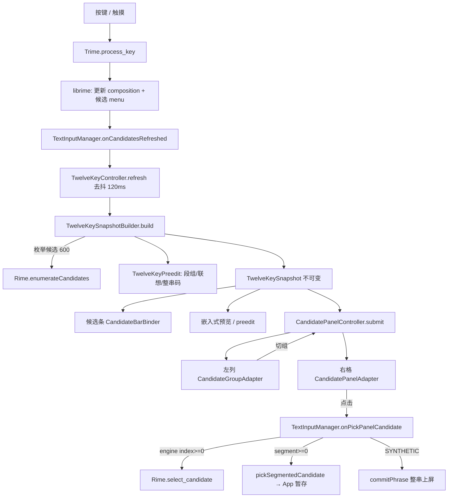

# 17 展开面板（候选面板）开发文档

> 本文说明 **12 键展开面板** 当前的代码面貌：数据从哪来、按什么规则组装/排序、点击之后发生什么、
> 哪些地方有性能陷阱、怎么观测、改哪里、改完验收什么。
>
> 面板是 12 键体验的核心：**候选条只给 12 条**，其余全部靠面板；面板一慢、一行错位，用户马上就骂。
> 所以本文把「不变量」写成硬约束（§11），把踩过的坑写成清单（§13），改动前请先读这两节。
>
> 适用范围：`hakka_jiugong`（12 键）方案；26 键/其它方案走同一条快照管线，但分组语义不同（见 §10.7）。
>
> 最后更新：2026-11-11（对应提交 `bb0dfd5` 之后的工作树）

---

## 1. 设计原则（先看这五条）

1. **一次按键 = 一份不可变快照**：`TwelveKeySnapshot`。候选条、展开面板、嵌入式预览、preedit
   全部只读同一份快照 —— 任何一处「自己去问引擎」都会造成两套 index 的错位（历史 bug：候选是第一页的、
   预览是引擎第 0 条）。
2. **面板关着就不建分组**：`wantGroups=false` 时 `groups` 恒为空。判断「有没有候选」**必须**用
   `snapshot.hasCandidates`（`barEntries || groups`），不能用 `groups.isEmpty()`。
3. **面板不碰引擎**：面板只画快照、只回调「点了哪条」。选中/上屏/学习都在 `TextInputManager`
   （必要时走 `Rime.select_candidate`）。
4. **重活不进面板路径**：分组组装里禁止出现 O(n²) 的大列表合并、禁止无上限的字符串拼接日志。
   面板构建是主线程可见的操作，卡 200ms 用户就觉得「点不动」。
5. **数据源只有一个入口**：App 侧字典/词表统一走 `core/RimeDictSource.kt`（共享目录优先、
   assets 兜底、展开 `import_tables`）。**不要**再直接 `assets.open("rime/xxx.dict.yaml")`。

---

## 2. 文件清单

| 文件（`app/src/main/java/com/hazukieq/hkrime/…`） | 职责 |
|---|---|
| `core/twelvekey/TwelveKeyModels.kt` | 数据模型：`CandidateItem`、`SyllableGroup`、`Fallback`、`TwelveKeySnapshot`；常量 `SYNTHETIC_SEGMENT=-2`、`RECOMMEND_SEGMENT=-3` |
| `core/twelvekey/TwelveKeySnapshotBuilder.kt` | **快照组装**：枚举候选 → 候选条排序 → 段组/联想/多音节词典词行 → 面板分组排序 → preview/inlineText/fallback |
| `core/twelvekey/CandidateRanking.kt` | 纯函数排序/合并：`rankBar`、`fullBarOrder`、`mergePhraseCandidates`、`rankPanelItems`、`groupCandidates`、`orderGroups`、`rankWithLearning`（合并/排序已统一到 `PanelRow.kt` 的 `mergeRows → collapsePrefixRows → tierAndSort → capRows`） |
| `core/twelvekey/TwelveKeyController.kt` | 异步刷新（协程 + 去抖 120ms）、快照缓存（8 条 LRU + `engineVersion`）、兜底重试（90ms ×3）、`selectCandidate` 转发 |
| `core/twelvekey/CandidatePanelController.kt` | 面板视图控制：`toggle()` / `submit()` / `show()` / `hide()`、`activeGroup` 保持、「推荐」落第 0 组 |
| `core/twelvekey/TwelveKeyTuning.kt` | **所有产品策略常量**（配额/上限）集中地，每个常量都写了「调大调小的后果」 |
| `core/twelvekey/PhraseMemory.kt` | App 侧合成候选：逐段拼出来的词、Beta-Binomial 曝光/点选打分、清理 |
| `core/twelvekey/SegmentMemory.kt` | 逐段选字的用户偏好（字分数 `charScore`） |
| `core/twelvekey/SelectionMemory.kt` | 候选条学习（选中即提升） |
| `core/TwelveKeyPreedit.kt` | 12 键码↔音节表、字典/词表解析、段组音節/字表、联想索引、**整串码前缀索引**、preedit 渲染 |
| `core/RimeDictSource.kt` | 字典文件统一入口（共享目录 > assets，展开 `import_tables`，跳过 YAML 头） |
| `ime/text/CandidateGroupAdapter.kt` | 面板左列（读音/推荐）列表 |
| `ime/text/CandidatePanelAdapter.kt` | 面板右格（候选网格） |
| `ime/text/CandidateBarBinder.kt` | 固定候选条渲染 |
| `ime/text/TextInputManager.kt` | 面板回调落地：`onPickPanelCandidate`、`resolveEngineIndexForSegment`、`resegmentAndSelect`、`pickSegmentedCandidate`（App 暂存逐段选字）、`commitPhrase`（合成候选）、pending/退格 |
| `util/DiagLog.kt` | **面板排查用**：直写 `<userDataDir>/logs/diag.log`，不经 Timber 轮转 |

---

## 3. 数据流总览



要点：

- **主线程不做枚举**：`refresh()` 在 `Dispatchers.Default` 里建快照，`withContext(Main.immediate)` 再 `emit`。
- 快照带缓存：`cacheKey = input|wantGroups|…|engineVersion`，命中直接复用；`onEngineChanged` 时
  `invalidateForEngine()` 让旧缓存失效（否则会一直看到「上一次引擎状态」的候选）。
- 预览文字（`previewText`/`inlineText`）在快照里算好，候选条第 0 条与预览**同源**。

---

## 4. 数据模型

### 4.1 `CandidateItem`

| 字段 | 含义 |
|---|---|
| `text` | 候选文字（词面） |
| `comment` | 读音（librime `spelling_hints` 打开时是精确拼音；可能带 `［］`，由 `cleanComment` 剥） |
| `index` | librime menu 的**全局下标**；`-1` = 不是引擎候选（段组/联想/合成） |
| `segment` | 见下表 |
| `restCode` | 点了之后要重新喂回引擎的剩余码（段组/合成用） |

### 4.2 `segment` 语义（判断「点击走哪条路」的唯一依据之一）

| 值 | 含义 | 点击行为 |
|---|---|---|
| `-3` (`RECOMMEND_SEGMENT`) | 面板「推荐」组（`SyllableGroup.segment` 专用） | 与普通候选项同：按 `index`/`segment` 分发 |
| `-2` (`SYNTHETIC_SEGMENT`) | App 侧合成候选（`PhraseMemory` 学的整串词） | `commitPhrase`：整串上屏 + 记学习；**不进引擎** |
| `-1` | 普通引擎候选（`index>=0`）或联想词（`index=-1`，`segment=-1`） | `index>=0` → `select_candidate`；联想词 → 整词上屏 |
| `>=0` | 段组的字典单字（按段选字） | `pickSegmentedCandidate`：本字进 App 暂存 + 剩余码回引擎 |

### 4.3 `SyllableGroup`

`reading` 是左列显示的文字（精确读音；「推荐」组为空串），`syllables` 是拆分后的音节
（**排序要用它**），`items` 是该读音下的全部候选，`segment` 见上表。

**不变量**：`reading` 相同 ⇒ 必须只有一行（同读音的行要合并，见 §6 的 `mergeRows`）。

### 4.4 `TwelveKeySnapshot`

| 字段 | 说明 |
|---|---|
| `input` / `consumedEnd` / `remaining` | librime 原始码串、已消费前缀字节数、未消费码串（面板都用 `remaining`） |
| `groups` | 面板左列（含第一行「推荐」）；面板关闭时为空 |
| `barEntries` | 候选条 12 条（**选单顺序**，不是第 0 组） |
| `recommend` | 「推荐」组内容 = **全部联想词**（候选条同一套顺序，≤`RECOMMEND_WORDS`=20；单字不进） |
| `fallback` | 引擎与字典**都没有**候选时的字母兜底（如 `qqqq`） |
| `previewText` / `inlineText` | 嵌入式预览：候选条第一条 / 已选前缀 + 第一条 |
| `hasCandidates` | `barEntries.isNotEmpty() \|\| groups.isNotEmpty()` —— **判断有没有候选只能用它** |

---

## 5. 候选条（固定 12 格）

`CandidateRanking.rankBar(ranked, barSize=12, wordSlots=4)`：

1. 先 `distinctBy { it.text }`（候选条不显示读音，同文字即重复；面板仍按读音分组保留）；
2. 取前 4 条「词组」（`isCjkWord` / 多字符），剩下 8 格给单字（`isSingleCjkChar`）；
3. **特例**：完全没有单字时，词可占满 12 格（用户 2026-11-11：「under no any single exist,
   words could be fully in the horizontal bar」）；反之绝不「用词补满」。
4. 候选条之外的续页 → `recommend`（`fullBarOrder(...).drop(barEntries.size).take(36)`），
   注意是**补集**：不能写成 `fullBarOrder.drop(12)`，否则被 4 条词配额挤掉的第 5..N 个词会一起丢。

`barEntries` 的两个来源：

- 正常：`barList(ordered)`（引擎选单顺序，叠加 `SelectionMemory`/`PhraseMemory` 排序）；
- **字典兜底**：引擎 0 条而字典段组有货（`ee5` 这种码串）→ 用段组第一段的候选拼候选条，
  不能退成字母（见 §13-6）。

---

## 6. 面板组装顺序（`TwelveKeySnapshotBuilder.build`）

```
1. 取 input / consumedEnd / remaining（consumedEnd 来自 context 段状态）
2. 枚举引擎候选（MAX_CANDIDATES=600）→ flat
3. ordered = rankWithLearning(flat)              // 覆盖深度 + 学习分 + 引擎顺序
4. engineGroups = engineGroupsOf(ordered)        // 面板左列的「引擎读音组/词组」（wantGroups 才建）
5. panelRows = buildPanelRows(remaining, anchor, engineGroups, includePanelOnlySources)
      五源：SYNTH_SINGLE / SPLIT_SINGLE / ASSOC / INITIAL_COMBO / WHOLE_WORD   // §7.1 / §7.2 / §7.5 / §7.4
6. panelRows = mergeRows(panelRows)              // 唯一合并点（同读音一行）
7. panelRows = collapsePrefixRows(panelRows)     // 多音节行按最长已有前缀收敛
8. panelRows = tierAndSort(panelRows)            // 分档 + 档内字典序（§8）
9. panelRows = capRows(panelRows, MAX_GROUPS)    // 超额先丢 INITIAL_COMBO
10. groups   = panelRows.map { it.toSyllableGroup() }   // 投影（sources 丢弃）
11. barEntries = barList(ordered) | 字典兜底（§5）
12. recommend = recommendWords(ordered, panelRows.filter { it.segment == 1 })  // §7.6
13. groupsWithRecommend = 推荐行(若有) + groups
14. previewText/inlineText/fallback
15. 返回不可变 TwelveKeySnapshot
```

顺序不能随便调：五源拼接顺序固定「段組 → 引擎 → 聯想 → 組合 → 詞行」（決定同讀音合併時誰的
`segment`/`items` 在前），`collapsePrefixRows` 必须在 `tierAndSort` 之前（否则多音节行会被拆成两档）。

---

## 7. 分组的数据来源

> **2026-11-11 重构后：面板左列 = 五源流水线**（docs/19）：
> `SYNTH_SINGLE / SPLIT_SINGLE / ASSOC / INITIAL_COMBO / WHOLE_WORD` 五个纯函数 →
> `mergeRows`（唯一合并点）→ `collapsePrefixRows` → `tierAndSort` → `capRows`。
> 每源都不自己排序/去重；`RowSource` 只用于 `diag.log` 统计，投影成 `SyllableGroup` 时丢弃。
> 下面的 7.1 / 7.2 / 7.4 / 7.5 是各源规则。

### 7.1 段组（`SYNTH_SINGLE` / `SPLIT_SINGLE`，`TwelveKeySnapshotBuilder`）

目标：把「当前待选段」的所有合法读法 + 每个读法的全部字列出来。

- 把 `remaining` 去 `'` 后，先试「整串是一个音节」（`we`=the），再按 `splitHeads` 拆首段；
- 每种切法给一段配额：普通键 16、音节丰富的键 24（`SEGMENT_SYLLABLE_LIMIT(_RICH)`），
  备选切法减半（`SECONDARY_SPLIT_DIVISOR`）；
- **段码恰好是一个完整音节时只列该音节**（`headIsCompleteSyllable` → `syllablesForSegment(exactOnly=true)`）：
  `4i` 只给 `mi/mh/ni/nh`（4 组）、`ea` 只给 `fa/da`（2 组）、`74` 只给 `po/so`；
  不再展开 `mia/min/miang…` 这些「同前缀但更长的音节」（用户 2026-11-11：理论上是噪音，
  那些音节要打更多键才会命中）。只有「码只是前缀」（`7` = p/s，没有一个完整音节）时才做前缀展开；
  若 exact 为空会自动回退到展开，避免段组直接空掉。
- 每个音节 → `charsForSyllable(syllable, SEGMENT_CHARS_LIMIT=1000)`（**列全部字**，
  用户 2026-11-11：「要罗列完整，除非数量大到影响性能」；实测最大音节 `ji` 122 字、
  `ki` 83、`fu` 76 —— 用 `tools/panel_probe.py chars ji` 可复现）；
- 每项 `segment=0`、`restCode=rest`（点了之后剩余码回引擎，面板接着列下一段）。

### 7.2 联想行（两音节，`ASSOC` 源）

**选行规则（2026-11-11 起，与 `tools/panel_probe.py` 的 `assoc_buckets` + `pick_bucket_rows` 同构）：**

1. **按首字母序列匹配，不按碼前綴**（2026-11-11 改，用戶：「必須走首字母序列匹配，不是碼前綴；
   碼前綴等於把元音釘死為 a/b/c」）：每個切法只看**該段第一個碼位**的首字母集合——
   `ee` → {d,f}、`5` → {k,l}；第一段音節 = 這些首字母打頭的全部字典音節（元音自由：da/dai/dang/di/de…），
   第二段同理（`5` → {k,l}：ka/ke/ki…），再用 `(第一音節, 第二音節)` 查聯想索引。
   只有一段（沒有剩餘碼）時仍按碼前綴展開，列出該音節的全部後續音節（維持原行為）。
2. 命中的行按 **（第一音節首字母, 第二音節首字母）** 分桶，桶內按「詞數降序 → 讀音字典序」排；
3. 跨桶輪轉：同一「第一段首字母」組內各桶先第 1 行、再第 2 行…，組與組之間再輪轉；
4. 總行數上限 **`ASSOC_BUCKET_ROW_BUDGET = ASSOC_MAX_ROWS × 3 = 12`**（用戶 2026-11-11 拍板：
   保留 App 富聯想 + 照腳本字母序 + 放開到 12 行；舊「每輪 ≤4 行」只適用於未分桶的舊實現）。

**行內詞**：每個 `(第一音節, 第二音節)` 桶取詞表熱度前 `ASSOC_WORDS=6` 條；行標題永遠是兩個完整讀音
（禁止 `than d**` 這種通配寫法）。

#### 7.2.0 只认**客家话音节集合**（2026-11-11 定）

**运行时（App）只用主词典音節集合**——用户 2026-11-11 定调：
「實際上 hakka 字典沒有的音節，注定不會有字，所以為了減少性能消耗，默認獲取 hakka 字典的音節集合」。

- App：`finishLoading(counts)` 里 `syllableSet = counts.keys`（`hakka.dict.yaml` 的「字→讀音」）；
  `loadWordLines()` 用它校驗詞表讀音，含集合外音節（`li xing` 的 `xing`）的詞條整條丟棄。
  **不再讀任何音節集資產**（少一次 asset 讀取+解析）。
- **標準集（定稿 841 個）= `app/src/main/assets/rime/hakka_syllables.txt`**：
  JS 源檔 787 ∪ `hakka.dict.yaml` 694（用户：「字典并入后的就是标准集」；JS 漏收 `ji` 等 55 個屬人為遺漏）。
  它的用途是**約束腳本與測試**，不是 App 運行時數據源：
  - `tools/panel_probe.py` 的詞表校驗與 App 同口徑（詞典音節），`selftest` 斷言「詞典音節 ⊆ 標準集」；
  - `build-syllables` 可從 JS 重新生成（JS ∪ 詞典 ∪ 可選補遺）；
  - 審核記錄：`docs/18-dict-only-syllables.md`（55 個詞典獨有音節，已審核結案；`nziamm→nziam`、`lod→lot` 已修）。
- 实测词表里仍在词典音節集之外的只有 7/1456 条（0.48%，`cn`、`打`、`hop` 之类）。
#### 7.5.00 首字母组合的规则（元音不固定；`.*` = ≥1 个字母）

**记号约定**：本文/脚本里的 `g.*`、`g·b` 中的每个字母都隐含「**后面至少还有 1 个字母**」——
`g.*` = 以 `g` 开头、长度 ≥2 的音节（`ga`、`gam`、`gong`…都算）；`b.*`、`z.*` 同理。
`g·b` 是两个音节的首字母序列（第 1 音节 `g.*`，第 2 音节 `b.*`），**不是**一个音节里的两个字母。

**首字母序列的长度 = 读音的音节数**，和「N键组合」的 N（= 已按的键数）不是一回事：

- `g·z` = 两个音节（如 `ga zi` 挂纸）；
- `g·b·z` = 三个音节（如 `gau boi z…` 这类三音节词）；
- 所以「`g·b·z` 推出 `挂纸 ga zi`」是**错误理解**：挂纸的首字母序列是 `g·z`（两音节），
  它出现在 3 键阶段是因为它的**码串** `ia8i` 以已打的 `ia8…` 开头（整串词行/码前缀匹配），
  与 `g·b·z` 这个三音节组合无关。脚本会给联想行/整串词行标注方括号 `[g·z]` 以示区分。

#### 7.5.00 首字母组合的规则（元音不固定）

用户 2026-11-11：「`ghi+abc` → `g b / g c / h b / h c` 4 个通配联想词组」「明明 g z 是首拼！
可没说过元音固定是 a！`g.* z.*` 看懂了没」。

- 首字母拼 = **一个键一个音节**：每个键只约束「该音节的首字母集合」，元音完全自由；
- 每键的首字母集合 = 该键字母里**能作音节首字母**的字母（元音 `a e i o u` 不作首字母）：
  `ghi→{g,h}`（i 排除）、`abc→{b,c}`（a 排除）、`zj→{z,j}`、`th→{t}`、`nz→{nz}` …
- 组合数 = 各键集合的笛卡尔积：`ia` → 4 组 `g b / g c / h b / h c`；`ia8` → 8 组 `(g|h)(b|c)(j|z)`；
- **组合是规则层的东西，和词条存不存在无关**：脚本 `syllables` 在**每个累积阶段**都打印组合
  （2 键→4 组、3 键→8 组、4 键→16 组、5 键→32 组；组数 = 各键首字母集合大小之积），
  末尾再给整串的一份「一行一組」清单（`g·b·j·g·r  → 0 詞`，点号分隔同组字母、附命中词条数）；
- **`r` 只在最后一键出现**（儿化后缀规则）：非末位按键不贡献 `r`，所以 5 键时末键 `vur` 给 `{r,v}`、
  其余 `vur` 不给 `r`；
- 行去重：同一读音可能同时来自联想行与词行，面板只有一行，脚本也只列一行（`collapse()` 先去重再收敛）；
- 联想**行标题仍然是具体读音**（`gang bung`、`han coi`…），查词按「读音首字母序列」匹配，
  **不是按码串前缀**——早期实现用码前缀展开，等于把元音钉死在 `a/b/c`，是错的。
  2026-11-11 起 `ASSOC` 源也遵循这条：`ee5` 的第一段不再只出 `de/den/det/fen/feu`（元音=e），
  而是 {d,f} 打头的全部音節 × {k,l} 打头的第二音節。
- 合成音节是另一条路：码串恰好是某个完整音节（`ia` = `ga`/`ha`）时，走单字组（`ga`、`ha`）。

#### 7.5.0 特殊规则：儿化后缀 `r` 只能出现在词尾

用户 2026-11-11：「关于 r，这是一个儿后缀的读音。所以它默认不做首字母拼，只能出现在后面，这是特殊规则」。

- `r` 在标准集里（`r` 也是 `儿` 的读音），但属**后缀音节**（`TwelveKeyPreedit.SUFFIX_ONLY_SYLLABLES`）；
- **不参与首字母简拼展开**：不能当第一段/中间段的音节候选（`syllablesForSegment(..., allowSuffixOnly = false)` 会滤掉）；
- **只能当这次输入的最后一个音节的候选**：`TwelveKeySnapshotBuilder.splitParts()` 用 `allowSuffixOnly = rest.isEmpty()` 判断，
  本地解码 `decodeSpans()` 里也要求 `i + len == input.length` 才允许 `r`；
- 例：`到下儿 = dau ha r`（码 `ea3ia3`）第一段只给 `dau/fa/da`，打到最后 `3` 时面板才给 `r`；
  `r` 夹在中间（如码 `35i`）时既不展开也不会被本地解码切成 `r + li`；
- 脚本同名实现：`panel_probe.py` 的 `SUFFIX_ONLY_SYLLABLES`/`syllables_for_segment(allow_suffix_only)`，
  `selftest` 有 3 条断言（最后一段出现、非结尾不出现、真实词 `dau ha r` 第一段不含 r）。

> 范围提醒：本节所有规则**只对客家话音节集合内**的音节成立（见 §7.2.0）。别家方案的读音既不加载、也不参与任何展开。

> 用户 2026-11-11 的要求：**拼音规则必须清晰**。下面是当前实现的完整规则，改任何一条都要同步
> `tools/panel_probe.py` 与本文档，并跑 `panel_probe.py selftest`。

#### 7.5.1 键位 → 字母组

| 键（键面） | 码 | 覆盖字母 | 键（键面） | 码 | 覆盖字母 |
|---|---|---|---|---|---|
| `abc` | `a` | `a b c` | `nz` | `y` | `n z` |
| `def` | `e` | `d e f` | `th` | `w` | `t h` |
| `ghi` | `i` | `g h i` | `ng` | `1` | `n g` |
| `kl` | `5` | `k l` | `mn` | `4` | `m n` |
| `ps` | `7` | `p s` | `qt` | `9` | `q t` |
| `vur` | `3` | `v u r` | `zj` | `8` | `z j` |

实现：`TwelveKeyPreedit.keyLetters`（源码唯一来源）。

#### 7.5.2 音节拼写 → 码串（`codeOf`）

顺序执行三条变换，再按上表逐字母换成码：

1. `nz**` → `y**`；`th**` → `w**`；`ng**` → `1**`（三个双字母声母单独规则）；
2. `(字母)o` → `(字母)4`、`(字母)u` → `(字母)3`（介音跟在声母后时并入前一位）；
3. 逐字母映射（`a/b/c→a`、`d/e/f→e`、`g/h/i→i`、`k/l→5`、`m/n→4`、`p/s→7`、`v/r→3`、`z/j→8`、`q/t→9`）。

例：`li → 5i`、`nak → 4a5`、`si → 7i`、`Linux(li nak si) → 5i4a57i`、`thok → w4…`、`ngin → 1i4`。

#### 7.5.3 段码 → 面板左列的音节（当前规则）

设用户输入的**本段**码为 `C`（多段时是 `remaining` 的某一段）：

1. **整段恰好是一个音节码**（存在音节 `s` 使 `codeOf(s) == C`）：
   **只列这些音节**（`exactOnly=true`）。例：`4i`→`mi/mh/ni/nh`、`ea`→`da/fa`、`74`→`po/so`。
   理由（用户 2026-11-11）：音節已经打全，再列 `mia/min/miang…` 是噪音，那些音节要打更多键。
2. **整段只是一个前缀**（没有任何音节码等于它）：按**前缀展开**列出以 `C` 开头的所有音节，
   两级分桶（外层「下一码位」、内层「音节首字母」）轮转选取，避免某个首字母占满；
   配额：普通键 16、音节丰富的键 24（`SEGMENT_SYLLABLE_LIMIT(_RICH)`，丰富 = 该码覆盖 ≥16 个音节）；
   例：`7`→`pa/pai/pak/…`（ps 键），`e`→`da/dai/…`。
3. **多切法**（`splitHeads`）：额外给出「head 恰为完整音节」的切法（最多 2 种，由长到短），
   备选切法配额减半（`SECONDARY_SPLIT_DIVISOR=2`）。例：`74ii` → `74i|i`（poi/soi）+ `74|ii`（po/so）；
   一个切法都切不出时退化为「首码 + 其余」（`855` → `8|55`），让面板至少能列首字母对应的音节。
4. **简拼的语义**（用户 2026-11-11 的规则说明）：
   lio 引擎允许「每个音节只打首字母」——通配写法是 `m** g**`、`m** h**`、`n** g**`、`n** h**`；
   **但展开面板里必须给出具体音节**（`man/mau/men…` 这些由 `m**` 展开出来的真实音节），
   不能显示通配。这就是 §7.5.3-2/3 在做的事：通配在候选条/引擎里生效，面板负责把它「具体化」。
5. `exact` 为空时自动回退到前缀展开（防止某个段组变空）。

配额与总数上限：`limit` 是该切法里每个首字母的最小名额，总数再受
`totalCap = max(limit, min(limit × 桶数, MAX_SYLLABLES_TOTAL))` 约束（`MAX_SYLLABLES_TOTAL = SEGMENT_SYLLABLE_LIMIT`）。

### 7.4 多音节词典词行（`wordsByCodePrefix`，2026-11-11 新增）

背景：旧联想索引只按**前两个音节**建 key，`Linux / li nak si` 这种三音节词打到第三键（`li nak s`）
永远查不到。现在另建「整串码」表：

- `TwelveKeyPreedit.wordCodeEntries`：**只收词表自带读音的条目**（`词\t读音[ \t权重]`），
  `code = Σ codeOf(音节)`（`Linux` → `5i4a57i`）；
- 数据量：真机全词表约 **1447 条**（**绝不能**把纯词表反推的两音节条目也塞进来：会到 17.6 万条，
  加载 1s→18s、内存暴涨，是 2026-11-11 面板「分组全消失」的直接原因）；
- 查询 `wordsByCodePrefix(codes)`：`entry.code.startsWith(输入码)` → 天然支持任意音节数、简拼、
  半截末节（`5i4a57` 命中 `5i4a57i`）；
- 组装：`WHOLE_WORD` 源走**轻路径**（只查表 + 拼行），与其它源一起交给 `mergeRows` 合并
  （整串词行按大小写不敏感去重，其余来源按精确文字）——与其它源一起交给 `mergeRows` 唯一合并点，避免两套合并逻辑漂移；
- **并入时按「最长已有前缀读音」找行**：`ko thiau fa` 若已有 `ko thiau` 行，就作为该行的候选，
  不再单独起一行（整串码本来就是「开头相同匹配」，长词单开一行会看起来像两个 list；
  用户 2026-11-11 指出）；只有没有任何前缀行匹配时，才用完整读音新建一行。

---

### 7.6 推荐组（`recommendWords`，2026-11-11 改）

推荐组 = **全部联想词的排序显示**（用户 2026-11-11：「推薦那裡的顯示的詞語，改為所有聯想詞語的排序顯示
（按照候選條顯示的算法來做），數量取至多 20 個」）：

1. 引擎/学习候选先走 `CandidateRanking.fullBarOrder`（与候选条同一排序），只留 **CJK 词**（单字不收）；
2. 再接面板词行（`panelRows.filter { it.segment == 1 }`）的全部 `items`——`ASSOC` / `INITIAL_COMBO` /
   `WHOLE_WORD` / 引擎词行，**ASCII 词（如 `Linux`）也收**；
3. 按文字 `HashSet` 去重（引擎项优先保留 `comment`/`index`），`take(RECOMMEND_WORDS=20)`；
4. 渲染为 `segment = RECOMMEND_SEGMENT` 的组，插在左列第 0 位（`CandidatePanelController` 只按
   `group.segment` 判断，不参与五源流水线）。

旧实现（候选条续页、`RECOMMEND_ITEMS=36`）已删除。

## 8. 左列排序（当前规则）

比较器（`TwelveKeySnapshotBuilder.build` 末尾）：

1. **分档只看「读音」的音节数**（`reading.split(' ')` 计数）：
   1 个 → 0 档；≥2 个 → 1 档；`reading` 为空串 → 2 档（「推荐」组例外，固定第一行）。
   注意 `BLANK_READING`（`…`）是一个**非空 token**，所以无读音的引擎组实际落 **0 档**、
   用首候选的字典读音参与排序——这是重構前 `readingSyllableCount` 的真实行为，
   2026-11-11 重構後照舊保留（不採「无读音→2 档」的舊文檔說法）。
   **不要用 `syllables.size`**：引擎组的 `syllables` 只是 `listOf(reading)`（1 个元素），
   `ka then` 这类两音节词会被误判成单音节混进 0 档（2026-11-11 的 `ko thiau` / `ko thiau fa` 分段问题）；
2. 档内：`reading.lowercase()` 字典序；
3. 再同：首候选文字字典序。

历史教训：曾把「App 联想行」和「引擎词组」分成两档，导致同为 `li…` 的多音节行被劈成两段，
`li nak si` 落在单音节与引擎词组之间的夹缝里（用户：「为什么我没有在 li na 后面找到」）。
**同是多音节行必须同档按字母排。**

---

## 9. 点击链路（面板 → 上屏）

`CandidatePanelController.gridAdapter` 的回调 → `TextInputManager`：

1. **引擎候选**（`index >= 0`，`segment < 0`）：`Rime.select_candidate(index)`；若之后没有 commit buffer
   （逐段选字的第一段），记 `uncommittedPrefix`；
2. **段组单字**（`segment >= 0`）：
   - 先 `resegmentAndSelect`：在合适位置插 `'` 重新分段（`88` → `8'8`）再 `resolveEngineIndexForSegment`，
     命中就走原生 `select_candidate`（选中不提交、全选完才上屏、退格可悔、学习走 librime）；
   - 引擎里没有这个字 → App 兜底 `pickSegmentedCandidate`：把字**暂存**在 `pendingPick`（不上屏），
     剩余码 `Rime.onText(rest)` 喂回引擎；**最后一段**才 `flushPendingPick()` 一次性上屏；
   - 退格优先撤 `pendingPick` 的最后一个字；
3. **合成候选**（`segment == SYNTHETIC_SEGMENT`）：`commitPhrase` = flush pending → 并入引擎已选前缀 →
   `commitText` 整串 → `PhraseMemory.bumpPicked`；
4. **联想词**（`segment == -1` 且 `index < 0`）：`pickAssociationWord` 整词上屏。

面板打开期间：`activeGroup` 落第 0 组（「推荐」）；连续消费时若当前 reading 仍存在就保持，
否则回第 0 组；只有「点左列切组」才把右格滚到顶。

---

## 10. 交互与状态

### 10.1 打开/关闭

- `▼`：`toggle()`。没有候选（`!hasCandidates && fallback == null`）时收起键盘，不开面板；
- 关闭：`hide()` 清空两个 adapter，`lastInput=null`；键盘重新可见；
- 输入清空（退格到空）时面板自动收起（上层判断 `snapshot.isEmpty`）。

### 10.2 刷新

`submit(next)`：每次按键/上屏后由上上层调用，整个面板只读这一份快照；DiffUtil 原地更新，
**不主动 scrollToPosition(0)**（避免跳顶/闪屏）。

### 10.3 兜底（`fallback`）

- 只有「引擎 0 条 **且** 字典段组也空」才显示字母兜底（如 `qqqq`）；
- `TwelveKeyController` 会做最多 3 次 90ms 的重试（`MAX_FALLBACK_RETRIES`）；
  历史上无限重试会一直抢引擎锁 → 面板点不开。

### 10.4 preedit 与候选条的一致性（面板相关）

- preedit = 候选条**第一条**的 `comment`（读音）+ 未覆盖的原始码（`TwelveKeyPreedit.render`）；
- 尾码边界用「comment 音节逐个吃掉输入前缀」，最后剩余码**原样**补上（不能吞键、不能拼凑）；
- 面板/候选条/preedit 必须同源（同一份快照），否则会出现「开面板才变」的诡异现象。

### 10.5 面板内退格

面板展开时键盘被盖住，右下角有退格按钮；它与键盘退格走同一条 `onKey(KEYCODE_DEL)` 逻辑。

### 10.6 曝光计数（合成候选评分）

面板打开时，`collectPhraseExposure` 会把「露过面但没点」的合成候选记一次 `noteShown`
（候选条必计；面板打开时 groups 也计），用于 Beta-Binomial 降权与自动清理。

### 10.7 非 12 键方案

26 键等方案也复用 `CandidatePanelController` 与同一份快照结构：快照由 `TextInputManager`
现算 `submit` 进去，分组语义（`segment`、排序档）与 12 键一致，但**不产生**段组/整串码词行
（那些依赖 12 键码表）。

---

## 11. 不变量（硬约束，改代码前逐条对照）

1. **同读音 = 一行**：任何来源的行（段组/联想/首字母组合/引擎/多音节词典词）合并后，
   `reading` 不得重复（`reading.lowercase()` 为 key）；行内 `text`：整串詞行（`WHOLE_WORD`）
   不分大小写去重，**其余來源用精確文字**（引擎同時給 `J`/`j`，小寫去重會吞掉大寫候選）。
2. **面板关着时 `groups` 必为空**；「有没有候选」只看 `hasCandidates`（= `barEntries || groups`）。
3. **候选条 / 面板 / preedit / 嵌入式预览 同源**：都从同一份快照取值，禁止另行访问引擎。
4. **一次按键 = 一份快照**；快照不可变，发布后不再修改。
5. **主线程不建快照**；建快照路径里不得有无限循环、不得有 O(n²) 的大列表操作。
6. **配额常量只在 `TwelveKeyTuning` 改**，且改完要在真机看左列高度与滚动距离。
7. **段组列字要全**（`SEGMENT_CHARS_LIMIT=1000`）；面板右格是 RecyclerView，懒加载。
8. **点击语义只由 `index` + `segment` 决定**（§4.2），不要在 adapter 里另加分支。
9. **来源不外显**：`RowSource`/`PanelStats` 只进 `diag.log` 與 `twelvekey:build`，
   `SyllableGroup` 字段不變、UI 不可觀察到「這行來自哪一源」。
10. **`INITIAL_COMBO` 走首字母序列匹配**（`[g,b]` → `gang bung`），不是碼前綴：
   組合數受 `INITIAL_COMBO_PATTERN_LIMIT=64` 封頂，任一鍵沒有可用首字母 → 整組跳過。
11. **兩份實現必須同步**：App（Kotlin）與 `tools/panel_probe.py`（Python）是同一規則的兩份實現，
   `PanelGoldenTest` 讀 `app/src/test/resources/panel-golden.json` 逐源/merged 對拍，改規則要一齊改並重生成 golden。
12. **聯想行（`ASSOC`）按首字母序列匹配，不是碼前綴**：每個切法只看該段第一個碼位的首字母集合
   （`ee`→{d,f}、`5`→{k,l}），音節候選 = 這些首字母打頭的全部字典音節（元音自由）；
   只有一段（無剩餘碼）時才回退碼前綴展開。改這條必須同步腳本並重生成 golden。

---

## 12. 性能与预算（实测）

| 场景 | 实测 | 备注 |
|---|---|---|
| 面板构建（`groups≈17`） | ~30–70ms | 12 键常见输入 |
| 面板构建（`groups≈215`） | ~150ms | 长输入/多切法；仍是可接受上限 |
| 词表加载（`assoc`） | ~1.1–1.4s（后台线程） | 整串码表只收带读音条目后从 18s 降回来 |
| 候选枚举 600 条 | ~1ms 级 | `op=engine` |
| 按键快照（候选条） | p90 ≈ 30–60ms | `tools/perf-gate.py` 门禁 |

红线：

- **不要把几百行的列表绕开 `mergeRows` 另起一套合并**（§11.6：合并/去重/分档/截断只有一条链；
  旧 `panelGroups` / `mergeAssociationGroups` 已删）。新增来源请按 §7.4 的
  「轻路径 + 最后并入排序」写法，源函数只选行、不做跨源去重/重排。
- 日志不要在主线程拼超长字符串（几百个组 + 每个组的候选）；诊断用 `DiagLog`，只打摘要。

---

## 13. 已知坑清单（血泪版，按踩坑时间）

1. **权重栏污染读音**：`hakka_zon.dict.yaml` 是 `词\t读音\t权重`，旧解析取「第一个 TAB 之后全部」，
   最后一节变成 `si\t1000` → 整串码对不上 → 面板查不到 `Linux`。现在只取第 2 列 + 过滤非字母。
2. **18s 加载 / 内存暴涨**：把纯词表（无读音）也塞进整串码表，条目 1447 → 176030。现在只收带读音条目。
3. **`groups` 判断候选**：面板关着 `groups` 恒空，用它判断会让每一帧都走兜底（`deek`/原码显示）。
4. **无限兜底重试**：90ms 无限重试抢引擎锁 → 面板点不开。现在上限 3 次。
5. **分档把多音节劈成两段**：联想行单独一档 → `li nak si` 不在 `li na` 后。现在按音节数分档。
6. **引擎 0 候选被误判成 bug**：`ee5` 在真实词库里真的没有候选（`RimeCandidateListBegin` 返回 false，
   因为 `!ctx->HasMenu()`）。现在候选条改用字典段组，只有字典也没有才显示字母。
7. **同读音重复行**：`deepseek` 在用户词典里两条读音（`di si`/`di thok`），引擎一行 + 多音节词行一行
   → 两行一模一样。现在 `mergeRows` 按读音合并、行内去重。
8. **`ConcurrentModificationException`**：词表在后台线程边读边加，按键线程遍历同一个 `ArrayList`
   → 整轮面板组装（`buildPanelRows`）抛异常、全部组消失。现在 `finishWordIndex` 发布不可变
   `@Volatile wordCodeIndex`，查询只读快照。
9. **`‸` 光标被当成前缀**：`getCompositionPrefix` 曾把 preedit 末尾的 `‸` 一起当已选前缀，
   导致输入框出现 `88˄以`。现在 `compositionPrefix` 只保留非 ASCII 且非 `‸` 的字。
10. **面板构建里做重合并**：见 §12 红线。

---

## 14. 观测与排障

### 14.1 `diag.log`（首选）

`util/DiagLog.kt` 直写 `<userDataDir>/logs/diag.log`（默认 `/sdcard/hkrime/logs/diag.log`），
**不经 Timber、不会被 2MB 轮转切走**，每次进程启动清空。当前每次快照构建都会写：

```
HH:mm:ss.SSS D/snapshot[thread] build code=5i4a57 wantGroups=true groups=215 bar=12 prefixWords=1 \
  prefixIdx=48 all=[推荐,di,dia,…,di nak si,ka go,…]
```

字段含义：

| 字段 | 含义 |
|---|---|
| `code` | librime 原始输入码 |
| `wantGroups` | 这次是否建分组（面板关着 = false） |
| `groups` | 左列组数（含「推荐」） |
| `bar` | 候选条条数 |
| `prefixWords` | 命中的「整串码多音节词行」数 |
| `prefixIdx` | 这些行在最终左列里的下标（`-1` = 没进列表） |
| `all` | 左列各行 reading（「推荐」显示为中文） |

排障顺序：**先看 `prefixWords`/`prefixIdx`/`all`**，再看屏幕顺序，基本能一次定位是「数据没来」
还是「排序/渲染错」。

### 14.2 Timber 日志文件

`/sdcard/hkrime/logs/hkrime-YYYYMMDD.log`（`LogFileTree`，2MB 轮转、按进程分档），
关键行：`twelvekey:build …|cached=|ms=`、`twelvekey:latency`、`twelvekey:fallback …`、
`TwelveKeyPreedit: dict=/assoc keys=`。

### 14.3 加诊断的规矩

- 诊断信息一律写 `DiagLog`（或 Timber，落文件）；**不要**只 `ALOGI`/`println`（logcat 会被冲掉）；
- 只在 `BuildConfig.DEBUG` 打；打摘要（数量/前几个），不要整列表；
- 面板相关诊断请保留 `prefixWords/prefixIdx` 这类**能直接回答「行在不在」**的字段。

---

## 15. 测试与验收

### 15.1 JVM 单元测试（`app/src/test/java/com/hazukieq/hkrime/`）

| 测试 | 覆盖 |
|---|---|
| `SnapshotDecouplingTest` | bar/full 快速一致性；有候选不兜底；`ee5` 走字典段组不是字母；preedit 与面板无关 |
| `TwelveKeyCoverageTest` | 逐键/键对：段组是否覆盖所有读音、联想行配额、面板组数 |
| `AssociatedWordsTest` | 联想行语义（热度选择、字母序显示）、整串码前缀查询、权重栏解析 |
| `CandidateRankingTest` | 候选条配额（≤4 词）、词/单字特例、面板分档排序、行内去重 |
| `PhraseMemoryTest` | 合成候选：阈值 2 次、曝光降权、清理、混排 |
| `RealCorpusTest` | 真实语料（`/tmp/hkrime-real-data` + `--corpus`）50k+ 帧：preedit 一致性 + 尾码原样 |

> 注意：单元测试**覆盖不到**用户词典的真实形态（例如三层权重栏、同词多条读音）。
> 因此面板类改动必须：跑完单测 + 装机 + 用 `diag.log` 在真机核一遍（用户 2026-11-11 明确要求）。

### 15.4 离线复现脚本（`tools/panel_probe.py`）

面板的左列音节、单字、联想词、整串码词行都能**不装机**复现，用于对照/回归：

```bash
python3 tools/panel_probe.py pull                 # 从真机 adb 拉词库到 /tmp/hkrime-real-data

# 码串可以写「码」，也可以直接写**键面标签**（空格/+ 分隔，两者可混写）：
python3 tools/panel_probe.py syllables 4i
python3 tools/panel_probe.py syllables "mno ghi"            # 等价 4i
python3 tools/panel_probe.py prefix "kl ghi mno abc kl ps"  # 等价 5i4a57（li nak si → Linux）
python3 tools/panel_probe.py panel "kl ghi mno abc ps"      # 等价 5i4a7（li na s，查不到 Linux 是正常的）

# 其余子命令（同样接受键名写法）
python3 tools/panel_probe.py syllables "ghi abc"  # 逐键累积 + 分块输出（合成音节 / 首字母组合 / 真实词语 / 联想行 / 整串词行）

# 输出分块（用户 2026-11-11 定的可读格式）：
## 2 键  ia
   合成音节: ga, ha
   2键组合(4): g·b, g·c, h·b, h·c
   实际存在词语:
     (g·b) gang bung=挭嘣；get ben=结冰
     (g·c) gan cak=惯尺；gat cok=刮凿
     (h·b) ha boi=下背
     (h·c) ha cun=下旬；han coi=苋菜
   联想行(两音节，词典联想索引): gai dau=计倒, gau gan=高悭, ha boi=下背 …
   整串词行: ga zi=挂纸；ha boi=下背
# 各块的含义：
#   合成音节   = 整串码恰好是一个完整音节（ia = ga/ha）
#   N键组合    = 每键贡献的「可作音节首字母的字母」的笛卡尔积（元音自由；r 仅末键）
#   实际存在词语 = 按组合首字母序列在词表里找到的真实词条（组合无词则跳过）
#   联想行     = 两音节联想索引命中的行（ga → ga zi/挂纸 这类后缀联想）
#   整串词行   = 整串码前缀命中的多音节词条（挂纸 ga zi，码 ia8i 以 ia 开头）

python3 tools/panel_probe.py syllables 4i         # 段码 → 左列音节组（标 exact/prefix、切法、剩余码）
python3 tools/panel_probe.py syllables "kl ghi mno abc kl ps"   # 逐键累积：2 键→3 键→…→整串，最后去重
python3 tools/panel_probe.py syllables 5i4a57 --no-stages       # 只看去重汇总（+ 实际存在读音集）
python3 tools/panel_probe.py chars ji             # 音节 → 全部单字（--limit 截断）
python3 tools/panel_probe.py assoc li 4a5         # 联想词（第一音节 + 剩余码前缀）
python3 tools/panel_probe.py prefix 5i4a57        # 整串码前缀（多音节词，如 li nak si → Linux）
python3 tools/panel_probe.py panel 5we            # 整个左列（含联想/词行/收敛/排序）
python3 tools/panel_probe.py selftest             # 文档样例自检（0 失败才提交；含键名解析用例）
```

脚本是**参考实现**（镜像 Kotlin 的 `codeOf`/`splitHeads`/`syllablesForSegment`/联想/整串码/
`collapsePrefixRows`），规则改了必须同步改脚本 + 本文档 + `selftest` 用例。

样例输出（真实词库）：

```
$ python3 tools/panel_probe.py syllables 4i
mi  mh  ni  nh                       ← 整段是一个音节：只列它（exactOnly）
man mau men min mo mu mui …          ← 另一切法 4|i：m**/n** 具体音节（配额内）

$ python3 tools/panel_probe.py syllables "kl ghi mno abc kl ps"
## 2 键  5i  → 单字组 16 + 联想/词行 17
## 3 键  5i4 → 单字组 8 + 联想/词行 15
…
# 码串 '5i4a57' 累积去重后共 N 个读音（按首次出现的键数排序）
  ki          单字  首现于 2 键
  li          单字  首现于 2 键
  …
  li nak      联想/词  首现于 2 键      ← 面板收敛后的行（行内含 Linux）
  li nak si   词行     首现于 3 键      ← 脚本单独再列一条，不合并（用户 2026-11-11：「li nak, li nak si」）

# 每個階段會分三行打印：單字組 / 聯想行 / 詞行（整串碼前綴，如 `li nak si=Linux/linux`）；
# 尾部还会打印「實際存在讀音集」：詞典全量反查、不受面板 16/24 配額限制，
# 用来核对「规则少给了 / 配额截掉了」哪些读音：
$ python3 tools/panel_probe.py syllables "mno ghi" --no-stages
# 實際存在讀音集（碼串 '4i'，詞典全量，不受配額限制）
  [single 4i|] 共 4: mi ni mh nh
  [split  4|i] 共 70: ma mai mak man … nut
# 單音節：去重後實際存在 70 個；面板規則已顯示 18 個；未顯示（多半被種子/配額截斷）: …
# 整串詞行（多音節讀音，碼前綴匹配，面板會按「最長已有前綴」收斂）：1 條
  li nak si          词: Linux/linux

$ python3 tools/panel_probe.py prefix 5i4a57
li nak si   Linux linux

$ python3 tools/panel_probe.py selftest
7 条全部 ok，0 条失败
```

### 15.2 PC 侧引擎覆盖测试

`rime-jni/host-test`（`./pull-real-data.sh && ./run-host-test.sh`）：验证 `table.cc` 补丁让
「任意码串都能查到整词候选」。改 librime 补丁必须跑（`AGENTS.md` 立过规矩）。

### 15.3 真机手测清单（面板改动必做）

1. `8`（zj）→ 面板左列第一行「推荐」+ 单音节组；`5i34i` → 词在单音字节前；
2. `88`（ji jen）→ 联现行；`5i4a57` → 应出现 `li nak si → Linux`（若词库有）且位置在 `li na*` 之后；
3. `ee5`（引擎 0 候选）→ 候选条是 `邸/的/地…`、preedit `de 5`，**不能**是字母；
4. `deepseek` 类同读音重复词 → 只出现一行；
5. 面板逐段选字（`88` → ji → 以 → 夜）→ 全程不提前上屏，最后一次性上屏；
6. 面板开/关、按键时无「跳顶/闪屏」，构建 ≤200ms；
7. 退格：`pendingPick` 先撤字；面板内退格同样。

---

## 16. 想改某个行为，改哪里

| 想改 | 改这里 |
|---|---|
| 候选条 12 格里词/单字比例 | `TwelveKeyTuning.BAR_WORD_SLOTS` |
| 「推荐」组条数 | `TwelveKeyTuning.RECOMMEND_WORDS`（=20，只放联想词） |
| 段组每个音节列多少字 | `TwelveKeyTuning.SEGMENT_CHARS_LIMIT` |
| 段组给多少个音节 | `SEGMENT_SYLLABLE_LIMIT(_RICH)`、`RICH_SYLLABLE_THRESHOLD` |
| 联想行数量/词数 | `ASSOC_MAX_ROWS`、`ASSOC_WORDS`、`ASSOC_INITIAL_ROWS`、`ASSOC_INITIALS` |
| 多音节词行上限 | `ASSOC_PREFIX_READINGS` |
| 面板组数上限 | `TwelveKeyTuning.MAX_GROUPS` |
| 左列排序（分档） | `TwelveKeySnapshotBuilder.build` 末尾 comparator（§8） |
| 候选条排序/配额 | `CandidateRanking.rankBar` / `fullBarOrder` |
| 段组「列哪些字」 | `TwelveKeyPreedit.charsForSyllable` / `rankChars` |
| 联想索引（哪些词进索引） | `TwelveKeyPreedit.loadWordLines` / `finishWordIndex` |
| 点击语义 | `TextInputManager.onPickPanelCandidate` 及其下游（§9） |

改完必做：`./gradlew testDebugUnitTest`（全绿）+ `python3 tools/perf-gate.py` + 装机 +
`diag.log` 核验 + §15.3 手测清单相关项。

---

## 17. 已知缺口 / 下一步

1. **多音节词行只在面板**：候选条不放（担心挤掉高频单字）；推荐组会收全部联想词（≤20）。
2. **`ASSOC_PREFIX_READINGS=4`** 是拍脑袋值，需要真机观察长词（4+ 音节）场景是否够。
3. **面板组数 200 上限**（`MAX_GROUPS`）在超长输入下可能截断引擎词组，需要实测确认可接受。
4. **性能监控**：目前 `diag.log` 只记结构，不记耗时；考虑加 `buildMs` 字段（注意别让日志本身变慢）。
5. **非 12 键方案的面板语义**尚未系统梳理（26 键目前复用同一套渲染，但无段组/整串码词行）。

---

## 18. 术语表

| 术语 | 含义 |
|---|---|
| 段组 / 分詞段 | 12 键按码位切出的「待选段」，每段一个音节，点字后剩余码回引擎递归 |
| 整串码 | 一个词的完整数字码串（`Σ codeOf(音节)`），如 `Linux`→`5i4a57i` |
| 推荐组 | 全部联想词的排序（候选条同一套顺序，≤20，单字不进），面板左列第一行 |
| 合成候选 | App 侧逐段拼出来后记住的整串词（`PhraseMemory`），引擎给不出 |
| 兜底 | 引擎与字典都没有候选时的字母显示（`qqqq`） |
| inline preview | 把第一条候选（+已选前缀）写进输入框的嵌入式预览 |
